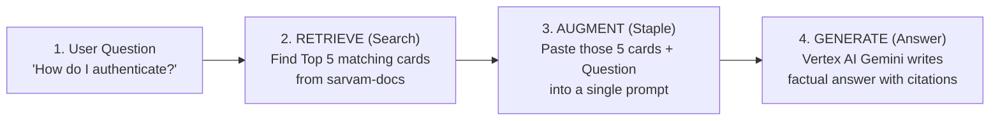
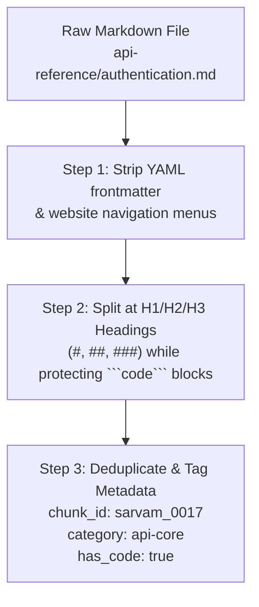
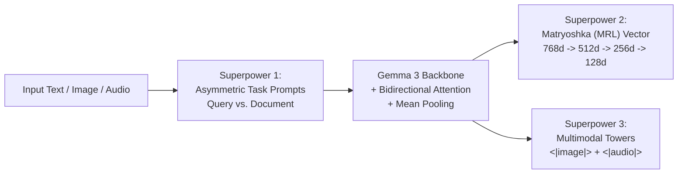
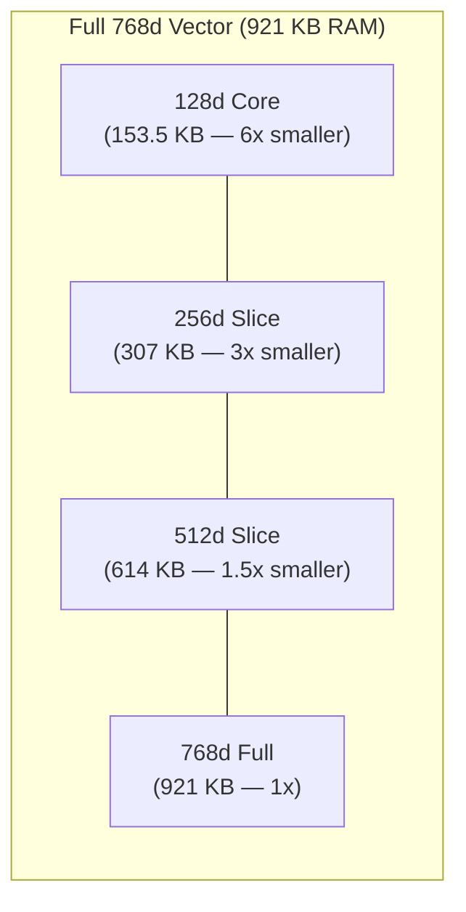
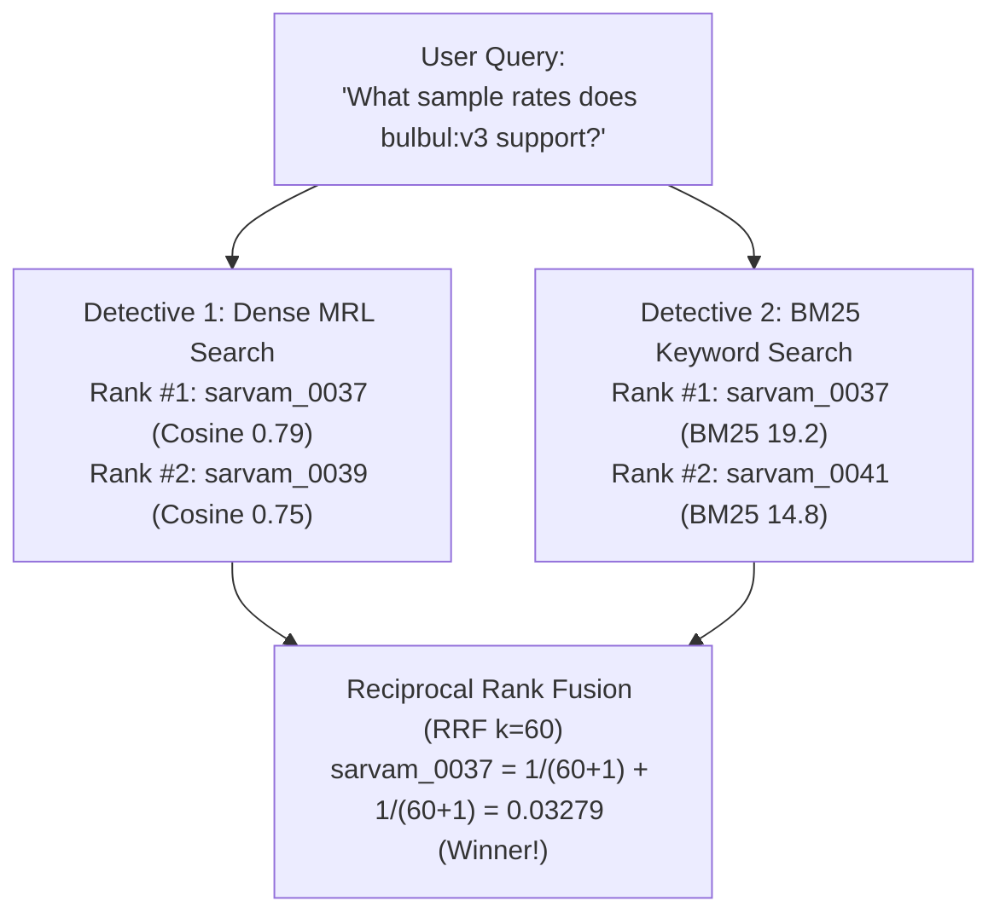
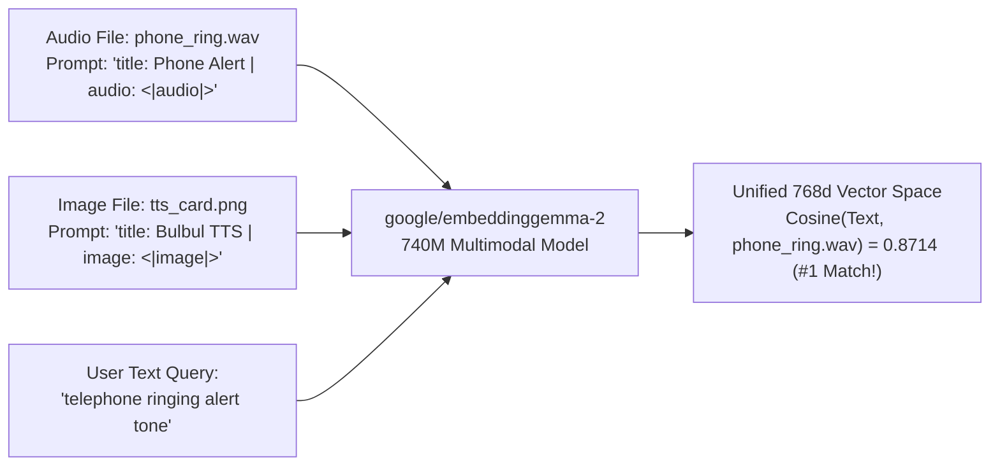

# 🌱 Beginner-to-Production RAG Guide: Explained Bit-by-Bit

Welcome! This guide is designed so that **even if this is your very first RAG (Retrieval-Augmented Generation) project**, you will understand **every single concept, every line of code, every CLI command, and every Web UI button** bit by bit — starting from zero and finishing with a **production-grade Google Cloud system**.

---

## 🗺️ How This Guide Works

For **every single step (Bit 1 to Bit 10)**, we follow the exact same easy-to-learn pattern:
1. 💡 **The Simple Analogy** — Understand the idea in plain English in 30 seconds.
2. 🔍 **What Happens Under the Hood (Bit-by-Bit)** — How the math and data actually work.
3. 🧩 **The Production Code** — Which file in `src/` does this and how each line works.
4. 💻 **Try It via CLI (Terminal)** — Exact command to copy-paste and what the output means.
5. 🖥️ **Try It via Web UI (Browser)** — Exact tab and button to click and what you will see.

---

# 🟢 PART 1: BEGINNER LEVEL — Understanding the Core Building Blocks

---

## Bit 1: What is RAG (Retrieval-Augmented Generation)?

### 💡 1. The Simple Analogy: Closed-Book vs. Open-Book Exam
Imagine asking a smart student (an AI model like Gemini or ChatGPT) a very specific question:
> *"What header name does the Sarvam AI API require for authentication, and what are the speaker names for Bulbul v3?"*

- **Without RAG (Closed-Book Exam)**: The AI has to rely purely on memory from when it was trained months ago. If Sarvam AI released Bulbul v3 after the AI was trained, the AI will **guess or make up a fake answer** (this is called a **hallucination**).
- **With RAG (Open-Book Exam)**: Before the AI answers, we first search the official **Sarvam AI Documentation (`sarvam-docs`)**, pull out the exact 5 paragraphs that talk about authentication or Bulbul v3, staple them to the user's question, and tell the AI:
  > *"Read ONLY these 5 official paragraphs and answer the user's question. Cite which paragraph you used!"*



### 🔍 2. Why Does Production RAG Need 3 Separate Pieces?
1. **A Chunker (`src/chunker.py`)**: Prepares the "index cards" from raw Markdown files.
2. **An Embedder & Retriever (`src/embedder.py` + `src/retriever.py`)**: Finds the best 5 index cards for any question in milliseconds using **`google/embeddinggemma-2`**.
3. **A Grounded Generator (`src/generator.py`)**: Uses **Google Cloud Vertex AI (`gemini-2.5-flash`)** to read those 5 cards and write a verified, cited answer.

---

## Bit 2: How Do We Turn Documentation into Index Cards? (Chunking)

### 💡 1. The Simple Analogy: Making Study Flashcards
Suppose you have 38 documentation pages in `sarvam-docs`.
- If you put an **entire 20-page document** on one giant flashcard, it's too big and noisy.
- If you chop the document blindly **every 500 characters**, you might slice a Python or `cURL` code snippet right down the middle, making the code broken and useless!
- **Structure-Aware Chunking** means we cut the document cleanly at Markdown headings (`#`, `##`, `###`) and **never cut inside a ` ``` ` code block**.



### 🔍 2. What Happens Bit-by-Bit in [`src/chunker.py`](./src/chunker.py)?
Let's trace what happens when `build_corpus_chunks()` runs on `/data/opencode/sarvam/docs`:

1. **Reads 38 Markdown files** from `sarvam-docs`.
2. **Cleans boilerplate** (`clean_markdown_body()`): Removes useless lines like `"Copy page"` or navigation links.
3. **Protects code blocks** (`split_markdown_sections()`):
   ```python
   # Inside src/chunker.py:
   if stripped.startswith("```"):
       in_code_block = not in_code_block  # Toggle code-block protection!
   # We ONLY split on a Markdown heading (#, ##, ###) if we are NOT inside a code block:
   if not in_code_block and re.match(r"^#{1,3}\s+.+", stripped):
       ...
   ```
4. **Creates 307 clean `DocChunk` objects** and saves them to `data/index/chunks.jsonl`.
   - Every chunk has a unique ID like `sarvam_0017`, its `title`, `section`, `category` (e.g., `text-to-speech`, `speech-to-text`, `api-core`), and `content`.
   - Out of **307 chunks**, **242 chunks (`78.8%`)** preserve complete, runnable code examples!

### 💻 3. Try Bit 2 via CLI
Run this command in your terminal to inspect a real chunk created from `sarvam-docs`:
```bash
cd /data/opencode/sarvam-rag-course
source .venv/bin/activate

# View chunk sarvam_0017 (API Authentication)
python -c "
import json
with open('data/index/chunks.jsonl') as f:
    chunks = [json.loads(line) for line in f]
print('Total chunks:', len(chunks))
c = [x for x in chunks if x['chunk_id'] == 'sarvam_0017'][0]
print('ID:', c['chunk_id'])
print('Title:', c['title'])
print('Category:', c['category'])
print('Content:\n', c['content'])
"
```

---

## Bit 3: What is an Embedding & How Does `google/embeddinggemma-2` Work?

### 💡 1. The Simple Analogy: GPS Coordinates for Meaning
Computers don't understand English words directly — they only understand numbers.
- Imagine a regular 2D map where every city has 2 GPS numbers: `(Latitude, Longitude)`. Cities that are close together have similar numbers.
- An **Embedding Model** like **`google/embeddinggemma-2`** creates a **768-dimensional map of meaning**. Every sentence or document chunk is converted into a list of **768 numbers** (a vector):
  `[-0.0365, -0.0085, 0.0156, ..., 0.0412]`
- Even if two sentences use **zero words in common**:
  - Question: *"How do I pass my secret token to Sarvam?"*
  - Document: *"Authenticate all requests using the `api-subscription-key` header."*
  Their **768 GPS coordinates land right next to each other** because they mean the same thing!

### 🔍 2. Why `google/embeddinggemma-2` is Special (3 Key Superpowers)



1. **Superpower 1 — Asymmetric Task Prompts (Questions vs. Documents)**:
   A short question (*"How to authenticate?"*) looks very different from a long documentation paragraph. `google/embeddinggemma-2` was trained with special prefixes so it knows whether it is encoding a **Query** or a **Document**:
   - **When encoding a User Query**:
     `task: search result | query: How do I authenticate with the Sarvam AI API?`
   - **When encoding a Document Chunk**:
     `title: Authentication — Overview | text: Authenticate all API requests using...`
   > ⚠️ **Beginner Pitfall Avoided**: If you forget these prefixes, accuracy drops by 10–15%! Our [`src/embedder.py`](./src/embedder.py) (`format_query_prompt()` and `format_doc_prompt()`) applies them automatically every time.

2. **Superpower 2 — Matryoshka Representation Learning (MRL)**:
    You can slice the 768 numbers down to the first `512`, `256`, or `128` numbers (explained in Bit 4!).

3. **Superpower 3 — True Multimodal Space (`<|image|>` and `<|audio|>`)**:
   The full `740M` model maps **text, PNG images, and WAV audio files** into the **exact same 768-number coordinate space** (explained in Bit 6!).

### 🧩 3. How the Code Works in [`src/embedder.py`](./src/embedder.py)
Let's look at the 4 steps inside `EmbeddingGemma2Engine._encode_raw_768()`:
```python
# Step 1: Tokenize the text with asymmetric prompts
encoded = self.text_tokenizer(texts, padding=True, truncation=True, return_tensors="pt")

# Step 2: Run the 24-layer Gemma3TextModel transformer backbone
outputs = self.text_backbone(**encoded)

# Step 3: Mean Pooling (average the token vectors across non-padding tokens)
pooled = (outputs.last_hidden_state * mask).sum(dim=1) / mask.sum(dim=1)

# Step 4: Pass through the two Dense projection layers (768 -> 3072 -> 768)
projected = self.dense2(self.dense1(pooled))
```

---

# 🟡 PART 2: INTERMEDIATE LEVEL — Smarter, Faster Search

---

## Bit 4: Matryoshka Embeddings (MRL) — Shrinking Vectors by 6x Without Losing Accuracy

### 💡 1. The Simple Analogy: Russian Nesting Dolls & Progressive Photos
Have you ever loaded a photo on a slow website where a **blurry preview appears immediately**, and then sharpens into **Full HD**?
- In standard embedding models, importance is spread randomly across all 768 numbers. If you delete the last 512 numbers, the vector breaks completely.
- **`google/embeddinggemma-2`** was trained with **Matryoshka Representation Learning (MRL)** (named after Russian nesting dolls). It forces the model to pack:
  - The **most critical meaning** into the **first 128 numbers (`128d`)** — `6.0x` smaller!
  - Fine details into the **first 256 numbers (`256d`)** — `3.0x` smaller!
  - Near-lossless precision into the **first 512 numbers (`512d`)** — `1.5x` smaller!
  - Full resolution in all **768 numbers (`768d`)**.



### 🔍 2. The Golden Rule of Matryoshka Slicing: Slice $\rightarrow$ L2 Renormalize!
When you slice a 768-number vector to its first `d` numbers (`vec[:d]`), its geometric length shrinks below `1.0`. Before computing Cosine Similarity (which is just a dot product `query @ doc` when vectors have length `1.0`), you **must divide the sliced vector by its new length** (called **L2 renormalization**):

```python
# From src/embedder.py:
def mrl_truncate_and_normalize(vectors_768: np.ndarray, dim: int) -> np.ndarray:
    sliced = vectors_768[:, :dim]                                    # 1. Take first `dim` numbers
    norms = np.linalg.norm(sliced, axis=1, keepdims=True)            # 2. Measure new length
    return (sliced / np.clip(norms, 1e-12, None)).astype(np.float32) # 3. Renormalize to length 1.0!
```

### 🚀 3. Production Trick: The Two-Stage Matryoshka Funnel (`128d -> 768d`)
Instead of comparing your query against all chunks using big `768d` vectors:
1. **Stage 1 (Fast Coarse Filter)**: Use tiny **`128d`** vectors (`6x` less memory bandwidth) to grab the **Top 25** candidates.
2. **Stage 2 (Exact Rerank)**: Multiply *only those 25 candidates* by the full **`768d`** query vector to get the final **Top 5**!
- **Result on `sarvam-docs`**: Achieves **`100.0%` Hit@1** and **`100.0%` Recall@5**!

### 💻 4. Try Bit 4 via CLI & Web UI
- **Via CLI**:
  ```bash
  python -m cli.rag_cli mrl-benchmark "What modes does Saaras v3 support for speech transcription?"
  ```
  Look at the table printed in your terminal: `768d`, `512d`, `256d`, and `128d` all find the **exact same Top-1 chunk (`sarvam_0058`)** while `128d` uses `6.0x` less memory (`153.5 KB` vs `921.0 KB`)!
- **Via Web UI (`http://localhost:8090`)**:
  Click **Tab 2: `Matryoshka (MRL) Explorer`**, enter any question, and click **Run MRL Benchmark** to see the 4 cards (`768d`, `512d`, `256d`, `128d`) side-by-side.

---

## Bit 5: Hybrid Search — Combining Keyword Search (BM25) + Meaning Search (Dense)

### 💡 1. The Simple Analogy: Hiring Two Detectives
Why not rely *only* on Dense Embedding vectors?
- **Detective 1: Dense Embeddings (`google/embeddinggemma-2`)** is a genius at understanding **concepts and synonyms** (e.g., matching *"making an AI sound like a specific person"* to *"Voice Cloning API"*).
- **Detective 2: Okapi BM25 (Keyword Search)** is a genius at finding **exact model names, error codes, and parameter strings** (e.g., `saaras:v3`, `api-subscription-key`, `24000Hz`).
- **How do we combine their scores?**
  Dense Cosine scores look like `0.78`, while BM25 scores look like `18.4`. You can't just add `0.78 + 18.4`!
  Instead, we use **Reciprocal Rank Fusion (RRF)**: we only look at **what rank (#1, #2, #3...)** each detective gave a document:
  $$\text{RRF Score}(d) = \frac{1}{60 + \text{Rank}_{\text{Dense}}(d)} + \frac{1}{60 + \text{Rank}_{\text{BM25}}(d)}$$
  If a chunk is ranked near the top by **both** detectives, its RRF score skyrockets to #1!



### 📊 Proof from Our Live Benchmark (`data/artifacts/evaluation_report.json`)
- **BM25 Alone**: `83.3%` Hit@1
- **Dense Alone (`768d` or `256d`)**: `91.7%` Hit@1
- **Hybrid RRF (Dense + BM25)**: **`100.0%` Hit@1** and **`100.0%` Recall@5**!

### 💻 Try Bit 5 via CLI & Web UI
- **Via CLI**:
  ```bash
  # Compare Hybrid RRF vs Dense vs BM25
  python -m cli.rag_cli search "How do I authenticate with the Sarvam AI API?" --mode hybrid --dim 768
  python -m cli.rag_cli search "How do I authenticate with the Sarvam AI API?" --mode bm25
  ```
- **Via Web UI (`http://localhost:8090`)**:
  On **Tab 1 (`Grounded RAG Studio`)**, use the **Retrieval Strategy** dropdown to switch between `Hybrid RRF`, `MRL 2-Stage Funnel`, `Dense MRL Only`, and `BM25 Lexical Only`.

---

# 🔴 PART 3: ADVANCED & PRODUCTION LEVEL — Multimodal, Vertex AI & Google Cloud

---

## Bit 6: Multimodal RAG — Searching Audio (`<|audio|>`) & Images (`<|image|>`) with Text!

### 💡 1. The Simple Analogy: One Map for Words, Pictures, and Sounds
In most RAG systems, if you want to search audio files or architecture diagrams, you first have to pay for a separate Speech-to-Text model or OCR model to turn them into text.
- **`google/embeddinggemma-2` (`740M` parameter full model)** has a built-in **Vision Tower (`<|image|>`)** and **Audio Tower (`<|audio|>`)** connected directly to its Gemma 3 language brain.
- That means a **real `.wav` sound file of rain falling**, a **`.png` diagram of Bulbul v3 TTS**, and an **English text question** are all converted into **768 numbers in the exact same coordinate space**!



### 💻 2. Try Bit 6 via CLI & Web UI
- **Via CLI**:
  ```bash
  python -m cli.rag_cli multimodal "telephone ringing alert tone"
  python -m cli.rag_cli multimodal "sound of rain falling"
  python -m cli.rag_cli multimodal "Bulbul v3 text to speech speaker voices"
  ```
- **Via Web UI (`http://localhost:8090`)**:
  Click **Tab 3: `Multimodal Audio & Vision Lab`**, click any preset query pill (e.g., *"telephone ringing alert tone"* or *"sound of rain falling"*), and watch the engine retrieve the actual `.wav` audio file or `.png` visual card at Rank #1!

---

## Bit 7: Grounded Answer Synthesis with Google Cloud Vertex AI (`gemini-2.5-flash`)

### 💡 1. The Simple Analogy: A Lawyer Who Must Cite Every Exhibit
Once our Retriever finds the Top 5 chunks from `sarvam-docs`, how do we stop the LLM from adding outside guesses?
In [`src/generator.py`](./src/generator.py), we send a strict **System Instruction** to **Vertex AI `gemini-2.5-flash`** (`GCP_PROJECT_ID=genai-511910`):
1. **Strict Context Boundary**: Answer **ONLY** using facts present in the retrieved `[sarvam_XXXX]` context blocks.
2. **Mandatory Inline Citations**: Every factual claim, endpoint URL, parameter, or speaker list **must include an inline citation** like `[sarvam_0017]`.
3. **Abstention Rule**: If the answer isn't in the retrieved chunks, explicitly state what is missing instead of guessing.

### 💻 2. Try Bit 7 via CLI & Web UI
- **Via CLI**:
  ```bash
  python -m cli.rag_cli ask "How do I authenticate with the Sarvam AI API and what header should I pass?" --mode hybrid --dim 768
  ```
- **Via Web UI (`http://localhost:8090`)**:
  On **Tab 1 (`Grounded RAG Studio`)**, ensure **Generate Grounded Answer (Vertex AI Gemini)** is checked and click **Run RAG Pipeline**.

---

## Bit 8: Production Cloud Scale — Google Cloud Storage (GCS) & BigQuery `VECTOR_SEARCH`

### 💡 1. The Simple Analogy: Moving from a Filing Cabinet to a Cloud Warehouse
Storing vectors in local NumPy files (`data/index/embeddings_256.npy`) is fast for 307 chunks on one machine. What happens when your company has **10 million documents** and **500 concurrent users**?
We sync our Matryoshka (`256d`) embeddings to **Google Cloud Platform (`genai-511910`)**:
1. **Google Cloud Storage (`gs://genai-511910-sarvam-rag/sarvam_rag/bq_vectors_256d.jsonl`)**: Stores the exported JSONL file containing each chunk's text, metadata, and `256d` float array.
2. **Google BigQuery (`genai-511910.sarvam_rag.docs_embeddings`)**: Loads those vectors into a serverless cloud table where the `embedding` column has type `ARRAY<FLOAT64>`.
3. **BigQuery `VECTOR_SEARCH` SQL Function**: Computes Cosine Distance across millions of rows directly inside Google's serverless SQL engine!

```sql
SELECT
  base.chunk_id,
  base.title,
  base.category,
  base.doc_path,
  base.content,
  (1.0 - distance) AS cosine_similarity
FROM VECTOR_SEARCH(
  TABLE `genai-511910.sarvam_rag.docs_embeddings`,
  'embedding',
  (SELECT @query_vector AS embedding),
  top_k => 5,
  distance_type => 'COSINE'
)
ORDER BY cosine_similarity DESC;
```

### 💻 2. Try Bit 8 via CLI & Web UI
- **Via CLI**:
  ```bash
  # 1. Sync local 256d vectors to GCS + BigQuery
  python -m cli.rag_cli gcp-sync --dim 256

  # 2. Run serverless SQL VECTOR_SEARCH on BigQuery
  python -m cli.rag_cli bq-search "How do I authenticate with the Sarvam API?" --top-k 5
  ```
- **Via Web UI (`http://localhost:8090`)**:
  Click **Tab 4: `GCP BigQuery Vector Search`**, enter a query, and click **Run BigQuery Vector Search** to see the live cloud results and the exact SQL executed on `genai-511910.sarvam_rag.docs_embeddings`.

---

## Bit 9: Production Evaluation — Grading Both the Retriever and the AI Answer

### 💡 1. The Simple Analogy: Grading Both the Research and the Essay
In production, you never guess whether your RAG system is good — you measure it automatically with **two sets of grades**:

1. **Grade the Retriever (Did we find the right index cards?)**:
   - **`Hit@1` (`100.0%`)**: Was the #1 top result the right document?
   - **`Recall@5` (`100.0%`)**: Was the right document anywhere in the Top 5 results?
   - **`MRR@5` (`1.0000`)**: Mean Reciprocal Rank (`1/rank` — if the right answer is at #1, score is `1/1 = 1.0`).

2. **Grade the Generator (LLM-as-a-Judge 1–5 Rubric via Vertex AI `gemini-2.5-flash`)**:
   - **Context Relevance (`5.0 / 5.0`)**: Did the retrieved chunks actually contain the facts needed?
   - **Faithfulness / Groundedness (`5.0 / 5.0`)**: Did the AI stick 100% to the retrieved chunks without hallucinating?
   - **Completeness (`5.0 / 5.0`)**: Did the AI fully answer the user's question with citations?

### 💻 2. Try Bit 9 via CLI & Web UI
- **Via CLI**:
  ```bash
  # Add --evaluate to any `ask` command to run the LLM-as-a-Judge grader!
  python -m cli.rag_cli ask "What are the supported speaker names and sample rates for Bulbul v3?" --evaluate
  ```
- **Via Web UI (`http://localhost:8090`)**:
  On **Tab 1 (`Grounded RAG Studio`)**, check **Run LLM-as-a-Judge Evaluation (1–5 Rubric)** before clicking **Run RAG Pipeline**.

---

## Bit 10: Complete File-by-File Map of the Production Codebase

When you open `/data/opencode/sarvam-rag-course`, here is what every single file does and the order to read them:

| Step | File Path | What It Does in Plain English |
| :---: | :--- | :--- |
| **1** | [`src/config.py`](./src/config.py) | Loads `.env` settings (GCP project `genai-511910`, bucket `genai-511910-sarvam-rag`, paths, MRL dimensions `768, 512, 256, 128`). |
| **2** | [`src/chunker.py`](./src/chunker.py) | Reads the 38 Markdown files in `sarvam-docs`, protects ` ``` ` code blocks, splits by headings, and writes 307 chunks to `data/index/chunks.jsonl`. |
| **3** | [`src/embedder.py`](./src/embedder.py) | Loads `google/embeddinggemma-2`, formats asymmetric query/doc prompts, computes `768d` vectors, slices + L2-renormalizes Matryoshka (`512d`, `256d`, `128d`) vectors, and encodes `<|image|>` & `<|audio|>` in the `740M` multimodal model. |
| **4** | [`src/retriever.py`](./src/retriever.py) | Runs Dense Cosine search, Okapi BM25 keyword search, Reciprocal Rank Fusion (`RRF`), and the Two-Stage Matryoshka Funnel (`128d -> 768d`). |
| **5** | [`src/multimodal_rag.py`](./src/multimodal_rag.py) | Generates real WAV audio & PNG visual cards and indexes them into `data/index/multimodal_embeddings_768.npy`. |
| **6** | [`src/generator.py`](./src/generator.py) | Sends retrieved chunks to Google Cloud Vertex AI (`gemini-2.5-flash`) for citation-grounded synthesis and runs the 3-metric LLM-as-a-Judge evaluator. |
| **7** | [`src/gcp_integration.py`](./src/gcp_integration.py) | Uploads JSONL vectors to Google Cloud Storage (`gs://genai-511910-sarvam-rag`) and executes serverless SQL `VECTOR_SEARCH` on Google BigQuery (`genai-511910.sarvam_rag.docs_embeddings`). |
| **8** | [`cli/rag_cli.py`](./cli/rag_cli.py) | The 8-command terminal application (`ingest`, `search`, `ask`, `mrl-benchmark`, `multimodal`, `gcp-sync`, `bq-search`, `chat`). |
| **9** | [`ui/app.py`](./ui/app.py) | The FastAPI web server and 4-tab Interactive Web UI Studio running on port `8090`. |
| **10** | [`scripts/run_all_verifications.py`](./scripts/run_all_verifications.py) | Automated end-to-end verification suite that tests all 5 phases and writes `data/artifacts/evaluation_report.json`. |
