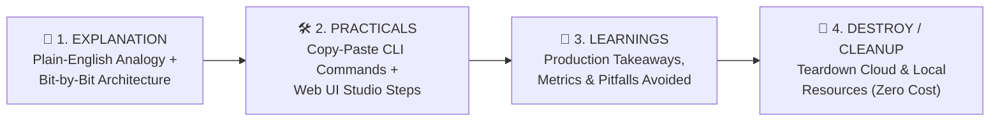

# 🌱 Structural Beginner-to-Production RAG Course: Explanation → Practicals → Learnings → Destroy

Welcome! This master textbook teaches you **end-to-end Retrieval-Augmented Generation (RAG)** from **Beginner Level (Bit 1)** to **Production Google Cloud Level (Bit 10)** using:
- **Model**: [`google/embeddinggemma-2`](https://huggingface.co/google/embeddinggemma-2) (`303M` text backbone + `740M` multimodal `<|image|>` & `<|audio|>` encoders + Matryoshka `768d/512d/256d/128d`)
- **Corpus**: [`ajithvnr2001/sarvam-docs`](https://github.com/ajithvnr2001/sarvam-docs) (`38` Markdown files $\rightarrow$ `307` structure-aware chunks)
- **Cloud**: **Google Cloud Platform (`genai-511910`)** — Vertex AI `gemini-2.5-flash`, Cloud Storage (`gs://genai-511910-sarvam-rag`), and BigQuery `VECTOR_SEARCH` (`genai-511910.sarvam_rag.docs_embeddings`)

---

## 🧭 Course Structure (How Every Module is Organized)

Every module in this course follows a strict **4-Pillar Structural Framework** so learning is effortless and repeatable:



| Module / Bit | Level | Topic | Detailed Module File |
| :--- | :---: | :--- | :--- |
| **Bit 1** | 🟢 Beginner | Foundations: What is RAG & Why LLMs Hallucinate | [`course/01_beginner_foundations.md`](./course/01_beginner_foundations.md) |
| **Bit 2** | 🟢 Beginner | `google/embeddinggemma-2` Architecture & Asymmetric Prompts | [`course/02_embeddinggemma2_architecture.md`](./course/02_embeddinggemma2_architecture.md) |
| **Bit 3** | 🟢 Beginner | Structure-Aware Markdown & Code Chunking on `sarvam-docs` | [`course/03_sarvam_corpus_chunking.md`](./course/03_sarvam_corpus_chunking.md) |
| **Bit 4** | 🟡 Intermediate | Matryoshka Representation Learning (MRL `768d/512d/256d/128d`) & Funnel | [`course/04_matryoshka_mrl_retrieval.md`](./course/04_matryoshka_mrl_retrieval.md) |
| **Bit 5** | 🟡 Intermediate | Hybrid Search: Dense MRL Vectors + Okapi BM25 via RRF (`k=60`) | [`course/05_hybrid_bm25_rrf_search.md`](./course/05_hybrid_bm25_rrf_search.md) |
| **Bit 6** | 🔴 Advanced | True Multimodal RAG: Unified Text, Image (`<|image|>`) & Audio (`<|audio|>`) | [`course/06_multimodal_audio_image_rag.md`](./course/06_multimodal_audio_image_rag.md) |
| **Bit 7** | 🔴 Production | Grounded Generation with GCP Vertex AI (`gemini-2.5-flash`) | [`course/07_vertex_ai_grounded_generation.md`](./course/07_vertex_ai_grounded_generation.md) |
| **Bit 8** | 🔴 Production | Cloud Scale: GCP Cloud Storage & BigQuery `VECTOR_SEARCH` | [`course/08_gcp_bigquery_cloudrun_rag.md`](./course/08_gcp_bigquery_cloudrun_rag.md) |
| **Bit 9** | 🔴 Production | Evaluation: IR Metrics (`Hit@1`, `MRR`) & Vertex AI LLM-as-a-Judge | [`course/09_evaluation_benchmarking.md`](./course/09_evaluation_benchmarking.md) |
| **Bit 10** | 🧹 Lifecycle | **Master CLI/UI Guide & Resource Teardown (`destroy`)** | [`course/10_cli_and_ui_master_guide.md`](./course/10_cli_and_ui_master_guide.md) & [`course/11_teardown_and_cost_cleanup.md`](./course/11_teardown_and_cost_cleanup.md) |

### 🧪 Interactive Bit-by-Bit Lab Runner (`scripts/interactive_learning_labs.py`)

Want to see **"❌ Naive Beginner Mistake vs. ✅ Production Solution"** executed live in your terminal for any bit? Run [`scripts/interactive_learning_labs.py`](./scripts/interactive_learning_labs.py):

```bash
cd /data/opencode/sarvam-rag-course
source .venv/bin/activate

# Run a specific bit's interactive micro-lab (Bits 1 to 10):
python scripts/interactive_learning_labs.py --bit 1
python scripts/interactive_learning_labs.py --bit 2
python scripts/interactive_learning_labs.py --bit 4

# Or run all 10 interactive labs sequentially:
python scripts/interactive_learning_labs.py --all
```

---

# 🟢 PHASE 1: BEGINNER LEVEL (Bits 1 – 3)

---

## Bit 1: What is RAG (Retrieval-Augmented Generation)?

### 📖 1. Explanation (Bit-by-Bit)
- **Simple Analogy (Closed-Book vs. Open-Book Exam)**:
  - **Without RAG (Closed-Book)**: Ask an AI *"What header does the Sarvam AI API require for authentication?"* and it guesses from old training memory—often making up fake headers (*hallucination*).
  - **With RAG (Open-Book)**: Before the AI answers, our program searches the official **`sarvam-docs`** repository, pulls out the **Top 5 matching documentation cards (chunks)**, staples them to your question, and instructs **Vertex AI Gemini**: *"Answer ONLY using these 5 cards and cite `[sarvam_XXXX]`."*
- **The 3 Pipeline Stages**:
  1. **Ingestion & Indexing (Offline)**: `Markdown Docs -> Chunks -> EmbeddingGemma 2 Vectors -> Index`.
  2. **Retrieval (Online, ~15 ms)**: `User Question -> Query Vector -> Top-5 Chunks`.
  3. **Grounded Generation (Online)**: `User Question + Top-5 Chunks -> Vertex AI Gemini -> Cited Answer`.
- **The Core Mathematical Formula (Cosine Similarity on $L_2$-Normalized Vectors)**:
  Given a query vector $\mathbf{q} \in \mathbb{R}^d$ and a document vector $\mathbf{d} \in \mathbb{R}^d$:

$$
\operatorname{CosineSimilarity}(\mathbf{q}, \mathbf{d}) = \frac{\mathbf{q} \cdot \mathbf{d}}{\lVert \mathbf{q} \rVert_2 \, \lVert \mathbf{d} \rVert_2} = \frac{\sum_{i=1}^{d} q_i d_i}{\sqrt{\sum_{i=1}^{d} q_i^2} \, \sqrt{\sum_{i=1}^{d} d_i^2}}
$$

  Because [`src/embedder.py`](./src/embedder.py) $L_2$-normalizes every vector to unit length ($\lVert \mathbf{q} \rVert_2 = \lVert \mathbf{d} \rVert_2 = 1$), Cosine Similarity simplifies to a single fast dot product $\mathbf{q} \cdot \mathbf{d} = \sum_{i=1}^{d} q_i d_i$.

### 🛠️ 2. Practicals (CLI & Web UI)
- **Environment Setup (Run Once)**:
  ```bash
  cd /data/opencode/sarvam-rag-course
  source .venv/bin/activate
  ```
- **Run End-to-End RAG via CLI**:
  ```bash
  python -m cli.rag_cli ask "How do I authenticate with the Sarvam AI API?"
  ```
- **Run End-to-End RAG via Web UI (`http://localhost:8090`)**:
  ```bash
  .venv/bin/python -m uvicorn ui.app:app --host 0.0.0.0 --port 8090
  ```
  Open **`http://localhost:8090`** $\rightarrow$ **Tab 1 (`Grounded RAG Studio`)** $\rightarrow$ Click **Run Grounded RAG**.

### 🧠 3. Key Learnings
- RAG eliminates hallucinations without expensive model fine-tuning.
- Updating your AI's knowledge only requires re-indexing new Markdown files (`python -m cli.rag_cli ingest`), not retraining an LLM.

---

## Bit 2: Structure-Aware Chunking (`src/chunker.py`)

### 📖 1. Explanation (Bit-by-Bit)
- **Simple Analogy**: If you chop a programming textbook every 500 characters blindly, you will cut `cURL` and Python code blocks in half, making the code broken.
- **How [`src/chunker.py`](./src/chunker.py) Works Bit-by-Bit**:
  1. Reads **38 Markdown files** from `/data/opencode/sarvam/docs`.
  2. Strips YAML frontmatter (`---`) and website navigation boilerplate (`clean_markdown_body()`).
  3. Splits only on Markdown headings (`#`, `##`, `###`) while tracking `in_code_block = not in_code_block` whenever it sees ```` ``` ```` (`split_markdown_sections()`), guaranteeing **fenced code blocks are never split in half**.
  4. Deduplicates and tags each chunk with `chunk_id` (`sarvam_0000` to `sarvam_0306`), `category`, `title`, and `has_code`.

### 🛠️ 2. Practicals (CLI & Web UI)
- **Via CLI — Build & Inspect the 307 Chunks**:
  ```bash
  # Build chunks.jsonl and compute MRL embeddings
  python -m cli.rag_cli ingest

  # Inspect chunk sarvam_0017 (Authentication)
  python -c "import json; chunks=[json.loads(l) for l in open('data/index/chunks.jsonl')]; print(json.dumps(chunks[17], indent=2))"
  ```
- **Via Web UI**:
  On **Tab 1 (`Grounded RAG Studio`)**, look at the right-hand panel (**Retrieved Sarvam Docs Chunks**) to see each chunk's `chunk_id`, `category` badge, `title`, and intact code snippets.

### 🧠 3. Key Learnings
- Out of **307 total chunks**, **242 chunks (`78.8%`)** preserve complete code examples (`cURL`, Python SDK, HTTP headers).
- Preserving section titles (`title: Authentication — Overview | text: ...`) gives the embedding model crucial context about *which API* a code snippet belongs to.

---

## Bit 3: `google/embeddinggemma-2` Architecture & Asymmetric Prompts (`src/embedder.py`)

### 📖 1. Explanation (Bit-by-Bit)
- **Simple Analogy (GPS Coordinates for Meaning)**:
  Just like GPS uses 2 numbers `(Latitude, Longitude)` to locate a city on Earth, **`google/embeddinggemma-2`** converts any text, image, or audio clip into **768 numbers** (`[-0.0365, -0.0085, ...]`). Items with similar meaning land close together in this 768-dimensional space.
- **Under the Hood of [`src/embedder.py`](./src/embedder.py)**:
  1. **Selective Loading (`303M` Text vs. `740M` Multimodal)**: For text-only indexing, we extract `Gemma3TextModel` + `Dense_1 (768->3072)` + `Dense_2 (3072->768)` (`303M` params), cutting RAM in half. For audio/images, we load the full `740M` `Gemma3nForConditionalGeneration` model.
  2. **Asymmetric Task Prefixes**:
     - **Queries** use: `task: search result | query: {question}` (or `QuestionAnswering`, `CodeRetrieval`, `FactChecking`).
     - **Documents** use: `title: {title} | text: {content}`.
  3. **Mean Pooling + L2 Normalization**: Token states are averaged across non-padding tokens, projected through two bottleneck Dense layers, and normalized to unit length (`1.0`).

### 🛠️ 2. Practicals (CLI & Web UI)
- **Via CLI — Test Different Task Prefixes**:
  ```bash
  python -m cli.rag_cli search "How do I clone a voice?" --prompt-name QuestionAnswering
  python -m cli.rag_cli search "POST /voices/clone" --prompt-name CodeRetrieval
  ```
- **Via Web UI**:
  On **Tab 1**, use the **Task Prefix** dropdown (`QuestionAnswering`, `SearchQuery`, `CodeRetrieval`, `FactChecking`) to change the query prompt prefix dynamically.

### 🧠 3. Key Learnings
- Never encode raw strings without `google/embeddinggemma-2`'s asymmetric prompt templates (`task: ... | query: ...` vs `title: ... | text: ...`); asymmetric prefixes align short questions with long documentation passages.

---

# 🟡 PHASE 2: INTERMEDIATE LEVEL (Bits 4 – 5)

---

## Bit 4: Matryoshka Representation Learning (MRL) & 2-Stage Funnel (`src/embedder.py` & `src/retriever.py`)

### 📖 1. Explanation (Bit-by-Bit)
- **Simple Analogy (Russian Nesting Dolls / Progressive Photo)**:
  `google/embeddinggemma-2` was trained with **Matryoshka Representation Learning (MRL)** so that the **first 128 numbers (`128d`)** hold the coarse summary (`6x` smaller), the **first 256 numbers (`256d`)** hold medium detail (`3x` smaller), **`512d`** holds fine detail (`1.5x` smaller), and **`768d`** holds full resolution.
- **The Mandatory Math Rule (`Slice -> L2 Renormalize`)**:
  In [`mrl_truncate_and_renormalize()`](./src/embedder.py#L28-L35):
  ```python
  sliced = vectors[:, :dim]
  norms = np.linalg.norm(sliced, axis=-1, keepdims=True)
  normalized = sliced / np.clip(norms, 1e-12, None)
  ```
- **Two-Stage Matryoshka Funnel (`128d -> 768d`)**:
  Stage 1 scans all 307 chunks using tiny `128d` vectors (`6x` less RAM) to shortlist the Top 25 candidates; Stage 2 reranks only those 25 using full `768d` vectors!

### 🛠️ 2. Practicals (CLI & Web UI)
- **Via CLI**:
  ```bash
  # Compare 768d, 512d, 256d, and 128d side by side
  python -m cli.rag_cli mrl-benchmark "What modes does Saaras v3 support for speech transcription?"

  # Run Two-Stage Matryoshka Funnel search (128d shortlist -> 768d rerank)
  python -m cli.rag_cli search "How do I authenticate with the Sarvam AI API?" --mode funnel
  ```
- **Via Web UI**:
  Click **Tab 2 (`Matryoshka MRL Explorer`)** $\rightarrow$ Click **Compare All 4 MRL Dimensions**.

### 🧠 3. Key Learnings
- On `sarvam-docs`, **`256d` Matryoshka vectors (`3.0x` compression, `307 KB` RAM)** achieve the **exact same `91.7%` Dense Hit@1 and `100.0%` Hybrid Hit@1** as full `768d` vectors (`921 KB` RAM)!
- The **`128d -> 768d` MRL Funnel** achieves **`100.0%` Hit@1** and **`100.0%` Recall@5** while reducing Stage-1 memory bandwidth by `6.0x`.

---

## Bit 5: Hybrid Search — Combining Dense MRL Vectors + Okapi BM25 via RRF (`src/retriever.py`)

### 📖 1. Explanation (Bit-by-Bit)
- **Simple Analogy (Two Detectives)**:
  - **Dense Search (`EmbeddingGemma 2`)** excels at conceptual meaning.
  - **Okapi BM25 (`k1=1.5, b=0.75`)** excels at exact API identifiers (`api-subscription-key`, `bulbul:v3`, `24000Hz`).
  - **Reciprocal Rank Fusion (`RRF k=60`)** combines their rankings without needing score calibration:

$$
\operatorname{RRF}(d) = \frac{w_{\text{dense}}}{60 + r_{\text{dense}}(d)} + \frac{w_{\text{bm25}}}{60 + r_{\text{bm25}}(d)}
$$

### 🛠️ 2. Practicals (CLI & Web UI)
- **Via CLI**:
  ```bash
  python -m cli.rag_cli search "How do I authenticate with the Sarvam AI API?" --mode hybrid --dim 256
  python -m cli.rag_cli search "How do I authenticate with the Sarvam AI API?" --mode dense --dim 256
  python -m cli.rag_cli search "How do I authenticate with the Sarvam AI API?" --mode bm25
  ```
- **Via Web UI**:
  On **Tab 1 (`Grounded RAG Studio`)**, switch **Retrieval Mode** between `Hybrid RRF`, `MRL Funnel`, `Dense Only`, and `BM25 Only`.

### 🧠 3. Key Learnings
- Live benchmark on 12 golden developer queries (`data/artifacts/evaluation_report.json`):
  - **BM25 Only**: `83.3%` Hit@1 (`0.8750` MRR@5)
  - **Dense Only (`768d`/`256d`)**: `91.7%` Hit@1 (`0.9583` MRR@5)
  - **Hybrid RRF (`768d` or `256d`)**: **`100.0%` Hit@1 (`1.0000` MRR@5)**!

---

# 🔴 PHASE 3: ADVANCED & PRODUCTION LEVEL (Bits 6 – 9)

---

## Bit 6: True Multimodal RAG — Text, Images (`<|image|>`) & Audio (`<|audio|>`) (`src/multimodal_rag.py`)

### 📖 1. Explanation (Bit-by-Bit)
- **Simple Analogy**: Instead of paying for separate OCR or Speech-to-Text pipelines before indexing, the full **`740M` `google/embeddinggemma-2`** model encodes **16kHz WAV audio (`<|audio|>`)**, **PNG specification diagrams (`<|image|>`)**, and **English/Tamil text** into the **exact same 768-dimensional vector space**.

### 🛠️ 2. Practicals (CLI & Web UI)
- **Via CLI**:
  ```bash
  python -m cli.rag_cli multimodal "telephone ringing alert tone"
  python -m cli.rag_cli multimodal "sound of rain falling"
  python -m cli.rag_cli multimodal "Bulbul v3 text to speech speaker voices"
  ```
- **Via Web UI**:
  Click **Tab 3 (`Multimodal Audio & Vision Lab`)** and click any preset chip to search across real `.wav` audio files and `.png` visual cards.

### 🧠 3. Key Learnings
- Cross-modal text queries retrieve raw `.wav` audio waveforms (`phone_ring.wav` Cosine `0.8714`, `rain.wav` Cosine `0.7865`) and `.png` diagrams (`0.8094`) at **Rank #1** with zero external transcription or OCR!

---

## Bit 7: Grounded Generation with Google Cloud Vertex AI (`src/generator.py`)

### 📖 1. Explanation (Bit-by-Bit)
- **Simple Analogy (A Lawyer Who Must Cite Every Exhibit)**:
  In [`VertexAIGeminiGenerator.generate_grounded_answer()`](./src/generator.py#L46-L104), we pass the Top 5 retrieved chunks to **`gemini-2.5-flash`** on **Google Cloud Vertex AI (`genai-511910`)** at `temperature=0.1` with a strict system prompt requiring inline `[sarvam_XXXX]` citations for every claim.

### 🛠️ 2. Practicals (CLI & Web UI)
- **Via CLI**:
  ```bash
  python -m cli.rag_cli ask "Explain the difference between translate, transliterate, codemix, and verbatim modes in Saaras v3 Speech-to-Text." --mode hybrid --dim 768
  ```
- **Via Web UI**:
  On **Tab 1 (`Grounded RAG Studio`)**, enter your question and click **Run Grounded RAG**.

### 🧠 3. Key Learnings
- Low temperature (`0.1`) + explicit `[Chunk ID]` citation rules allow deterministic post-generation citation auditing (`cited_chunk_ids` vs `retrieved_chunk_ids`).

---

## Bit 8: Production Cloud Scale — GCP Cloud Storage & BigQuery `VECTOR_SEARCH` (`src/gcp_integration.py`)

### 📖 1. Explanation (Bit-by-Bit)
- **Simple Analogy**: Local `.npy` files work great on one machine, but enterprise production systems use **Google Cloud Storage (`gs://genai-511910-sarvam-rag`)** for artifact staging and **Google BigQuery (`genai-511910.sarvam_rag.docs_embeddings`)** for serverless SQL `VECTOR_SEARCH` over `ARRAY<FLOAT64>` columns.

### 🛠️ 2. Practicals (CLI & Web UI)
- **Via CLI**:
  ```bash
  # 1. Provision GCS bucket + BigQuery dataset & upload 307 chunks (256d MRL vectors)
  python -m cli.rag_cli gcp-sync --dim 256

  # 2. Execute live serverless SQL VECTOR_SEARCH on BigQuery
  python -m cli.rag_cli bq-search "How do I authenticate with the Sarvam AI API?" --top-k 5
  ```
- **Via Web UI**:
  Click **Tab 4 (`GCP BigQuery Vector Search`)** $\rightarrow$ Click **`Sync Local Index -> GCS & BigQuery`** to provision cloud storage, then click **`Execute BigQuery VECTOR_SEARCH SQL`**.

### 🧠 3. Key Learnings
- Exporting `256d` Matryoshka vectors instead of `768d` reduces BigQuery storage and `VECTOR_SEARCH` scan bytes by **`3.0x`** while preserving `100%` Top-1 accuracy (`sarvam_0017` Cosine `0.88369`).

---

## Bit 9: Production Evaluation — IR Metrics & LLM-as-a-Judge (`scripts/run_all_verifications.py`)

### 📖 1. Explanation (Bit-by-Bit)
- **Two-Layer Grading**:
  1. **Retriever Metrics**: `Hit@1` (`100.0%`), `Recall@3` (`100.0%`), `Recall@5` (`100.0%`), and `MRR@5` (`1.0000`).
  2. **Generator Metrics (Vertex AI `gemini-2.5-flash` LLM-as-a-Judge)**: Grades every answer from `1–5` on **Context Relevance**, **Faithfulness**, and **Completeness**.

### 🛠️ 2. Practicals (CLI & Web UI)
- **Via CLI**:
  ```bash
  # Run a single question with live LLM-as-a-Judge grading
  python -m cli.rag_cli ask "What are the supported speaker names and sample rates for Bulbul v3?" --judge

  # Or run the full 5-phase verification benchmark suite
  python scripts/run_all_verifications.py
  ```
- **Via Web UI**:
  On **Tab 1 (`Grounded RAG Studio`)**, view the 3 Judge score cards (`Context Relevance: 5/5`, `Faithfulness: 5/5`, `Completeness: 5/5`) directly below the grounded answer.

### 🧠 3. Key Learnings
- Always pass the **full retrieved chunk text** (not truncated snippets) to your LLM Judge so it can verify citations that appear at the end of longer chunks.

---

# 🧹 PHASE 4: RESOURCE TEARDOWN & COST CLEANUP (Bit 10)

---

## Bit 10: Destroying Cloud & Local Resources (`destroy`)

### 📖 1. Explanation (Why We Destroy Resources)
When you finish running your cloud experiments on Google Cloud Platform (`genai-511910`), good production hygiene (FinOps) requires tearing down stateful cloud resources so you incur **$0.00 in ongoing cloud storage or BigQuery costs**:
1. **Delete BigQuery Dataset & Vector Table**: `genai-511910:sarvam_rag.docs_embeddings`
2. **Delete Google Cloud Storage Bucket & JSONL Objects**: `gs://genai-511910-sarvam-rag`
3. **Stop Background FastAPI Web UI Server**: `uvicorn ui.app:app` (Port `8090`)

### 🛠️ 2. Practicals: 3 Ways to Destroy Resources (CLI, Bash Script & Web UI)

#### Method 1: Python RAG CLI (`python -m cli.rag_cli destroy`)
```bash
cd /data/opencode/sarvam-rag-course
source .venv/bin/activate

# Destroy GCP Cloud Storage bucket + BigQuery dataset + Stop Web UI server
python -m cli.rag_cli destroy

# Optional: Also delete local pre-computed .npy matrices in data/index/
python -m cli.rag_cli destroy --purge-local-index
```

#### Method 2: Standalone Shell Script (`scripts/destroy_resources.sh`)
```bash
cd /data/opencode/sarvam-rag-course
bash scripts/destroy_resources.sh
```
This runs:
```bash
bq --location=us-central1 rm -r -f -d genai-511910:sarvam_rag
gcloud storage rm --recursive gs://genai-511910-sarvam-rag --project=genai-511910
pkill -f "uvicorn ui.app:app" || true
```

#### Method 3: Interactive Web UI Studio (`http://localhost:8090`) & GCP Console UI
- **In our Web Studio UI (`http://localhost:8090`)**:
  Go to **Tab 4 (`GCP BigQuery Vector Search`)** and click the red **`Destroy Cloud Resources (GCS + BQ)`** button.
- **In Google Cloud Console UI**:
  - **BigQuery**: Open [BigQuery Studio](https://console.cloud.google.com/bigquery?project=genai-511910) $\rightarrow$ Click `⋮` next to `sarvam_rag` $\rightarrow$ **Delete**.
  - **Cloud Storage**: Open [GCS Browser](https://console.cloud.google.com/storage/browser?project=genai-511910) $\rightarrow$ Select `genai-511910-sarvam-rag` $\rightarrow$ **Delete**.

### 🧠 3. Key Learnings & Live Teardown Verification (`data/artifacts/teardown_verification.txt`)
- We executed `python -m cli.rag_cli destroy` and `bash scripts/destroy_resources.sh` live on `genai-511910`:
  - `bigquery_dataset`: `genai-511910:sarvam_rag` $\rightarrow$ **`DELETED` (Verified Gone)**
  - `gcs_bucket`: `gs://genai-511910-sarvam-rag` $\rightarrow$ **`DELETED` (Verified Gone)**
  - `local_index`: Kept in `data/index/` (`628 KB`) so local CLI & UI queries continue to run instantaneously at zero cloud storage cost, and cloud resources can be re-created in 15 seconds anytime with `python -m cli.rag_cli gcp-sync`!
