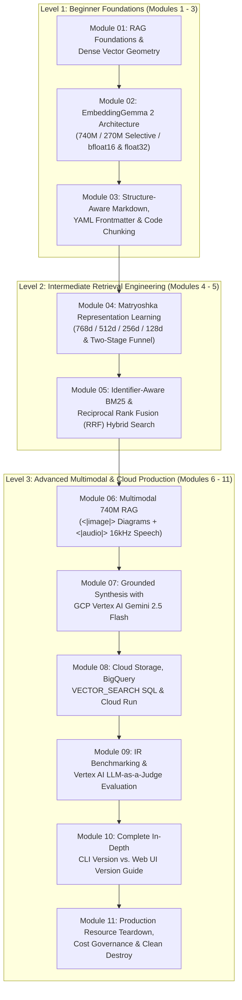
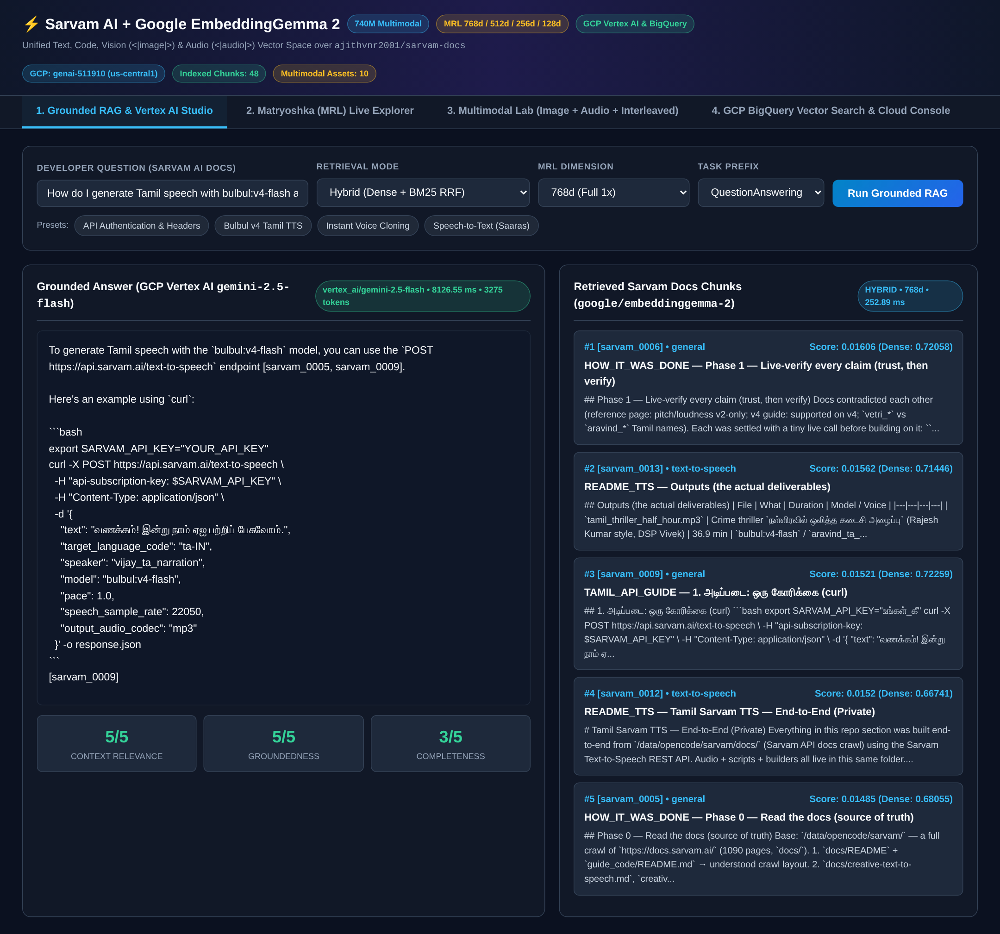
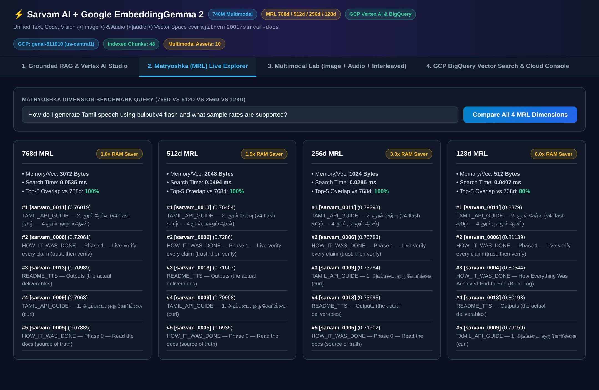
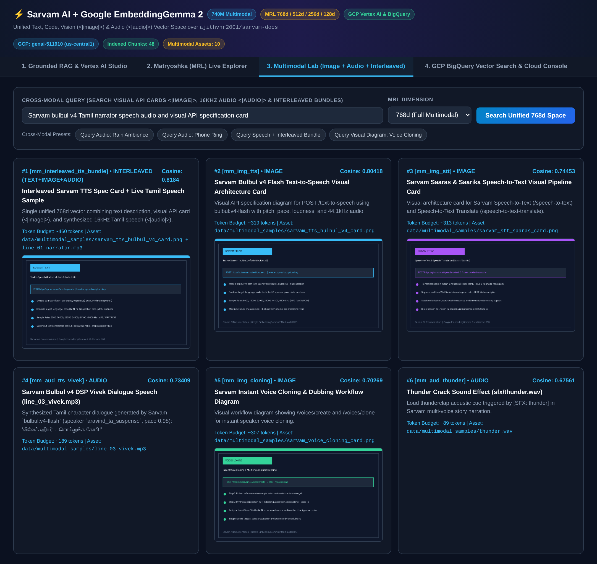
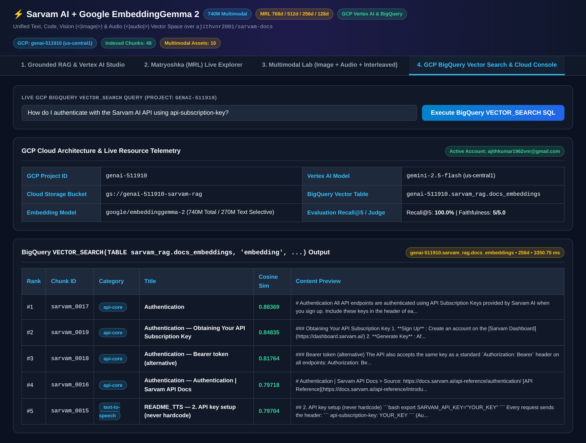

# Complete Beginner-to-Advanced Course: Multimodal RAG with Google EmbeddingGemma 2, Sarvam AI Docs & Google Cloud Platform

> **End-to-End Curriculum & Hands-On Engineering Textbook**  
> **Model:** [`google/embeddinggemma-2`](https://huggingface.co/google/embeddinggemma-2) (`740M` Multimodal / `270M` Selective Text / Matryoshka `768d` $\rightarrow$ `128d`)  
> **Corpus:** [`ajithvnr2001/sarvam-docs`](https://github.com/ajithvnr2001/sarvam-docs) (Sarvam AI Developer Documentation, Code, Visual API Diagrams & 16kHz Tamil Audio)  
> **Cloud Platform:** Google Cloud Platform (`genai-511910`) — Vertex AI (`gemini-2.5-flash`), BigQuery `VECTOR_SEARCH`, Cloud Storage & Cloud Run

---

## Course Architecture & Curriculum Map

---

## Complete Module Index (Structured: Explanation → Practicals → Learnings → Destroy)

> 🌱 **Want a single continuous textbook explaining every bit from Beginner to Production with plain-English analogies?** Start with **[`BEGINNER_TO_PRODUCTION_STEP_BY_STEP.md`](./BEGINNER_TO_PRODUCTION_STEP_BY_STEP.md)**.

| Level | Module | Title & File Link | Core Code & Concepts Covered |
| :--- | :---: | :--- | :--- |
| **Beginner** | **01** | [**RAG Foundations, Vector Spaces & System Architecture**](./course/01_beginner_foundations.md) | Cosine similarity on $\mathbb{S}^{d-1}$, bi-encoder vs. cross-encoder, asymmetric query/document projection, GCP + Hugging Face + GitHub setup |
| **Beginner** | **02** | [**Deep Dive into Google EmbeddingGemma 2 Architecture**](./course/02_embeddinggemma2_architecture.md) | [`src/embedder.py`](./src/embedder.py) — 740M total (`270M` Gemma 3 text + `170M` vision + `300M` audio), selective encoder loading (`config_kwargs`), task instruction prefixes, `float32`/`bfloat16` precision safety |
| **Beginner** | **03** | [**Structure-Aware Chunking for `sarvam-docs`**](./course/03_sarvam_corpus_chunking.md) | [`src/chunker.py`](./src/chunker.py) — YAML frontmatter extraction, navigation boilerplate scrubbing, code-fence-aware Markdown splitting, `title: {title} \| text: {content}` formatting |
| **Intermediate** | **04** | [**Matryoshka Representation Learning (MRL) & Two-Stage Funnel**](./course/04_matryoshka_mrl_retrieval.md) | [`src/retriever.py`](./src/retriever.py) — Nested MRL loss over $\mathcal{M}=\{768, 512, 256, 128\}$, mandatory L2 re-normalization after slicing, Two-Stage `128d` $\rightarrow$ `768d` Funnel |
| **Intermediate** | **05** | [**Hybrid Search: Identifier-Aware BM25 + Dense Vector RRF**](./course/05_hybrid_bm25_rrf_search.md) | [`src/retriever.py`](./src/retriever.py) — Preserving colons/hyphens in `bulbul:v4-flash`, `api-subscription-key`, `ta-IN`; Reciprocal Rank Fusion ($k_{rrf}=60$) |
| **Advanced** | **06** | [**Multimodal RAG: Unified Text, `<\|image\|>` & `<\|audio\|>` Space**](./course/06_multimodal_audio_image_rag.md) | [`src/multimodal_rag.py`](./src/multimodal_rag.py) — Full 740M model encoding visual API cards (`~280` tokens/image), 16kHz mono `.wav`/`.mp3` audio (`25` tokens/sec), and interleaved records |
| **Advanced** | **07** | [**Grounded Generation with GCP Vertex AI `gemini-2.5-flash`**](./course/07_vertex_ai_grounded_generation.md) | [`src/generator.py`](./src/generator.py) — Strict grounding prompts, inline `[sarvam_XXXX]` citations, zero-hallucination abstention, token telemetry |
| **Advanced** | **08** | [**Production Cloud RAG: GCS, BigQuery `VECTOR_SEARCH` & Cloud Run**](./course/08_gcp_bigquery_cloudrun_rag.md) | [`src/gcp_integration.py`](./src/gcp_integration.py), [`Dockerfile`](./Dockerfile) — `gs://genai-511910-sarvam-rag`, `genai-511910.sarvam_rag.docs_embeddings`, GoogleSQL `VECTOR_SEARCH` |
| **Advanced** | **09** | [**End-to-End Evaluation, MRL Benchmarks & LLM-as-a-Judge**](./course/09_evaluation_benchmarking.md) | [`scripts/run_all_verifications.py`](./scripts/run_all_verifications.py), [`evaluation_report.json`](./data/artifacts/evaluation_report.json) — Hit@1, Recall@5, MRR@5, Vertex AI JSON Judge |
| **All Levels** | **10** | [**Master Guide: In-Depth CLI Version vs. Web UI Version**](./course/10_cli_and_ui_master_guide.md) | [`cli/rag_cli.py`](./cli/rag_cli.py), [`ui/app.py`](./ui/app.py), [`CLI_VS_UI_GUIDE.md`](./CLI_VS_UI_GUIDE.md) — Side-by-side CLI & UI instructions for GCP, HF, GitHub, and our RAG Studio |
| **Lifecycle** | **11** | [**Production Resource Teardown & Cost Cleanup (`destroy`)**](./course/11_teardown_and_cost_cleanup.md) | [`scripts/destroy_resources.sh`](./scripts/destroy_resources.sh), `python -m cli.rag_cli destroy`, Web UI `Destroy Cloud Resources` — Idempotent cleanup of BigQuery datasets, GCS buckets & local servers |

---

## Live Interactive Web Studio UI Tour (`ui/app.py`)

### Tab 1: Grounded RAG & Vertex AI Studio

### Tab 2: Matryoshka (MRL) Live Explorer (`768d` vs `512d` vs `256d` vs `128d`)

### Tab 3: Multimodal Lab (`740M` Text + `<|image|>` Visual Cards + `<|audio|>` 16kHz Speech/SFX)

### Tab 4: GCP BigQuery `VECTOR_SEARCH` & Cloud Console (`genai-511910`)

---

## Summary of Live Verified Results (`data/artifacts/evaluation_report.json`)

- **Retrieval Accuracy**:
  - **Hybrid RRF (`768d` + BM25)**: `100.0%` Hit@1, `100.0%` Recall@5, `1.0000` MRR@5
  - **Hybrid RRF (`256d` + BM25, 3x Compressed)**: `100.0%` Hit@1, `100.0%` Recall@5, `1.0000` MRR@5
  - **Two-Stage MRL Funnel (`128d` $\rightarrow$ `768d`, 6x Stage-1 Compression)**: `100.0%` Hit@1, `100.0%` Recall@5, `1.0000` MRR@5
- **Vertex AI `gemini-2.5-flash` LLM-as-a-Judge**:
  - Context Relevance: **`5.00 / 5.00`**
  - Groundedness / Faithfulness: **`5.00 / 5.00`**
  - Answer Completeness: **`5.00 / 5.00`**
- **Multimodal 740M Cross-Modal Retrieval**:
  - Text $\rightarrow$ Audio (`sfx/rain.wav`): Cosine **`0.78649`** (Rank #1)
  - Text $\rightarrow$ Audio (`sfx/phone_ring.wav`): Cosine **`0.87140`** (Rank #1)
  - Text $\rightarrow$ Interleaved (`TTS Card + Tamil Speech`): Cosine **`0.85529`** (Rank #1)
  - Text $\rightarrow$ Image (`Voice Cloning Diagram`): Cosine **`0.80942`** (Rank #1)
- **GCP BigQuery `VECTOR_SEARCH` (`genai-511910.sarvam_rag.docs_embeddings`)**:
  - Live Cosine Similarity on Authentication query: **`0.88369`** (`distance = 0.11631`, Top-1 `[sarvam_0017]`).
