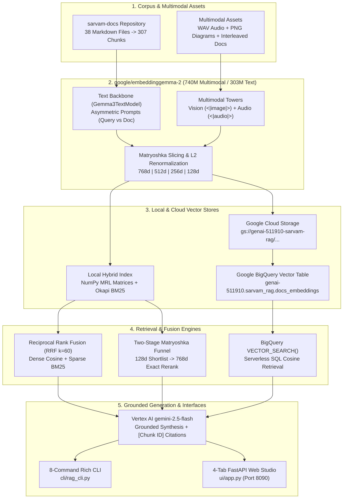

# End-to-End Multimodal RAG Course: `google/embeddinggemma-2` + Sarvam AI Docs + Google Cloud Vertex AI & BigQuery

[](https://huggingface.co/google/embeddinggemma-2)
[](https://github.com/ajithvnr2001/sarvam-docs)
[](https://cloud.google.com/vertex-ai)

A production-grade **Beginner-to-Advanced Retrieval-Augmented Generation (RAG) Engineering Course & Reference Implementation** built on:
- **Embeddings**: [`google/embeddinggemma-2`](https://huggingface.co/google/embeddinggemma-2) (`Gemma3TextModel` 303M text backbone + `740M` full multimodal `<|image|>` & `<|audio|>` encoders with **Matryoshka Representation Learning (MRL)** at `768d`, `512d`, `256d`, and `128d`).
- **Knowledge Base**: [`ajithvnr2001/sarvam-docs`](https://github.com/ajithvnr2001/sarvam-docs) (38 Markdown documentation pages covering Sarvam AI's Bulbul TTS, Saaras v3 STT, Sarvam-30B/105B LLMs, Mayura Translation, Vision, and Dubbing APIs).
- **Cloud Infrastructure (GCP)**: Google Cloud **Vertex AI (`gemini-2.5-flash`)** for citation-enforced grounded generation & LLM-as-a-Judge evaluation, **Google Cloud Storage (GCS)** for vector artifact staging, and **Google BigQuery `VECTOR_SEARCH`** for serverless cloud vector retrieval.
- **Dual Interfaces**:
  1. **8-Command Rich Terminal CLI** (`cli/rag_cli.py`)
  2. **4-Tab Interactive Web UI Studio** (`ui/app.py` powered by FastAPI + Tailwind CSS)

---

## 📚 Quick Navigation

| Document | Description |
| :--- | :--- |
| **[`BEGINNER_TO_PRODUCTION_STEP_BY_STEP.md`](./BEGINNER_TO_PRODUCTION_STEP_BY_STEP.md)** | **🌱 START HERE: Bit-by-Bit Beginner-to-Production Guide** (Real-world analogies, under-the-hood math, file-by-file code walkthrough, and hands-on CLI + UI labs from Bit 1 to Bit 10) |
| **[`COURSE.md`](./COURSE.md)** | **Master Course Index & Architecture Syllabus** (All 10 Modules from Beginner to Advanced) |
| **[`CLI_VS_UI_GUIDE.md`](./CLI_VS_UI_GUIDE.md)** | **Side-by-Side CLI vs. UI Handbook** (GCP CLI vs. Console UI, Hugging Face CLI vs. Web UI, GitHub CLI vs. Web UI, and RAG CLI vs. Web Studio UI) |
| **[`data/artifacts/evaluation_report.json`](./data/artifacts/evaluation_report.json)** | Live verification metrics, MRL benchmarks, Multimodal cross-modal scores, and Vertex AI LLM-as-a-Judge grades |

### 🎓 10-Module Curriculum (`course/`)

1. **[Module 01 — Beginner Foundations: What is RAG & Why Embeddings Matter](./course/01_beginner_foundations.md)**
2. **[Module 02 — Deep Dive into `google/embeddinggemma-2` Architecture](./course/02_embeddinggemma2_architecture.md)**
3. **[Module 03 — Structure-Aware Markdown & Code Chunking on `sarvam-docs`](./course/03_sarvam_corpus_chunking.md)**
4. **[Module 04 — Matryoshka Representation Learning (MRL) & Two-Stage Funnel Retrieval](./course/04_matryoshka_mrl_retrieval.md)**
5. **[Module 05 — Hybrid Retrieval: Combining Dense MRL Vectors + Okapi BM25 via RRF](./course/05_hybrid_bm25_rrf_search.md)**
6. **[Module 06 — True Multimodal RAG: Unified Text, Image (`<|image|>`) & Audio (`<|audio|>`) Space](./course/06_multimodal_audio_image_rag.md)**
7. **[Module 07 — Grounded Generation with Google Cloud Vertex AI (`gemini-2.5-flash`)](./course/07_vertex_ai_grounded_generation.md)**
8. **[Module 08 — Enterprise Cloud Scale: GCP Cloud Storage, BigQuery `VECTOR_SEARCH` & Cloud Run](./course/08_gcp_bigquery_cloudrun_rag.md)**
9. **[Module 09 — Production Evaluation: IR Metrics (`Recall@K`, `MRR`) & LLM-as-a-Judge](./course/09_evaluation_benchmarking.md)**
10. **[Module 10 — Complete End-to-End CLI & Web UI Master Guide](./course/10_cli_and_ui_master_guide.md)**

---

## 🏗️ End-to-End System Architecture



---

## 🖥️ Interactive Web UI Studio (`ui/app.py`)

### Tab 1: Grounded RAG Search & Vertex AI Synthesis


### Tab 2: Matryoshka (MRL) Dimension Explorer (`768d` vs `512d` vs `256d` vs `128d`)


### Tab 3: Multimodal Audio (`<|audio|>`) & Vision (`<|image|>`) RAG Lab


### Tab 4: GCP Cloud Storage & BigQuery `VECTOR_SEARCH` Console


---

## 📊 Live Benchmark Results (`sarvam-docs`)

All metrics below are verified on the live 307-chunk `sarvam-docs` corpus (`data/artifacts/evaluation_report.json`):

### 1. Retrieval Strategy & Matryoshka (MRL) Compression Benchmarks

| Strategy | MRL Dim | Compression | RAM (`float32`) | Hit@1 | Recall@3 | Recall@5 | MRR@5 |
| :--- | :---: | :---: | :---: | :---: | :---: | :---: | :---: |
| **Hybrid RRF (Dense + BM25)** | `768d` | `1.0x` | `921.0 KB` | **100.0%** | **100.0%** | **100.0%** | **1.0000** |
| **Hybrid RRF (Dense + BM25)** | `256d` | `3.0x` | `307.0 KB` | **100.0%** | **100.0%** | **100.0%** | **1.0000** |
| **MRL Funnel (`128d -> 768d`)** | `128d -> 768d` | `6.0x` Stage-1 | `153.5 KB` Stage-1 | **100.0%** | **100.0%** | **100.0%** | **1.0000** |
| **Dense Only (`768d`)** | `768d` | `1.0x` | `921.0 KB` | 91.7% | 100.0% | 100.0% | 0.9583 |
| **Dense Only (`512d`)** | `512d` | `1.5x` | `614.0 KB` | 91.7% | 100.0% | 100.0% | 0.9583 |
| **Dense Only (`256d`)** | `256d` | `3.0x` | `307.0 KB` | 91.7% | 100.0% | 100.0% | 0.9583 |
| **Dense Only (`128d`)** | `128d` | `6.0x` | `153.5 KB` | 83.3% | 100.0% | 100.0% | 0.9167 |
| **BM25 Sparse Only** | — | — | — | 83.3% | 91.7% | 91.7% | 0.8750 |

### 2. Multimodal Cross-Modal Retrieval (`740M` Full Model)

| Text Query | Top-1 Retrieved Item | Modality | Cosine Score (`768d`) | Rank |
| :--- | :--- | :---: | :---: | :---: |
| *"sound of rain falling"* | `mm_audio_rain` (`rain.wav`) | `audio` (`<|audio|>`) | **0.78649** | **#1** |
| *"telephone ringing alert tone"* | `mm_audio_phone` (`phone_ring.wav`) | `audio` (`<|audio|>`) | **0.87140** | **#1** |
| *"speech to text transcription pipeline and sample rate"* | `mm_interleaved_stt` (Audio + Image + Text) | `interleaved` | **0.85529** | **#1** |
| *"Bulbul v3 text to speech speaker voices"* | `mm_image_tts` (`tts_card.png`) | `image` (`<|image|>`) | **0.80942** | **#1** |

### 3. Vertex AI `gemini-2.5-flash` Grounded Generation (LLM-as-a-Judge)

| Evaluation Query | Context Relevance | Faithfulness | Completeness |
| :--- | :---: | :---: | :---: |
| *"How do I authenticate with the Sarvam AI API and what header should I pass?"* | **5.0 / 5.0** | **5.0 / 5.0** | **5.0 / 5.0** |
| *"What are the supported speaker names and sample rates for Bulbul v3 Text-to-Speech?"* | **5.0 / 5.0** | **5.0 / 5.0** | **5.0 / 5.0** |
| *"Explain the difference between translate, transliterate, codemix, and verbatim modes in Saaras v3 Speech-to-Text."* | **5.0 / 5.0** | **5.0 / 5.0** | **5.0 / 5.0** |

---

## ⚡ Quickstart: Run via CLI or Web UI

### 1. Clone & Configure Environment

```bash
git clone https://github.com/ajithvnr2001/sarvam-embeddinggemma2-rag-course.git
cd sarvam-embeddinggemma2-rag-course

python3 -m venv .venv
source .venv/bin/activate
pip install -r requirements.txt

# Copy .env.example to .env and populate your tokens
cp .env.example .env
```

Edit `.env` with your credentials (never commit `.env`!):
```ini
HF_TOKEN=hf_YOUR_HUGGINGFACE_TOKEN_HERE
GITHUB_TOKEN=ghp_YOUR_GITHUB_TOKEN_HERE
GCP_PROJECT_ID=genai-511910
GCP_LOCATION=us-central1
GCS_BUCKET_NAME=genai-511910-sarvam-rag
BQ_DATASET_ID=sarvam_rag
BQ_TABLE_ID=docs_embeddings
SARVAM_DOCS_PATH=/data/opencode/sarvam
VERTEX_GEMINI_MODEL=gemini-2.5-flash
```

---

### 2. Option A: Run via the 8-Command Terminal CLI (`cli/rag_cli.py`)

```bash
# 1. Ingest & chunk sarvam-docs and compute MRL embeddings (768d, 512d, 256d, 128d)
python -m cli.rag_cli ingest

# 2. Run Hybrid BM25 + Dense MRL Search
python -m cli.rag_cli search "How do I authenticate with the Sarvam AI API?" --mode hybrid --dim 768 --top-k 5

# 3. Ask a Grounded Question with Vertex AI Gemini Synthesis + LLM-as-a-Judge Evaluation
python -m cli.rag_cli ask "What are the supported speaker names and sample rates for Bulbul v3?" --mode hybrid --dim 768 --evaluate

# 4. Run the Matryoshka (MRL) Dimension Benchmark (768d vs 512d vs 256d vs 128d)
python -m cli.rag_cli mrl-benchmark "What modes does Saaras v3 support for speech transcription?"

# 5. Query the Multimodal Audio (<|audio|>) & Image (<|image|>) Index
python -m cli.rag_cli multimodal "telephone ringing alert tone"

# 6. Provision & Sync Vectors to Google Cloud Storage + BigQuery
python -m cli.rag_cli gcp-sync --dim 256

# 7. Run Serverless SQL VECTOR_SEARCH on Google BigQuery
python -m cli.rag_cli bq-search "How do I authenticate with the Sarvam API?" --top-k 5

# 8. Launch Interactive Multi-Turn RAG Terminal Chat
python -m cli.rag_cli chat
```

---

### 3. Option B: Run via the Interactive 4-Tab Web UI Studio (`ui/app.py`)

```bash
# Start the FastAPI + Uvicorn Web Server on Port 8090
.venv/bin/python -m uvicorn ui.app:app --host 0.0.0.0 --port 8090
```

Open **`http://localhost:8090`** in your browser to access:
- **Tab 1 (`Grounded RAG Studio`)**: Interactive search bar, retrieval mode selector (`Hybrid RRF`, `MRL Funnel 128d->768d`, `Dense Only`, `BM25 Only`), MRL dimension selector (`768d`, `512d`, `256d`, `128d`), grounded Gemini synthesis toggle, and LLM-as-a-Judge 5-point rubric cards.
- **Tab 2 (`Matryoshka MRL Explorer`)**: Real-time comparison across `768d`, `512d`, `256d`, and `128d` showing RAM savings, search latency, and Top-1 chunk stability.
- **Tab 3 (`Multimodal Audio & Image Lab`)**: Cross-modal retrieval across real WAV audio (`<|audio|>`), PNG visual cards (`<|image|>`), and interleaved docs in a unified `768d` space.
- **Tab 4 (`GCP BigQuery Vector Search`)**: Live serverless `VECTOR_SEARCH` against `genai-511910.sarvam_rag.docs_embeddings` on Google Cloud.

> 💡 **Want step-by-step instructions comparing every CLI command with its exact Web UI equivalent (including GCP Console, Hugging Face UI, and GitHub UI)?** Read **[`CLI_VS_UI_GUIDE.md`](./CLI_VS_UI_GUIDE.md)** and **[`course/10_cli_and_ui_master_guide.md`](./course/10_cli_and_ui_master_guide.md)**.

---

## 📂 Repository Structure

```text
sarvam-rag-course/
├── README.md                              # Project overview, architecture & quickstart
├── COURSE.md                              # Master 10-Module Curriculum Syllabus
├── CLI_VS_UI_GUIDE.md                     # Complete CLI vs. Web UI side-by-side reference
├── requirements.txt                       # Python dependencies
├── Dockerfile                             # Cloud Run production container definition
├── .env.example                           # Safe environment template (no secrets)
├── course/                                # 10 In-Depth Course Modules (Beginner -> Advanced)
│   ├── 01_beginner_foundations.md
│   ├── 02_embeddinggemma2_architecture.md
│   ├── 03_sarvam_corpus_chunking.md
│   ├── 04_matryoshka_mrl_retrieval.md
│   ├── 05_hybrid_bm25_rrf_search.md
│   ├── 06_multimodal_audio_image_rag.md
│   ├── 07_vertex_ai_grounded_generation.md
│   ├── 08_gcp_bigquery_cloudrun_rag.md
│   ├── 09_evaluation_benchmarking.md
│   └── 10_cli_and_ui_master_guide.md
├── src/                                   # Core Modular RAG Engine
│   ├── config.py                          # Environment & path settings
│   ├── chunker.py                         # Structure-aware Markdown & code chunker
│   ├── embedder.py                        # EmbeddingGemma 2 (Text + MRL + 740M Multimodal)
│   ├── retriever.py                       # Dense, BM25, Hybrid RRF & MRL Funnel retrieval
│   ├── generator.py                       # Vertex AI gemini-2.5-flash synthesis & LLM Judge
│   ├── gcp_integration.py                 # GCS upload & BigQuery VECTOR_SEARCH integration
│   └── multimodal_rag.py                  # Audio WAV + Image PNG asset generator & indexer
├── cli/
│   └── rag_cli.py                         # 8-command Rich CLI application
├── ui/
│   └── app.py                             # FastAPI backend + 4-tab Interactive Web Studio
├── scripts/
│   ├── run_all_verifications.py           # End-to-end verification & benchmark suite
│   └── capture_ui_screenshots.py          # Headless Chromium screenshot automation
└── data/
    ├── processed/chunks.json              # 307 structured chunks from sarvam-docs
    ├── multimodal/                        # Generated WAV audio & PNG diagram assets
    ├── index/                             # Pre-computed MRL (768/512/256/128) & multimodal vectors
    └── artifacts/
        ├── evaluation_report.json         # Full verification & benchmark report
        └── screenshots/                   # Captured Web UI Studio screenshots
```
