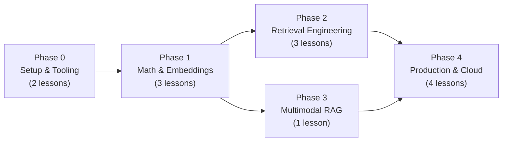
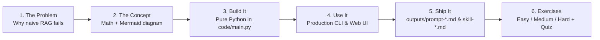

# Sarvam AI + `google/embeddinggemma-2` RAG Engineering from Scratch

<p align="center">
  <b>Five phases. Thirteen lessons. Every RAG primitive written from scratch in pure Python before using production SDKs. Every lesson ends with runnable code, a 4-question quiz, a reusable system prompt, and an agent skill.</b>
</p>

<p align="center">
  
  
  
  
  
</p>

<p align="center">
  <a href="#run-local-code">Quickstart</a> &nbsp;·&nbsp;
  <a href="#choose-a-learning-path">Learning Paths</a> &nbsp;·&nbsp;
  <a href="#contents">All 5 Phases &amp; 13 Lessons</a> &nbsp;·&nbsp;
  <a href="ROADMAP.md">Roadmap</a> &nbsp;·&nbsp;
  <a href="cheatsheets/sarvam-rag.md">Cheatsheet</a> &nbsp;·&nbsp;
  <a href="#production-cli--4-tab-web-studio">CLI &amp; UI Studio</a> &nbsp;·&nbsp;
  <a href="#cloud-finops-teardown-destroy">Cloud Destroy ($0.00)</a>
</p>

---

Every lesson in [`phases/`](phases/) follows the **6-Beat Lesson Contract** (`The Problem` $\rightarrow$ `The Concept` $\rightarrow$ `Build It` $\rightarrow$ `Use It` $\rightarrow$ `Ship It` $\rightarrow$ `Exercises` + `Key Terms`) and contains:
- **`docs/en.md`** — Mathematical derivation, Mermaid architecture diagrams, and step-by-step walkthrough
- **`code/main.py`** — Self-contained, runnable Python implementation from scratch (verified via `scripts/lesson_run.py --execute --strict`)
- **`quiz.json`** — 2 pre-quiz + 2 post-quiz questions with detailed explanations
- **`outputs/prompt-*.md`** — Copy-pasteable production system prompt
- **`outputs/skill-*.md`** — Reusable AI agent skill definition (installable via `scripts/install_skills.py`)

---

## Run local code

```bash
git clone https://github.com/ajithvnr2001/sarvam-embeddinggemma2-rag-course.git
cd sarvam-embeddinggemma2-rag-course
pip install -r requirements.txt

# 1. Verify environment & preflight checks
python3 phases/00-setup-and-tooling/01-dev-environment-and-preflight/code/verify.py

# 2. Run your first lesson (Vectors, Norms & Cosine Similarity from scratch)
python3 phases/01-math-and-embeddings/01-vectors-norms-and-cosine-similarity/code/main.py

# 3. Audit and execute all 13 lessons across all 5 phases
python3 scripts/audit_lessons.py --strict
python3 scripts/lesson_run.py --execute --strict
```

---

## Use every lesson the same way

```text
1. Pre-quiz (2 Qs)  →  2. Read docs/en.md  →  3. Run code/main.py  →  4. Do 3 exercises  →  5. Grab outputs/
   quiz.json              The 6-Beat lesson      Modify & re-run         Easy / Med / Hard     prompt-*.md + skill-*.md
```

1. **Test your intuition first** — Open the lesson's `quiz.json` and answer the two `"stage": "pre"` questions before reading.
2. **Read `docs/en.md` top-to-bottom** — Every equation is derived from first principles and paired with its exact Python translation.
3. **Run `code/main.py` and break it** — Change a hyperparameter ($k \in \lbrace 768, 512, 256, 128 \rbrace$, $k_1 = 1.5$, $b = 0.75$, $k_{\text{rrf}} = 60$) and observe the output.
4. **Complete the 3 graded exercises** — Move from `[Easy]` to `[Medium]` to `[Hard]` at the bottom of `docs/en.md`.
5. **Ship the artifacts** — Copy `outputs/prompt-*.md` and `outputs/skill-*.md` into your production project or install all 26 artifacts into your agent with `python3 scripts/install_skills.py skills --type all --layout flat --force`.

---

## Choose a learning path

| Path | Who it's for | Phases & Lessons | Est. Time |
|------|-------------|------------------|-----------|
| **`beginner` (Full Zero-to-Production Track)** | Anyone learning embeddings, vector search, RAG, and Cloud FinOps from scratch | **All Phases (`00` $\rightarrow$ `04`, all 13 lessons)** | ~10 hrs |
| **`rag-foundations` (Core Math + Hybrid Retrieval)** | Engineers who want from-scratch Cosine Similarity, Matryoshka (`MRL`), Markdown chunking, BM25, and Hybrid RRF | **Phase 01 (`01`–`03`) + Phase 02 (`01`–`03`)** | ~4.5 hrs |
| **`multimodal` (Audio + Image + Text RAG)** | Builders indexing voice clips (`.wav`/`.mp3`), architecture diagrams (`.png`), and docs in one 768-D space | **Phase 01 (`02`–`03`) + Phase 03 (`01`)** | ~2.5 hrs |
| **`gcp-production` (Vertex AI, BigQuery & FinOps Destroy)** | Cloud/MLOps engineers deploying grounded RAG on GCP with evaluation gates and `$0.00` teardown | **Phase 00 (`01`–`02`) + Phase 04 (`01`–`04`)** | ~4 hrs |

---

## The shape of the curriculum



Five phases. Click any phase below to inspect its lessons, runnable scripts, quizzes, and shippable outputs.

---

## Contents

<a id="phase-0"></a>
### Phase 0: Setup & Tooling `2 lessons`
> Verify your Python/PyTorch/GCP workstation, authenticate with Hugging Face & Google Cloud, and audit the 57-file Sarvam AI corpus.

| # | Lesson | Code | Quiz | Outputs (Prompt + Skill) | Type |
|:---:|--------|:----:|:----:|--------------------------|:----:|
| 01 | [Dev Environment & Preflight Verification](phases/00-setup-and-tooling/01-dev-environment-and-preflight/docs/en.md) | [`main.py`](phases/00-setup-and-tooling/01-dev-environment-and-preflight/code/main.py) · [`verify.py`](phases/00-setup-and-tooling/01-dev-environment-and-preflight/code/verify.py) | [`quiz.json`](phases/00-setup-and-tooling/01-dev-environment-and-preflight/quiz.json) | [`prompt-env-check.md`](phases/00-setup-and-tooling/01-dev-environment-and-preflight/outputs/prompt-env-check.md) · [`skill-rag-preflight-auditor.md`](phases/00-setup-and-tooling/01-dev-environment-and-preflight/outputs/skill-rag-preflight-auditor.md) | Build |
| 02 | [GCP, Hugging Face & Corpus Setup](phases/00-setup-and-tooling/02-gcp-hf-and-corpus-setup/docs/en.md) | [`main.py`](phases/00-setup-and-tooling/02-gcp-hf-and-corpus-setup/code/main.py) | [`quiz.json`](phases/00-setup-and-tooling/02-gcp-hf-and-corpus-setup/quiz.json) | [`prompt-corpus-audit.md`](phases/00-setup-and-tooling/02-gcp-hf-and-corpus-setup/outputs/prompt-corpus-audit.md) · [`skill-corpus-readiness-checker.md`](phases/00-setup-and-tooling/02-gcp-hf-and-corpus-setup/outputs/skill-corpus-readiness-checker.md) | Build |

<details id="phase-1" open>
<summary><b>Phase 1 — Math &amp; Embeddings</b> &nbsp;<code>3 lessons</code>&nbsp; <em>Vectors, L2 normalization, cosine similarity, asymmetric prompts, and Matryoshka truncation from first principles.</em></summary>
<br/>

| # | Lesson | Code | Quiz | Outputs (Prompt + Skill) | Type |
|:---:|--------|:----:|:----:|--------------------------|:----:|
| 01 | [Vectors, L2 Norms & Cosine Similarity from Scratch](phases/01-math-and-embeddings/01-vectors-norms-and-cosine-similarity/docs/en.md) | [`main.py`](phases/01-math-and-embeddings/01-vectors-norms-and-cosine-similarity/code/main.py) | [`quiz.json`](phases/01-math-and-embeddings/01-vectors-norms-and-cosine-similarity/quiz.json) | [`prompt-similarity-debugger.md`](phases/01-math-and-embeddings/01-vectors-norms-and-cosine-similarity/outputs/prompt-similarity-debugger.md) · [`skill-vector-space-auditor.md`](phases/01-math-and-embeddings/01-vectors-norms-and-cosine-similarity/outputs/skill-vector-space-auditor.md) | Build |
| 02 | [`google/embeddinggemma-2` Architecture & Asymmetric Prompts](phases/01-math-and-embeddings/02-embeddinggemma2-architecture-and-prompts/docs/en.md) | [`main.py`](phases/01-math-and-embeddings/02-embeddinggemma2-architecture-and-prompts/code/main.py) | [`quiz.json`](phases/01-math-and-embeddings/02-embeddinggemma2-architecture-and-prompts/quiz.json) | [`prompt-prefix-architect.md`](phases/01-math-and-embeddings/02-embeddinggemma2-architecture-and-prompts/outputs/prompt-prefix-architect.md) · [`skill-embeddinggemma2-integrator.md`](phases/01-math-and-embeddings/02-embeddinggemma2-architecture-and-prompts/outputs/skill-embeddinggemma2-integrator.md) | Build |
| 03 | [Matryoshka Representation Learning (MRL) & Truncation](phases/01-math-and-embeddings/03-matryoshka-representation-learning/docs/en.md) | [`main.py`](phases/01-math-and-embeddings/03-matryoshka-representation-learning/code/main.py) | [`quiz.json`](phases/01-math-and-embeddings/03-matryoshka-representation-learning/quiz.json) | [`prompt-mrl-capacity-planner.md`](phases/01-math-and-embeddings/03-matryoshka-representation-learning/outputs/prompt-mrl-capacity-planner.md) · [`skill-mrl-dimension-optimizer.md`](phases/01-math-and-embeddings/03-matryoshka-representation-learning/outputs/skill-mrl-dimension-optimizer.md) | Build |

</details>

<details id="phase-2" open>
<summary><b>Phase 2 — Retrieval Engineering</b> &nbsp;<code>3 lessons</code>&nbsp; <em>Structure-aware Markdown chunking, Okapi BM25 from scratch, and Hybrid Reciprocal Rank Fusion (RRF).</em></summary>
<br/>

| # | Lesson | Code | Quiz | Outputs (Prompt + Skill) | Type |
|:---:|--------|:----:|:----:|--------------------------|:----:|
| 01 | [Structure-Aware Markdown Chunking](phases/02-retrieval-engineering/01-structure-aware-markdown-chunking/docs/en.md) | [`main.py`](phases/02-retrieval-engineering/01-structure-aware-markdown-chunking/code/main.py) | [`quiz.json`](phases/02-retrieval-engineering/01-structure-aware-markdown-chunking/quiz.json) | [`prompt-chunking-strategist.md`](phases/02-retrieval-engineering/01-structure-aware-markdown-chunking/outputs/prompt-chunking-strategist.md) · [`skill-markdown-chunk-architect.md`](phases/02-retrieval-engineering/01-structure-aware-markdown-chunking/outputs/skill-markdown-chunk-architect.md) | Build |
| 02 | [Okapi BM25 Sparse Retrieval from Scratch](phases/02-retrieval-engineering/02-okapi-bm25-from-scratch/docs/en.md) | [`main.py`](phases/02-retrieval-engineering/02-okapi-bm25-from-scratch/code/main.py) | [`quiz.json`](phases/02-retrieval-engineering/02-okapi-bm25-from-scratch/quiz.json) | [`prompt-lexical-tuner.md`](phases/02-retrieval-engineering/02-okapi-bm25-from-scratch/outputs/prompt-lexical-tuner.md) · [`skill-bm25-index-builder.md`](phases/02-retrieval-engineering/02-okapi-bm25-from-scratch/outputs/skill-bm25-index-builder.md) | Build |
| 03 | [Hybrid Search & Reciprocal Rank Fusion (RRF)](phases/02-retrieval-engineering/03-hybrid-search-and-rrf-fusion/docs/en.md) | [`main.py`](phases/02-retrieval-engineering/03-hybrid-search-and-rrf-fusion/code/main.py) | [`quiz.json`](phases/02-retrieval-engineering/03-hybrid-search-and-rrf-fusion/quiz.json) | [`prompt-hybrid-fusion-debugger.md`](phases/02-retrieval-engineering/03-hybrid-search-and-rrf-fusion/outputs/prompt-hybrid-fusion-debugger.md) · [`skill-hybrid-rag-architect.md`](phases/02-retrieval-engineering/03-hybrid-search-and-rrf-fusion/outputs/skill-hybrid-rag-architect.md) | Build |

</details>

<details id="phase-3" open>
<summary><b>Phase 3 — Multimodal RAG</b> &nbsp;<code>1 lesson</code>&nbsp; <em>Cross-modal retrieval across text, PNG architecture cards, and WAV/MP3 audio samples in one unified 768-D vector space.</em></summary>
<br/>

| # | Lesson | Code | Quiz | Outputs (Prompt + Skill) | Type |
|:---:|--------|:----:|:----:|--------------------------|:----:|
| 01 | [Cross-Modal Audio & Image RAG with `embeddinggemma-2`](phases/03-multimodal-rag/01-cross-modal-audio-and-image-rag/docs/en.md) | [`main.py`](phases/03-multimodal-rag/01-cross-modal-audio-and-image-rag/code/main.py) | [`quiz.json`](phases/03-multimodal-rag/01-cross-modal-audio-and-image-rag/quiz.json) | [`prompt-multimodal-rag-designer.md`](phases/03-multimodal-rag/01-cross-modal-audio-and-image-rag/outputs/prompt-multimodal-rag-designer.md) · [`skill-cross-modal-index-engineer.md`](phases/03-multimodal-rag/01-cross-modal-audio-and-image-rag/outputs/skill-cross-modal-index-engineer.md) | Build |

</details>

<details id="phase-4" open>
<summary><b>Phase 4 — Production &amp; Cloud</b> &nbsp;<code>4 lessons</code>&nbsp; <em>Vertex AI Gemini grounded generation, BigQuery vector search, IR evaluation metrics, and Cloud FinOps teardown to $0.00.</em></summary>
<br/>

| # | Lesson | Code | Quiz | Outputs (Prompt + Skill) | Type |
|:---:|--------|:----:|:----:|--------------------------|:----:|
| 01 | [Vertex AI Grounded Generation & Citations](phases/04-production-and-cloud/01-vertex-ai-grounded-generation-and-citations/docs/en.md) | [`main.py`](phases/04-production-and-cloud/01-vertex-ai-grounded-generation-and-citations/code/main.py) | [`quiz.json`](phases/04-production-and-cloud/01-vertex-ai-grounded-generation-and-citations/quiz.json) | [`prompt-grounded-rag-system.md`](phases/04-production-and-cloud/01-vertex-ai-grounded-generation-and-citations/outputs/prompt-grounded-rag-system.md) · [`skill-citation-guardrail-auditor.md`](phases/04-production-and-cloud/01-vertex-ai-grounded-generation-and-citations/outputs/skill-citation-guardrail-auditor.md) | Build |
| 02 | [GCP Storage & BigQuery Vector Search (`COSINE_DISTANCE`)](phases/04-production-and-cloud/02-gcp-storage-and-bigquery-vector-search/docs/en.md) | [`main.py`](phases/04-production-and-cloud/02-gcp-storage-and-bigquery-vector-search/code/main.py) | [`quiz.json`](phases/04-production-and-cloud/02-gcp-storage-and-bigquery-vector-search/quiz.json) | [`prompt-bigquery-vector-architect.md`](phases/04-production-and-cloud/02-gcp-storage-and-bigquery-vector-search/outputs/prompt-bigquery-vector-architect.md) · [`skill-gcp-vector-ops.md`](phases/04-production-and-cloud/02-gcp-storage-and-bigquery-vector-search/outputs/skill-gcp-vector-ops.md) | Build |
| 03 | [RAG Evaluation: IR Metrics (`Hit@K`, `MRR@K`, `NDCG@K`) & LLM Judge](phases/04-production-and-cloud/03-rag-evaluation-ir-metrics-and-llm-judge/docs/en.md) | [`main.py`](phases/04-production-and-cloud/03-rag-evaluation-ir-metrics-and-llm-judge/code/main.py) | [`quiz.json`](phases/04-production-and-cloud/03-rag-evaluation-ir-metrics-and-llm-judge/quiz.json) | [`prompt-rag-eval-judge.md`](phases/04-production-and-cloud/03-rag-evaluation-ir-metrics-and-llm-judge/outputs/prompt-rag-eval-judge.md) · [`skill-rag-evaluation-harness.md`](phases/04-production-and-cloud/03-rag-evaluation-ir-metrics-and-llm-judge/outputs/skill-rag-evaluation-harness.md) | Build |
| 04 | [CLI/UI Operations & Cloud FinOps Resource Destroy (`$0.00`)](phases/04-production-and-cloud/04-cli-ui-operations-and-resource-destroy/docs/en.md) | [`main.py`](phases/04-production-and-cloud/04-cli-ui-operations-and-resource-destroy/code/main.py) | [`quiz.json`](phases/04-production-and-cloud/04-cli-ui-operations-and-resource-destroy/quiz.json) | [`prompt-finops-teardown-auditor.md`](phases/04-production-and-cloud/04-cli-ui-operations-and-resource-destroy/outputs/prompt-finops-teardown-auditor.md) · [`skill-cloud-rag-destroyer.md`](phases/04-production-and-cloud/04-cli-ui-operations-and-resource-destroy/outputs/skill-cloud-rag-destroyer.md) | Build |

</details>

---

## The shape of a lesson

Every lesson follows the same six-beat flow (`LESSON_TEMPLATE.md`) so you always know where you are:



---

## Production CLI & 4-Tab Web Studio

In addition to the 13 self-contained lessons under `phases/`, this repository includes the full production RAG engine (`src/`), 8-command Typer CLI (`cli/rag_cli.py`), 6 interactive terminal labs (`scripts/interactive_learning_labs.py`), and 4-tab Gradio Web Studio (`ui/app.py`):

```bash
# Run all 6 interactive terminal labs
python3 scripts/interactive_learning_labs.py --lab all

# Build or refresh the 244-chunk Sarvam Docs index across 768/512/256/128 MRL dims
python -m cli.rag_cli index

# Hybrid RRF retrieval + Vertex AI Gemini grounded answer with [Doc i] citations
python -m cli.rag_cli query "How do I authenticate to Sarvam APIs and what is Bulbul v3?" --dim 256 --mode hybrid

# Matryoshka (MRL) dimension benchmark (768 vs 512 vs 256 vs 128)
python -m cli.rag_cli mrl-benchmark "How does Saaras v3 handle speech-to-text?"

# Multimodal cross-modal retrieval (Text -> Audio/Image/Interleaved)
python -m cli.rag_cli multimodal-query "Voice cloning speaker audio and TTS architecture"

# Launch the 4-Tab Gradio Web Studio on http://localhost:7860
python -m ui.app
```

| Tab 1: Hybrid RAG Studio | Tab 2: Matryoshka (`MRL`) Explorer |
| :---: | :---: |
|  |  |
| **Tab 3: Multimodal Audio & Image Lab** | **Tab 4: GCP BigQuery Vector Search** |
|  |  |

---

## Cloud FinOps Teardown (`destroy`)

Never leave cloud storage or data warehouse artifacts accruing charges after finishing your experiments. [Phase 04 · Lesson 04](phases/04-production-and-cloud/04-cli-ui-operations-and-resource-destroy/docs/en.md) teaches and verifies idempotent teardown:

```bash
# Option A: One-command automated Python teardown + post-delete verification
python -m cli.rag_cli destroy --yes

# Option B: Direct gcloud / bq CLI teardown
bq rm -r -f -d genai-511910:sarvam_rag
gcloud storage rm --recursive gs://genai-511910-sarvam-rag
```

---

## The Toolkit

| Script / Guide | Purpose |
|----------------|---------|
| [`scripts/audit_lessons.py`](scripts/audit_lessons.py) | Validates rules `L001`–`L010` (`docs/en.md`, `code/`, `quiz.json` schema, internal relative links) across all 13 lessons |
| [`scripts/lesson_run.py`](scripts/lesson_run.py) | Byte-compiles or executes (`--execute --strict`) every lesson's `code/main.py` |
| [`scripts/install_skills.py`](scripts/install_skills.py) | Exports all 26 lesson prompts (`prompt-*.md`) and skills (`skill-*.md`) into [`skills/`](skills/) with [`skills/manifest.json`](skills/manifest.json) |
| [`scripts/interactive_learning_labs.py`](scripts/interactive_learning_labs.py) | 6 interactive step-by-step terminal labs covering the entire RAG lifecycle |
| [`LESSON_TEMPLATE.md`](LESSON_TEMPLATE.md) | Canonical 6-Beat template for authoring new lessons |
| [`ROADMAP.md`](ROADMAP.md) | Phase and lesson completion tracker |
| [`cheatsheets/sarvam-rag.md`](cheatsheets/sarvam-rag.md) | One-page quick reference for formulas, hyperparameters, and CLI commands |
| [`course/`](course/) | Deep-dive companion textbook modules (`MODULE_00` through `MODULE_08` + `PRACTICAL_HANDBOOK.md`) |

---

## License

MIT. Use it however you want — fork it, teach it, ship it in production.
