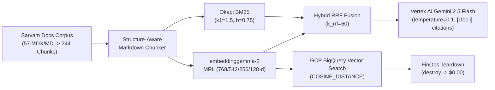

# Retrieval-Augmented Generation (RAG) with `google/embeddinggemma-2` & Sarvam AI — Cheatsheet

> Chunk, embed with asymmetric prompts, truncate via Matryoshka (`768 -> 256 -> 128`), fuse BM25 + Dense via Reciprocal Rank Fusion (RRF), generate grounded citations with Vertex AI Gemini, query BigQuery `COSINE_DISTANCE`, evaluate `Hit@K`/`MRR@K`/`NDCG@K`, and destroy cloud resources to `$0.00`.

---

## 1. End-to-End RAG Architecture

---

## 2. Core Mathematical Formulas

- **L2 Norm & Normalization**:
  $$\lVert \mathbf{v} \rVert_2 = \sqrt{\sum_{i=1}^{d} v_i^2}, \qquad \hat{\mathbf{v}} = \frac{\mathbf{v}}{\max(\lVert \mathbf{v} \rVert_2, \varepsilon)}$$

- **Cosine Similarity & Cosine Distance**:
  $$\operatorname{CosineSimilarity}(\mathbf{q}, \mathbf{d}) = \frac{\mathbf{q} \cdot \mathbf{d}}{\lVert \mathbf{q} \rVert_2 \lVert \mathbf{d} \rVert_2} = \hat{\mathbf{q}} \cdot \hat{\mathbf{d}}, \qquad \operatorname{CosineDistance}(\mathbf{q}, \mathbf{d}) = 1 - \operatorname{CosineSimilarity}(\mathbf{q}, \mathbf{d})$$

- **Matryoshka Representation Learning (MRL) Truncation ($k \in \lbrace 768, 512, 256, 128 \rbrace$)**:
  $$\hat{\mathbf{v}}_{1:k} = \frac{\mathbf{v}[0:k]}{\lVert \mathbf{v}[0:k] \rVert_2}$$

- **Okapi BM25 Sparse Score**:
  $$\operatorname{IDF}(t) = \ln\left(1 + \frac{N - n(t) + 0.5}{n(t) + 0.5}\right), \qquad \operatorname{BM25}(q, d) = \sum_{t \in q} \operatorname{IDF}(t) \cdot \frac{f(t, d) \cdot (k_1 + 1)}{f(t, d) + k_1 \cdot \left(1 - b + b \cdot \frac{\lvert d \rvert}{\operatorname{avgdl}}\right)}$$

- **Reciprocal Rank Fusion (RRF)**:
  $$\operatorname{RRF}(d \mid q) = \frac{w_{\text{dense}}}{k_{\text{rrf}} + r_{\text{dense}}(d)} + \frac{w_{\text{bm25}}}{k_{\text{rrf}} + r_{\text{bm25}}(d)} \quad (k_{\text{rrf}} = 60)$$

- **Information Retrieval Evaluation Metrics (`Hit@K`, `MRR@K`, `NDCG@K`)**:
  $$\operatorname{Hit@}K = \frac{1}{M}\sum_{m=1}^{M} \mathbb{I}(L_{m,K} \cap R_m \neq \emptyset), \qquad \operatorname{MRR@}K = \frac{1}{M}\sum_{m=1}^{M} \frac{1}{\operatorname{rank}_m}, \qquad \operatorname{NDCG@}K = \frac{\operatorname{DCG@}K}{\operatorname{IDCG@}K}$$

---

## 3. Production CLI Reference (`python -m cli.rag_cli`)

| Command | Purpose |
| :--- | :--- |
| `python3 phases/00-setup-and-tooling/01-dev-environment-and-preflight/code/verify.py` | Verify Python, NumPy, PyTorch, Transformers, and GCP preflight |
| `python3 scripts/audit_lessons.py --strict` | Lint all 13 lessons across Phases 0–4 against the 6-Beat contract |
| `python3 scripts/lesson_run.py --execute --strict` | Execute every `code/main.py` across all 13 lessons |
| `python3 scripts/interactive_learning_labs.py --lab all` | Run the 6 hands-on terminal labs end-to-end |
| `python -m cli.rag_cli index` | Chunk 57 Sarvam MDX/MD files into 244 chunks and build MRL (`768/512/256/128`) + BM25 + Multimodal indexes |
| `python -m cli.rag_cli query "How do I authenticate?" --dim 256 --mode hybrid` | Run Hybrid RRF + Vertex AI Gemini grounded answer with `[Doc i]` citations |
| `python -m cli.rag_cli mrl-benchmark "How does Saaras v3 handle STT?"` | Compare latency, memory savings, and Top-5 overlap across `768`, `512`, `256`, and `128` dims |
| `python -m cli.rag_cli multimodal-query "Text to speech Bulbul"` | Query cross-modal image cards and audio samples in a unified 768-D vector space |
| `python -m cli.rag_cli gcp-sync` | Upload index artifacts to GCS and create/populate BigQuery vector table |
| `python -m cli.rag_cli bq-query "Bulbul v3 speaker voices" --dim 256` | Run serverless `COSINE_DISTANCE` SQL search directly on BigQuery |
| `python -m cli.rag_cli evaluate` | Run retrieval (`Hit@5`, `MRR@5`) + MRL retention evaluation suite |
| `python -m cli.rag_cli destroy --yes` | **Cloud FinOps Teardown**: Delete BigQuery dataset + GCS bucket and verify `$0.00` footprint |

---

## 4. Defaults & Golden Benchmark Numbers

| Parameter / Metric | Production Value | Why It Matters |
| :--- | :--- | :--- |
| **Embedding Model** | `google/embeddinggemma-2` | Native 768-D Matryoshka + Multimodal (Text, Image, Audio) encoder |
| **Query Prefix** | `"task: search result \| query: "` | Required asymmetric prefix for user search queries |
| **Document Prefix** | `"title: {section} \| text: "` | Required asymmetric prefix for indexed documentation chunks |
| **MRL Production Sweet Spot** | **`256-D`** (`3.0x` smaller) | **100% Top-5 overlap** with 768-D (`cosine = 0.9963`) at `1/3` memory cost |
| **Chunk Size / Overlap** | `1100` chars / `150` chars | Structure-aware Markdown splitting; preserves code blocks & API tables |
| **BM25 Hyperparameters** | `k1 = 1.5`, `b = 0.75` | Exact saturation & document length normalization for technical docs |
| **RRF Smoothing Constant** | `k_rrf = 60` | Scale-free fusion of Dense Cosine + Sparse BM25 ranks |
| **Retrieval `Hit@5` / `MRR@5`** | **`100.0%` / `0.9167`** | Verified across the Sarvam AI golden benchmark query suite |
| **GCP Post-Destroy State** | **`DELETED ($0.00/month)`** | Verified zero-residue state for both GCS and BigQuery |
