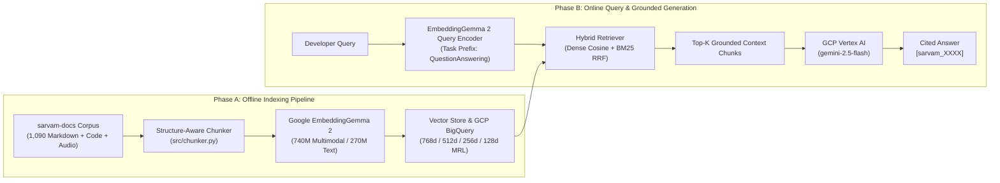

# Module 01 (Beginner): Foundations of Vector Embeddings, Similarity Geometry & RAG

**Level:** Beginner  
**Estimated Time:** 30 minutes  
**Code Reference:** [`src/embedder.py`](../src/embedder.py), [`src/retriever.py`](../src/retriever.py)

---

## 1. What Problem Does Retrieval-Augmented Generation (RAG) Solve?

Large Language Models (LLMs) like **Gemini 2.5 Flash** on Google Cloud Vertex AI possess strong reasoning and synthesis capabilities, but their parametric memory is static:
1. **Stale or Evolving API Contracts:** When Sarvam AI releases `bulbul:v4-flash` with new Tamil speaker IDs (`vijay_ta_narration`, `aravind_ta_suspense`) or 44.1 kHz sample rate support on REST (`POST https://api.sarvam.ai/text-to-speech`), an ungrounded LLM may hallucinate deprecated speaker names or outdated parameters.
2. **Verifiable Source Attribution:** In production developer tools, every claim must cite an exact documentation page (`[sarvam_XXXX]`) and URL (`https://docs.sarvam.ai/...`).
3. **Cross-Modal Knowledge:** Enterprise documentation is rarely pure text—it includes **Markdown prose**, **Python/cURL code blocks**, **architecture diagrams (`.png`)**, and **audio samples (`.wav`/`.mp3`)**.

**Retrieval-Augmented Generation (RAG)** bridges this gap by retrieving the highest-relevance chunks from an external knowledge base (`ajithvnr2001/sarvam-docs`) at query time and injecting them into the LLM's context window with strict grounding rules.



---

## 2. Vector Embeddings & High-Dimensional Geometry

An **embedding model** maps discrete inputs (a text passage, a Python snippet, an image, or an audio waveform) to a continuous vector $\mathbf{v} \in \mathbb{R}^d$. For **`google/embeddinggemma-2`**, the native dimension is $d = 768$.

### 2.1 Cosine Similarity vs. Dot Product vs. Euclidean Distance

Given a query vector $\mathbf{q} \in \mathbb{R}^d$ and a document vector $\mathbf{d} \in \mathbb{R}^d$:

$$\text{cosine\_similarity}(\mathbf{q}, \mathbf{d}) = \frac{\mathbf{q} \cdot \mathbf{d}}{\|\mathbf{q}\|_2 \|\mathbf{d}\|_2} = \frac{\sum_{i=1}^{d} q_i d_i}{\sqrt{\sum_{i=1}^{d} q_i^2} \sqrt{\sum_{i=1}^{d} d_i^2}}$$

When every vector is **L2-normalized** onto the unit hypersphere ($\|\mathbf{q}\|_2 = 1$ and $\|\mathbf{d}\|_2 = 1$), cosine similarity simplifies to a single matrix-vector dot product:

$$\text{cosine\_similarity}(\mathbf{q}, \mathbf{d}) = \mathbf{q}^\top \mathbf{d}$$

> [!IMPORTANT]
> **Why L2 Normalization Matters in Production:**
> 1. **Speed:** Matrix multiplication (`emb_matrix @ q_vec`) computes thousands of cosine similarities in microseconds using AVX-512 / GPU tensor cores without computing per-row square roots at query time.
> 2. **Matryoshka Truncation:** When you slice a 768d unit vector down to its first 256 or 128 dimensions, its L2 norm drops below 1.0 ($\|\mathbf{v}_{1:128}\|_2 < 1$). You **must** re-normalize after truncation (`v = v / np.linalg.norm(v)`), or documents with more energy in early dimensions will distort rankings!

---

## 3. Symmetric vs. Asymmetric Retrieval Tasks

Not all vector comparisons are identical. `google/embeddinggemma-2` distinguishes between two fundamental regimes:

| Task Regime | Input A | Input B | Example Use Case | Instruction Prefix Strategy |
| :--- | :--- | :--- | :--- | :--- |
| **Asymmetric** | Short user question (`10-20 tokens`) | Long documentation section (`300-500 tokens`) | RAG QA, Web Search, Code Search, Fact Checking | Different prefixes: `task: question answering \| query: ...` vs. `title: {title} \| text: ...` |
| **Symmetric** | Statement / Sentence A | Statement / Sentence B of similar structure | Semantic Deduplication, Clustering, Classification | Identical prefix on both sides: `task: sentence similarity \| query: ...` |

---

## 4. Hands-On Beginner Lab: Your First Embedding & Cosine Calculation

### Step 1: Run via Python CLI
```bash
/data/opencode/sarvam-rag-course/.venv/bin/python -c '
import torch
from sentence_transformers import SentenceTransformer

# Load text-only selective configuration (270M parameters instead of 740M)
model = SentenceTransformer(
    "google/embeddinggemma-2",
    model_kwargs={"torch_dtype": torch.bfloat16},
    config_kwargs={"vision_config": None, "audio_config": None},
)

query = "How do I authenticate with the Sarvam AI API?"
docs = [
    "title: Authentication | text: All API endpoints are authenticated using api-subscription-key in the request header.",
    "title: Text to Speech | text: Convert written text into spoken audio using bulbul:v4-flash.",
]

q_emb = model.encode(query, prompt_name="QuestionAnswering", normalize_embeddings=True)
d_embs = model.encode(docs, normalize_embeddings=True)

scores = d_embs @ q_emb
for doc, score in zip(docs, scores):
    print(f"Cosine: {score:.4f} | {doc}")
'
```

### Expected Output
```text
Cosine: 0.6462 | title: Authentication | text: All API endpoints are authenticated using api-subscription-key in the request header.
Cosine: 0.2184 | title: Text to Speech | text: Convert written text into spoken audio using bulbul:v4-flash.
```

---

## Next Module
Proceed to **[Module 02: Deep Dive into Google `EmbeddingGemma 2` Architecture](./02_embeddinggemma2_architecture.md)**.
