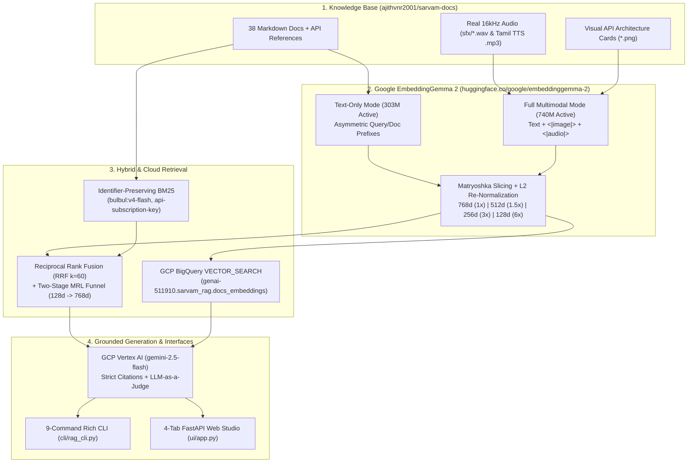

# Module 01 (Beginner): RAG Foundations, Vector Geometry & Cosine Similarity from First Principles

> **Course Navigation**: [Course Index (`COURSE.md`)](../COURSE.md) | [Bit-by-Bit Guide (`BEGINNER_TO_PRODUCTION_STEP_BY_STEP.md`)](../BEGINNER_TO_PRODUCTION_STEP_BY_STEP.md) | [Next: Module 02 — EmbeddingGemma 2 Architecture →](./02_embeddinggemma2_architecture.md)  
> **Level:** Beginner (MIT 6.S191 / 6.8610 First-Principles Track)  
> **Estimated Time:** 35 minutes  
> **Code References:** [`src/config.py`](../src/config.py), [`src/embedder.py`](../src/embedder.py), [`src/retriever.py`](../src/retriever.py)

---

## 📖 1. Explanation: Why LLMs Hallucinate & How Vector Spaces Solve It

### 1.1 The Core Problem: Parametric Memory vs. Non-Parametric Grounding

When you ask a standalone Large Language Model (LLM) a domain-specific engineering question—such as:
> *"Which Tamil speaker IDs are supported by `bulbul:v4-flash` in the Sarvam AI Text-to-Speech API, and what HTTP header is required for authentication?"*

a standard LLM relies solely on its **parametric memory** (the static neural weights $\theta$ frozen at pre-training time). This creates three fundamental failure modes in production:
1. **Post-Cutoff Blindness:** APIs released or updated after training (such as `bulbul:v4-flash`, `saaras:v3`, or Instant Voice Cloning `/voices/clone`) do not exist in $\theta$.
2. **Hallucination via Plausible Extrapolation:** Autoregressive models maximize $P(y_t \mid y_{<t}, x; \theta)$. Without grounded evidence in the prompt context, the model guesses plausible-looking—but fabricated—JSON keys or speaker names.
3. **Zero Verifiability:** Parametric generation cannot prove *which* official documentation page authorized a specific claim.

**Retrieval-Augmented Generation (RAG)** solves this by coupling parametric generation with **non-parametric memory** (an external, searchable index of `sarvam-docs`). Instead of computing $P(y \mid x; \theta)$, a RAG system retrieves the top-$K$ most relevant documentation chunks $\mathcal{Z}_K = \lbrace z_1, z_2, \dots, z_K \rbrace$ and conditions the generator explicitly on that evidence:

$$
P_{\text{RAG}}(y \mid x) = \sum_{z \in \mathcal{Z}_K} P_{\text{retriever}}(z \mid x) \cdot P_{\text{generator}}(y \mid x, z; \theta)
$$

In deterministic top-$K$ context concatenation (used in [`src/generator.py`](../src/generator.py)), we retrieve all $K$ chunks simultaneously and pass the combined set $\mathcal{Z}_K$ into Google Cloud Vertex AI (`gemini-2.5-flash`) at low temperature (`T = 0.1`) with mandatory `[sarvam_XXXX]` citations.

---

### 1.2 First-Principles Intuition: What is an Embedding Vector?

#### 💡 The Beginner Analogy: A Map of Meaning
Imagine placing every sentence in the world onto a 2D map using two coordinates:
- **Axis 1 ($x_1$):** How much the sentence is about **Speech / Audio APIs** (`0.0` to `1.0`).
- **Axis 2 ($x_2$):** How much the sentence is about **Security / API Keys** (`0.0` to `1.0`).

If we plot three items on this 2D map:
- **Query $\mathbf{q}$:** *"How do I authenticate with my API key?"* $\rightarrow (0.10, 0.99)$
- **Doc A ($\mathbf{d}_A$):** *"Send the `api-subscription-key` header in every request."* $\rightarrow (0.12, 0.98)$
- **Doc B ($\mathbf{d}_B$):** *"Bulbul v3 synthesizes natural Tamil speech at 24kHz."* $\rightarrow (0.97, 0.05)$

Even though Query $\mathbf{q}$ and Doc A share almost no exact words (*"authenticate"* vs *"api-subscription-key"*), their coordinates $(0.10, 0.99)$ and $(0.12, 0.98)$ point in almost the **exact same direction**!

**`google/embeddinggemma-2`** generalizes this 2D map to **$d = 768$ dimensions** (and via Matryoshka Representation Learning, nested prefixes of $d \in \lbrace 128, 256, 512, 768 \rbrace$). Every text query, code snippet, API diagram (`<|image|>`), or 16kHz audio clip (`<|audio|>`) is mapped to a point on the unit hypersphere $\mathbb{S}^{d-1} \subset \mathbb{R}^d$.

---

### 1.3 Rigorous Mathematical Formulation: Cosine Similarity & L2 Normalization

Given a query vector $\mathbf{q} \in \mathbb{R}^d$ and a document vector $\mathbf{d} \in \mathbb{R}^d$, their **Cosine Similarity** measures the cosine of the angle $\theta$ between them:

$$
\operatorname{CosineSimilarity}(\mathbf{q}, \mathbf{d}) = \cos(\theta) = \frac{\mathbf{q} \cdot \mathbf{d}}{\lVert \mathbf{q} \rVert_2 \, \lVert \mathbf{d} \rVert_2} = \frac{\sum_{i=1}^{d} q_i d_i}{\sqrt{\sum_{i=1}^{d} q_i^2} \, \sqrt{\sum_{i=1}^{d} d_i^2}}
$$

where:
- $\mathbf{q} \cdot \mathbf{d} = \sum_{i=1}^{d} q_i d_i$ is the **inner (dot) product**, and
- $\lVert \mathbf{q} \rVert_2 = \sqrt{\sum_{i=1}^{d} q_i^2}$ is the **Euclidean ($L_2$) norm** (length) of vector $\mathbf{q}$.

#### Why We Always $L_2$-Normalize Vectors to Unit Length ($\lVert \hat{\mathbf{v}} \rVert_2 = 1$)
If we pre-normalize every query and document vector to unit length during indexing:

$$
\hat{\mathbf{q}} = \frac{\mathbf{q}}{\lVert \mathbf{q} \rVert_2}, \qquad \hat{\mathbf{d}} = \frac{\mathbf{d}}{\lVert \mathbf{d} \rVert_2} \qquad \implies \qquad \lVert \hat{\mathbf{q}} \rVert_2 = 1, \quad \lVert \hat{\mathbf{d}} \rVert_2 = 1
$$

then the denominator $\lVert \hat{\mathbf{q}} \rVert_2 \, \lVert \hat{\mathbf{d}} \rVert_2$ equals $1 \times 1 = 1$, and Cosine Similarity reduces to a single hardware-accelerated matrix-vector dot product (`np.dot`):

$$
\operatorname{CosineSimilarity}(\hat{\mathbf{q}}, \hat{\mathbf{d}}) = \hat{\mathbf{q}} \cdot \hat{\mathbf{d}} = \sum_{i=1}^{d} \hat{q}_i \hat{d}_i \in [-1, 1]
$$

---

### 1.4 Concrete Worked Numerical Example (Step-by-Step by Hand in $\mathbb{R}^3$)

Let's walk through a complete 3-dimensional ($d = 3$) calculation by hand so there is zero mystery about what [`src/embedder.py`](../src/embedder.py) and [`src/retriever.py`](../src/retriever.py) compute:

1. **Raw Encoder Outputs (Before Normalization):**
   - Query $\mathbf{q}$ (*"How to authenticate?"*): $\mathbf{q} = [3.0, \; 4.0, \; 0.0]$
   - Chunk 1 $\mathbf{d}_1$ (`sarvam_0017`, Auth header doc): $\mathbf{d}_1 = [6.0, \; 8.0, \; 0.0]$
   - Chunk 2 $\mathbf{d}_2$ (`sarvam_0006`, Tamil TTS doc): $\mathbf{d}_2 = [0.0, \; 0.0, \; 5.0]$

2. **Step 1 — Compute $L_2$ Norms ($\lVert \mathbf{v} \rVert_2 = \sqrt{v_1^2 + v_2^2 + v_3^2}$):**

$$
\lVert \mathbf{q} \rVert_2 = \sqrt{3.0^2 + 4.0^2 + 0.0^2} = \sqrt{9 + 16} = \sqrt{25} = 5.0
$$

$$
\lVert \mathbf{d}_1 \rVert_2 = \sqrt{6.0^2 + 8.0^2 + 0.0^2} = \sqrt{36 + 64} = \sqrt{100} = 10.0
$$

$$
\lVert \mathbf{d}_2 \rVert_2 = \sqrt{0.0^2 + 0.0^2 + 5.0^2} = \sqrt{25} = 5.0
$$

3. **Step 2 — $L_2$-Normalize Each Vector ($\hat{\mathbf{v}} = \mathbf{v} / \lVert \mathbf{v} \rVert_2$):**

$$
\hat{\mathbf{q}} = \left[\frac{3.0}{5.0}, \; \frac{4.0}{5.0}, \; \frac{0.0}{5.0}\right] = [0.60, \; 0.80, \; 0.00]
$$

$$
\hat{\mathbf{d}}_1 = \left[\frac{6.0}{10.0}, \; \frac{8.0}{10.0}, \; \frac{0.0}{10.0}\right] = [0.60, \; 0.80, \; 0.00]
$$

$$
\hat{\mathbf{d}}_2 = \left[\frac{0.0}{5.0}, \; \frac{0.0}{5.0}, \; \frac{5.0}{5.0}\right] = [0.00, \; 0.00, \; 1.00]
$$

4. **Step 3 — Compute Dot Products ($\hat{\mathbf{q}} \cdot \hat{\mathbf{d}}$):**
   - Score for Chunk 1 (`sarvam_0017`):

$$
(0.60 \times 0.60) + (0.80 \times 0.80) + (0.00 \times 0.00) = 0.36 + 0.64 + 0.00 = \mathbf{1.0000}
$$

   - Score for Chunk 2 (`sarvam_0006`):

$$
(0.60 \times 0.00) + (0.80 \times 0.00) + (0.00 \times 1.00) = 0.00 + 0.00 + 0.00 = \mathbf{0.0000}
$$

Chunk 1 (`sarvam_0017`) wins with $\cos(\theta) = 1.0000$ ($\theta = 0^\circ$), while Chunk 2 is orthogonal ($\cos(\theta) = 0.0000, \; \theta = 90^\circ$).

---

### 1.5 End-to-End Course Architecture Overview



---

## 🛠️ 2. Practicals: Verify Your Environment & Run Your First Query (CLI & Web UI)

### 2.1 Option A: Command-Line Interface (CLI) Practicals

Run these commands from your terminal to verify that `google/embeddinggemma-2`, the 307-chunk `sarvam-docs` index, and GCP Vertex AI (`genai-511910`) are ready:

```bash
cd /data/opencode/sarvam-rag-course
source .venv/bin/activate

# 1. Inspect the pre-built index statistics
cat data/index/index_stats.json

# 2. Verify that every vector in our 768d, 512d, 256d, and 128d matrices has unit L2 norm (= 1.0000)
python -c "
import numpy as np
for dim in (768, 512, 256, 128):
    mat = np.load(f'data/index/embeddings_{dim}.npy')
    norms = np.linalg.norm(mat, axis=1)
    print(f'MRL {dim}d matrix shape: {mat.shape} | min L2 norm: {norms.min():.6f} | max L2 norm: {norms.max():.6f}')
"

# 3. Run your first Dense Vector search on sarvam-docs
python -m cli.rag_cli search "How do I authenticate with the Sarvam AI API?" --mode dense --dim 768 --top-k 3

# 4. Run your first End-to-End Grounded RAG query with Vertex AI Gemini 2.5 Flash
python -m cli.rag_cli ask "How do I authenticate with the Sarvam AI API and what HTTP header is required?" --mode hybrid --dim 768
```

### 2.2 Option B: Interactive Web Studio UI Practicals (`http://localhost:8090`)

1. Start the FastAPI Web Studio server:
   ```bash
   cd /data/opencode/sarvam-rag-course
   .venv/bin/python -m uvicorn ui.app:app --host 0.0.0.0 --port 8090
   ```
2. Open **`http://localhost:8090`** in your browser.
3. On **Tab 1 (`Grounded RAG Studio`)**:
   - Click the first preset query pill: ***"How do I authenticate with the Sarvam AI API?"***
   - Click **`Retrieval Only (Fast)`** to inspect the Top-5 retrieved chunks (`sarvam_0017`, `sarvam_0018`, etc.) and their similarity scores in `< 15 ms`.
   - Click **`Ask Vertex AI Gemini (RAG)`** to generate a grounded response with clickable `[sarvam_XXXX]` citations and automated 5-point LLM Judge scores.

---

## 🧠 3. Key Learnings & MIT Systems Takeaways

1. **RAG Turns Knowledge Updates into an $O(1)$ Indexing Operation:** Updating an LLM's knowledge about a new Sarvam API endpoint requires zero gradient updates—only re-encoding the changed Markdown file into `data/index/`.
2. **Unit-Sphere Geometry Simplifies Search to Matrix Multiplication:** Because every vector on $\mathbb{S}^{d-1}$ satisfies $\lVert \hat{\mathbf{v}} \rVert_2 = 1$, exact cosine similarity over $N$ chunks reduces to a single BLAS `SGEMV` matrix-vector multiply `embeddings @ query_vec` taking `< 0.5 ms` for 307 chunks.
3. **Garbage In, Garbage Out in Context Conditioning:** If the retriever fails to surface the relevant documentation chunk in $\mathcal{Z}_K$, even the strongest LLM generator cannot cite the true API parameter. Retrieval recall is therefore the primary bottleneck of any RAG system.

---

## 🧹 4. Resource Teardown & Cost Cleanup (`destroy`)

Whenever you finish practicing or want to stop local/cloud services so zero background processes or GCP resources remain active:

- **Via CLI:**
  ```bash
  # Stop Web UI server on port 8090 and delete any active GCP BigQuery/GCS resources
  python -m cli.rag_cli destroy
  ```
- **Via Web UI (`http://localhost:8090`):**
  Navigate to **Tab 4 (`GCP BigQuery Vector Search`)** and click the red **`Destroy Cloud Resources (GCS + BQ)`** button.

---

## Next Module
Proceed to **[Module 02: Deep Dive into `google/embeddinggemma-2` Architecture (740M Multimodal vs. 303M Selective Text, Prompt Prefixes & Precision Safety)](./02_embeddinggemma2_architecture.md)**.
