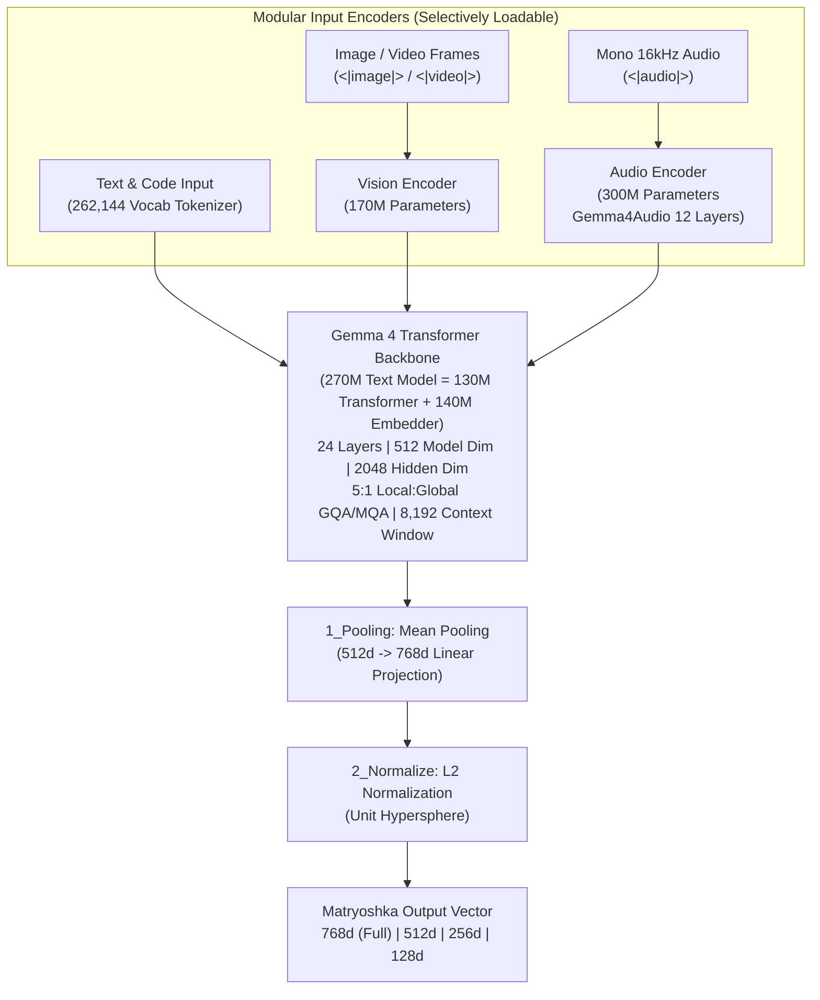

# Module 02 (Beginner): Deep Dive into Google `EmbeddingGemma 2` Architecture

**Level:** Beginner to Intermediate  
**Estimated Time:** 45 minutes  
**Model Card:** [`https://huggingface.co/google/embeddinggemma-2`](https://huggingface.co/google/embeddinggemma-2)  
**Code Reference:** [`src/embedder.py`](../src/embedder.py)

---

## 1. Architectural Anatomy of `google/embeddinggemma-2`

Built by Google DeepMind on the **Gemma 4** foundation, **EmbeddingGemma 2** is a **740M-parameter native multimodal embedding model** that maps **text, source code, images, video, and audio** into a single shared **768-dimensional** vector space across **100+ languages** (including Indian languages like Tamil `ta-IN`, Hindi `hi-IN`, Telugu `te-IN`, Kannada `kn-IN`, and Malayalam `ml-IN`).



### Core Specifications Table

| Architectural Component | Specification | Engineering Impact |
| :--- | :--- | :--- |
| **Total Parameters** | **740M** | Fits on laptops, edge servers, and CPU-only Cloud Run instances |
| **Text Model** | **270M** (`130M` backbone + `140M` embedder) | Can be loaded standalone by disabling vision & audio encoders |
| **Vision Encoder** | **170M** | Encodes images (`280 tokens/image`) and video (`140 tokens/frame` @ 1 FPS) |
| **Audio Encoder** | **300M** (`gemma4_audio`, 12 layers, 1024 hidden) | Encodes 16kHz mono audio at **25 tokens/second** (up to ~327s in 8K window) |
| **Transformer Layers** | **24 layers** (`model_dim=512`, `ffn_hidden=2048`) | 5:1 Local (1024 sliding window) to Global attention ratio |
| **Attention Heads** | 4 Query Heads, 2 Local KV Heads / 1 Global KV Head | Grouped-Query / Multi-Query Attention (GQA/MQA) minimizes KV-cache RAM |
| **Context Window** | **8,192 tokens** | 4x larger than EmbeddingGemma 1 (2,048 tokens) |
| **Output Dimension** | **768d** (with MRL at **512d, 256d, 128d**) | Up to **6x reduction** in vector database RAM and storage |

---

## 2. Selective Encoder Loading: Cut Memory by up to 63%

One of the most practical engineering features of `google/embeddinggemma-2` is that its vision (`170M`) and audio (`300M`) encoders are modular. If your microservice only indexes text and code chunks, you can omit unused encoders via `config_kwargs`:

| Active Modalities | `config_kwargs` Passed to `SentenceTransformer` | Active Parameters | RAM Savings |
| :--- | :--- | :---: | :---: |
| **Text + Code Only** | `{"vision_config": None, "audio_config": None}` | **270M** | **-63.5%** |
| **Text + Image** | `{"audio_config": None}` | **440M** | **-40.5%** |
| **Text + Audio** | `{"vision_config": None}` | **570M** | **-23.0%** |
| **Full Multimodal** | `{}` | **740M** | Baseline |

```python
from sentence_transformers import SentenceTransformer
import torch

# Load 270M Text-Only configuration for fast document chunk ingestion
text_embedder = SentenceTransformer(
    "google/embeddinggemma-2",
    model_kwargs={"torch_dtype": torch.bfloat16},
    config_kwargs={"vision_config": None, "audio_config": None},
)
```

---

## 3. Critical Numerical Precision Rule: NEVER Use `float16`!

> [!CAUTION]
> **Do NOT run `google/embeddinggemma-2` in `torch.float16` (`fp16`)!**
> EmbeddingGemma 2's internal activations exceed the dynamic range of IEEE 754 `float16` (max value `65,504`). Running in `float16` causes silent activation overflow or `NaN` embeddings without raising an exception.
>
> **Always use `torch.bfloat16` (recommended, 8-bit exponent matching `float32`) or `torch.float32`.**

```python
import torch
from sentence_transformers import SentenceTransformer

dtype = torch.bfloat16
model = SentenceTransformer(
    "google/embeddinggemma-2",
    model_kwargs={"torch_dtype": dtype},
)
```

---

## 4. Official Task Instruction Prefixes

`google/embeddinggemma-2` uses task-steered instruction prefixes for **text** inputs (never prepend text prefixes to standalone image/audio inputs):

| Use Case | Task Type | `prompt_name` | Underlying Prefix String | Document Formatting Template |
| :--- | :--- | :--- | :--- | :--- |
| **Document / Web Search** | Asymmetric | `SearchQuery` | `task: search result \| query: {query}` | `title: {title} \| text: {content}` |
| **Question Answering (RAG)** | Asymmetric | `QuestionAnswering` | `task: question answering \| query: {question}` | `title: {title} \| text: {passage}` |
| **Code Search** | Asymmetric | `CodeRetrieval` | `task: code retrieval \| query: {query}` | `title: {filename} \| text: {code}` |
| **Fact Verification** | Asymmetric | `FactChecking` | `task: fact checking \| query: {claim}` | `title: {title} \| text: {evidence}` |
| **Classification** | Symmetric | `Classification` | `task: classification \| query: {content}` | Same prefix on all items |
| **Clustering** | Symmetric | `Clustering` | `task: clustering \| query: {content}` | Same prefix on all items |
| **Sentence Similarity** | Symmetric | `SentenceSimilarity` | `task: sentence similarity \| query: {content}` | Same prefix on all items |

> [!TIP]
> Notice that calling `model.encode(doc, prompt_name="Document")` automatically prepends `title: none | text: `. When indexing `sarvam-docs`, every page has a real title and section heading (e.g. `Authentication — Bearer token`), so we format documents explicitly as:
> `f"title: {title} — {section} | text: {content}"`
> and call `model.encode(formatted_docs, normalize_embeddings=True)` **without** `prompt_name="Document"`.

---

## Next Module
Proceed to **[Module 03: Corpus Engineering & Structure-Aware Chunking on `sarvam-docs`](./03_sarvam_corpus_chunking.md)**.
