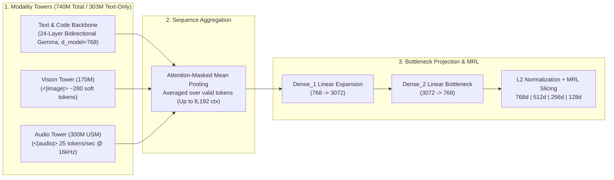

# Module 02 (Beginner): Deep Dive into `google/embeddinggemma-2` Architecture, Selective Loading & Asymmetric Prompts

> **Course Navigation**: [← Module 01: RAG Foundations](./01_beginner_foundations.md) | [Course Index (`COURSE.md`)](../COURSE.md) | [Next: Module 03 — Corpus Chunking →](./03_sarvam_corpus_chunking.md)  
> **Level:** Beginner to Intermediate  
> **Estimated Time:** 40 minutes  
> **Model Card:** [`https://huggingface.co/google/embeddinggemma-2`](https://huggingface.co/google/embeddinggemma-2)  
> **Code Reference:** [`src/embedder.py`](../src/embedder.py)

---

## 📖 1. Explanation: Inside `google/embeddinggemma-2`

### 1.1 Architectural Anatomy: A Modular 3-Tower + Bottleneck Projection Network

**`google/embeddinggemma-2`** is Google's 2026 state-of-the-art open multimodal & multilingual bi-encoder embedding model built on the Gemma backbone (`Gemma3n` / `Gemma4` architecture family) and trained across **100+ languages** (including Indian languages such as Tamil `ta-IN`, Hindi `hi-IN`, Telugu `te-IN`, Kannada `kn-IN`, and Malayalam `ml-IN`).

#### 💡 The Simple Analogy: A Universal Translator with Detachable Lenses
Think of `google/embeddinggemma-2` as a camera body (**the 303M Text Backbone + Projection Head**) that comes with two optional snap-on lenses:
- **Snap-On Lens 1:** A **170M Vision Encoder (`<|image|>`, `<|video|>`)** for reading diagrams and images.
- **Snap-On Lens 2:** A **300M USM Audio Encoder (`<|audio|>`)** for listening to 16kHz speech and sound effects.

When you are indexing pure text and code (`sarvam-docs` Markdown files), you can detach the Vision and Audio lenses (`modality_mode="text_only"`), cutting active memory and parameter count by more than **50%** while producing the **exact same 768-dimensional vectors**! When you need to index `.wav` audio or `.png` diagrams (Module 06), you attach all lenses (`modality_mode="multimodal"`, `740M` total parameters).



---

### 1.2 Mathematical Formulation of Mean Pooling & Linear Projection

Let an input sequence of $T$ tokens pass through the 24 bidirectional Transformer layers of `google/embeddinggemma-2`, producing contextualized hidden states $\mathbf{H} = [\mathbf{h}_1, \mathbf{h}_2, \dots, \mathbf{h}_T]^\top \in \mathbb{R}^{T \times 768}$ and binary attention mask $m_t \in \lbrace 0, 1 \rbrace$.

1. **Attention-Masked Mean Pooling ($\boldsymbol{\mu} \in \mathbb{R}^{768}$):**
   Padding tokens ($m_t = 0$) are excluded so batching never alters a sequence's representation:

$$
\boldsymbol{\mu} = \frac{\sum_{t=1}^{T} m_t \, \mathbf{h}_t}{\max\left(\sum_{t=1}^{T} m_t, \; 1\right)} \in \mathbb{R}^{768}
$$

2. **Two-Layer Linear Bottleneck Projection ($\mathbf{z} \in \mathbb{R}^{768}$):**
   The pooled vector $\boldsymbol{\mu}$ is projected through two bias-free linear transformations $\mathbf{W}_1 \in \mathbb{R}^{3072 \times 768}$ and $\mathbf{W}_2 \in \mathbb{R}^{768 \times 3072}$:

$$
\mathbf{z} = \mathbf{W}_2 \left(\mathbf{W}_1 \boldsymbol{\mu}\right) \in \mathbb{R}^{768}
$$

3. **Unit Hypersphere $L_2$ Normalization ($\hat{\mathbf{z}} \in \mathbb{S}^{767}$):**

$$
\hat{\mathbf{z}} = \frac{\mathbf{z}}{\lVert \mathbf{z} \rVert_2}
$$

---

### 1.3 Asymmetric Task Instruction Prefixes (Why Queries $\neq$ Documents)

A user question (*"How do I clone a voice?"*, 6 words) and an API documentation passage (*300 words of Markdown + JSON schema*) have completely different surface distributions. If we encoded both symmetrically without instructions, the model would try to match questions to other questions rather than questions to answers.

`google/embeddinggemma-2` uses **Asymmetric Task Prefixes** to project short queries and long documents into aligned regions of $\mathbb{S}^{767}$:

| Input Role | `prompt_name` in `src/embedder.py` | Exact String Prefix Prepended Before Tokenization | When to Use on `sarvam-docs` |
| :--- | :--- | :--- | :--- |
| **Document / Chunk** | `Retrieval-document` | `title: {DocTitle — Section} \| text: {ChunkBody}` | Indexing all 307 `sarvam-docs` chunks |
| **Developer Question** | `QuestionAnswering` | `task: question answering \| query: {Question}` | Natural-language Q&A (`ask`, `search`) |
| **Keyword / Topic Search** | `SearchQuery` | `task: search result \| query: {Query}` | Broad topic exploration & BigQuery search |
| **Code / Endpoint Lookup** | `CodeRetrieval` | `task: code retrieval \| query: {CodeQuery}` | Searching for `cURL`, Python SDK, or `/voices/clone` |
| **Claim Verification** | `FactChecking` | `task: fact checking \| query: {Claim}` | Auditing whether an API supports a specific parameter |

---

### 1.4 Precision Safety Rule: `float32` vs. `bfloat16` (Never `float16`!)

> [!CAUTION]
> **Critical Numerical Stability Rule:** Never run `google/embeddinggemma-2` in IEEE-754 `float16` (`fp16`)!
> - `float16` has only **5 exponent bits** (max representable value $= 65,504$). Intermediate activations inside the 24 Gemma layers and the $768 \rightarrow 3072$ projection overflow `65,504`, producing `NaN` vectors or degraded cosine scores.
> - **`bfloat16`** (8 exponent bits, same dynamic range as `float32`: $\sim 3.4 \times 10^{38}$) and **`float32`** never overflow.
> - In [`src/embedder.py`](../src/embedder.py), our engine automatically uses `float32` on CPU and `bfloat16` on CUDA/TPU.

---

## 🛠️ 2. Practicals: Inspect Selective Loading & Compare Task Prefixes (CLI & Web UI)

### 2.1 Option A: Command-Line Interface (CLI) Practicals

```bash
cd /data/opencode/sarvam-rag-course
source .venv/bin/activate

# 1. Verify Selective Text-Only Loading (303M params) and inspect query vs document prefixes
python -c "
import numpy as np
from src.embedder import EmbeddingGemma2Engine

engine = EmbeddingGemma2Engine(modality_mode='text_only')
q_qa = engine.encode_query('How do I clone a voice in Sarvam AI?', prompt_name='QuestionAnswering')
q_code = engine.encode_query('How do I clone a voice in Sarvam AI?', prompt_name='CodeRetrieval')
doc = engine.encode_documents(['title: Instant Voice Cloning | text: POST https://api.sarvam.ai/voices/clone'])

print('Query (QuestionAnswering) -> Doc Cosine:', float(q_qa @ doc[0]))
print('Query (CodeRetrieval)     -> Doc Cosine:', float(q_code @ doc[0]))
"

# 2. Compare retrieval using QuestionAnswering vs CodeRetrieval prefixes via CLI
python -m cli.rag_cli search "POST /text-to-speech bulbul:v3 python example" --prompt-name CodeRetrieval --mode dense
python -m cli.rag_cli search "How does text to speech work in Sarvam?" --prompt-name QuestionAnswering --mode dense
```

### 2.2 Option B: Interactive Web Studio UI Practicals (`http://localhost:8090`)

1. Open **`http://localhost:8090`** in your browser (`Tab 1: Grounded RAG Studio`).
2. Locate the **Task Prefix (`EmbeddingGemma 2`)** dropdown.
3. Run the same query with `QuestionAnswering` vs. `CodeRetrieval` in `Dense Only` mode and observe how `CodeRetrieval` boosts chunks containing `cURL` and Python SDK blocks (`has_code = true`).

---

## 🧠 3. Key Learnings & MIT Systems Takeaways

1. **Selective Sub-Network Loading Saves 55% RAM for Text Indexing:** Extracting the `Gemma3TextModel` + `Dense_1` + `Dense_2` sub-graph (`303M` parameters) produces bit-for-bit identical text embeddings to the full `740M` model while cutting memory footprint in half.
2. **Asymmetric Prompting Bridges the Modality/Length Gap:** Prefixing documents with `title: {title} | text: {body}` and queries with `task: question answering | query: {q}` aligns short interrogative queries with long declarative passages.
3. **Dynamic Range Matters More Than Mantissa Precision:** Always choose `float32` or `bfloat16` (8-bit exponent) over `float16` (5-bit exponent) for Gemma-family models.

---

## 🧹 4. Resource Teardown & Cost Cleanup (`destroy`)

To clean up any running Web UI server or cloud resources after completing this module:

```bash
python -m cli.rag_cli destroy
```

---

## Next Module
Proceed to **[Module 03: Corpus Engineering & Structure-Aware Markdown/Code Chunking on `sarvam-docs`](./03_sarvam_corpus_chunking.md)**.
