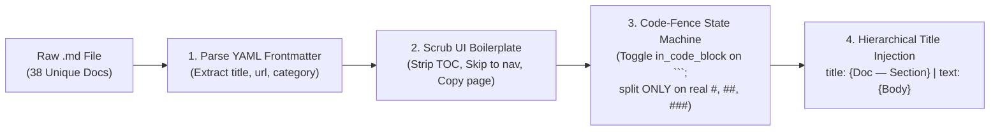

# Module 03 (Beginner): Corpus Engineering & Structure-Aware Markdown/Code Chunking on `sarvam-docs`

> **Course Navigation**: [← Module 02: EmbeddingGemma 2 Architecture](./02_embeddinggemma2_architecture.md) | [Course Index (`COURSE.md`)](../COURSE.md) | [Next: Module 04 — Matryoshka (MRL) Retrieval →](./04_matryoshka_mrl_retrieval.md)  
> **Level:** Beginner  
> **Estimated Time:** 40 minutes  
> **Dataset Source:** [`https://github.com/ajithvnr2001/sarvam-docs`](https://github.com/ajithvnr2001/sarvam-docs)  
> **Code Reference:** [`src/chunker.py`](../src/chunker.py)

---

## 📖 1. Explanation: Why Naive Text Splitting Fails on Developer Documentation

### 1.1 The Anatomy of the `sarvam-docs` Corpus

The [`ajithvnr2001/sarvam-docs`](https://github.com/ajithvnr2001/sarvam-docs) repository contains the official developer documentation and production build guides for **Sarvam AI**:
1. **Core Speech & Language APIs (`docs/api-reference-docs/`)**:
   - Authentication (`api-subscription-key` HTTP header)
   - Text-to-Speech (`bulbul:v3`, `bulbul:v4-flash`, speaker roster, sample rates `8000Hz–24000Hz`)
   - Speech-to-Text & Translation (`saaras:v3` with `transcribe`, `translate`, `verbatim`, `translit`, `codemix` modes)
   - Text Translation (`mayura:v1`), Transliteration, Language Identification, and Document Intelligence (`Sarvam Vision`).
2. **Conversational & Generative Models**:
   - `sarvam-30b` and `sarvam-105b` Chat Completions, Reasoning effort, and Wikipedia Search grounding.
3. **Production Guides & Real Audio Assets (`README_TTS.md`, `TAMIL_API_GUIDE.md`, `HOW_IT_WAS_DONE.md`, `sfx/*.wav`, `cinematic_chunks/*.mp3`)**:
   - Verified Tamil TTS speaker configurations, `ffmpeg` audio mixing pipelines, and real 16kHz sound effects.

---

### 1.2 First-Principles Intuition: Three Fatal Flaws of Naive Fixed-Window Chunking

#### 💡 The Simple Analogy: Tearing a Cookbook Every 50Lines
Suppose a beginner splits documentation using a naive sliding character window (e.g., `chunk_size = 500` characters, `overlap = 50` characters):
1. **Severed Code Blocks:** A `cURL` or Python SDK snippet gets sliced right through the middle of the JSON payload—separating the endpoint URL (`POST https://api.sarvam.ai/text-to-speech`) from its required parameters (`"model": "bulbul:v3", "speaker": "shubh"`).
2. **False-Positive Heading Splits Inside Code:** In Python and Bash scripts, comments begin with `#` (e.g., `# Step 1: Send audio file`). A naive regex splitter that splits on `^#` treats every Python comment as a new Markdown `# Heading 1`!
3. **Orphaned Context (Missing Parent Title):** A subsection titled `### Parameters` is completely ambiguous unless the chunk explicitly carries its parent document title (`Text to Speech — Parameters`). Without the parent title, the embedding for `### Parameters` in Speech-to-Text looks identical to `### Parameters` in Text Translation!

---

### 1.3 Our 4-Stage Structure- & Code-Fence-Aware Chunker (`src/chunker.py`)



#### How the Finite-State Code-Fence Tracker Works (`split_markdown_sections`)
We can formalize our line-by-line parser as a two-state machine with state variable $s_i \in \lbrace \text{PROSE}, \text{CODE} \rbrace$ at line $i$:
- Whenever line $i$ begins with a triple-backtick fence (```` ``` ````), the state toggles:

$$
s_i = \neg s_{i-1}
$$
- A line matching `^#{1,3}\s+(.+)$` is recognized as a **structural section boundary** *if and only if* $s_i = \text{PROSE}$.
- If a single section exceeds `max_chars = 1800`, our secondary splitter (`chunk_section_preserving_code`) groups consecutive lines Inside `CODE` states as **atomic, indivisible blocks** so a code snippet is never cut in half.

#### Quantitative Proof on `sarvam-docs` (`data/index/index_stats.json`)
- **Total Unique Markdown Files Indexed:** `38`
- **Total Semantic Chunks Produced:** `307` (`sarvam_0000` through `sarvam_0306`)
- **Chunks Containing Intact Code Blocks (`has_code = true`):** `242 / 307` (**`78.8%`**)
- **Broken Code Fences:** **`0`** (100% of opening ```` ``` ```` fences have their matching closing ```` ``` ```` fence in the same chunk).

---

## 🛠️ 2. Practicals: Run the Chunker & Inspect Structured Chunks (CLI & Web UI)

### 2.1 Option A: Command-Line Interface (CLI) Practicals

```bash
cd /data/opencode/sarvam-rag-course
source .venv/bin/activate

# 1. Run the full ingestion & MRL indexing pipeline on sarvam-docs
python -m cli.rag_cli ingest

# 2. Inspect Chunk sarvam_0017 (Authentication) in data/index/chunks.jsonl
python -c "
import json
chunks = [json.loads(line) for line in open('data/index/chunks.jsonl')]
c = chunks[17]
print('Chunk ID:', c['chunk_id'])
print('Category:', c['category'])
print('Title:   ', c['title'])
print('Has Code:', c['has_code'])
print('Formatted for EmbeddingGemma 2:\n', c['formatted_for_embedding'][:450])
"

# 3. Verify that 0 chunks have unbalanced triple-backtick code fences
python -c "
import json
chunks = [json.loads(line) for line in open('data/index/chunks.jsonl')]
unbalanced = [c['chunk_id'] for c in chunks if c['content'].count('```') % 2 != 0]
print(f'Total chunks: {len(chunks)} | Chunks with code: {sum(c[\"has_code\"] for c in chunks)} | Unbalanced code fences: {len(unbalanced)}')
"
```

### 2.2 Option B: Interactive Web Studio UI Practicals (`http://localhost:8090`)

1. Start the Web Studio (`uvicorn ui.app:app --host 0.0.0.0 --port 8090`) and open **`http://localhost:8090`**.
2. In the top header bar, observe the live corpus badge: **`307 Chunks Indexed | 38 Docs`**.
3. On **Tab 1 (`Grounded RAG Studio`)**, run any search and inspect the **Retrieved Sarvam Docs Chunks** cards on the right—each card displays the preserved hierarchical `title`, `category` pill, `chunk_id`, and complete, unbroken code blocks.

---

## 🧠 3. Key Learnings & MIT Systems Takeaways

1. **Syntax-Aware Chunking Beats Fixed Token Windows:** Tracking the ```` ``` ```` code-fence state prevents `#` comments inside Python/Bash code from triggering false section splits and keeps every code block executable.
2. **Contextual Header Prefixing Eliminates Orphan Chunks:** Prepending `title: {Document Title} — {Section Heading} | text: ...` ensures that every chunk's embedding vector encodes both *what API* it belongs to and *what specific details* it contains.
3. **Content-Hash Deduplication Prevents Top-$K$ Redundancy:** Crawled developer docs often mirror identical pages under multiple URLs. Hashing normalized content during ingestion (`seen_hashes`) ensures all $K$ slots in top-$K$ retrieval return distinct evidence.

---

## 🧹 4. Resource Teardown & Cost Cleanup (`destroy`)

To stop any running Web UI server or tear down cloud resources:

```bash
# Keep local chunks.jsonl and .npy index, but destroy cloud resources & stop UI server
python -m cli.rag_cli destroy

# Optional: Also purge local .npy vector files if you want a 100% clean slate
python -m cli.rag_cli destroy --purge-local-index
```

---

## Next Module
Proceed to **[Module 04: Matryoshka Representation Learning (MRL) & Two-Stage Funnel Retrieval](./04_matryoshka_mrl_retrieval.md)**.
