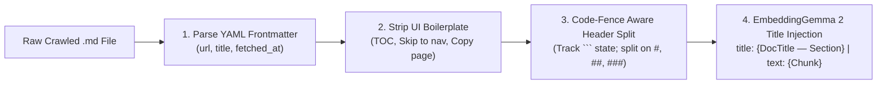

# Module 03 (Beginner): Corpus Engineering & Markdown/Code-Aware Chunking on `sarvam-docs`

**Level:** Beginner  
**Estimated Time:** 40 minutes  
**Dataset Source:** [`https://github.com/ajithvnr2001/sarvam-docs`](https://github.com/ajithvnr2001/sarvam-docs)  
**Code Reference:** [`src/chunker.py`](../src/chunker.py)

---

## 1. Understanding the `sarvam-docs` Knowledge Base

The [`ajithvnr2001/sarvam-docs`](https://github.com/ajithvnr2001/sarvam-docs) repository contains a complete crawl of `https://docs.sarvam.ai/` (1,090 Markdown pages + metadata + real Tamil TTS audio assets and procedural sound effects):

1. **API Reference (`docs/api-reference/`)**: Authentication (`api-subscription-key`), Text-to-Speech (`bulbul:v4-flash`, `bulbul:v3`), Speech-to-Text (`saaras:v3`, `saarika`), Text Translation (`mayura:v1`), Document Translation, Instant Voice Cloning (`/voices/create`, `/voices/clone`), Transliteration, and Language Identification (`/text-lid`).
2. **Product & Developer Guides (`docs/api/`, `docs/voice-agents/`, `docs/docai/`, `docs/creative/`)**: Best practices, voice rosters, punctuation rules, sample rate charts, and SDK workflows.
3. **Production Build Guides & Audio Assets (`README_TTS.md`, `TAMIL_API_GUIDE.md`, `HOW_IT_WAS_DONE.md`, `cinematic_chunks/*.mp3`, `sfx/*.wav`)**: Live verified findings (e.g., `bulbul:v4-flash` Tamil speaker IDs `vijay_ta_narration` and `aravind_ta_suspense`, 44.1 kHz support, and `ffmpeg` audio mixing recipes).

---

## 2. Why Naive Fixed-Size Character Splitting Fails on Developer Docs

If you split developer documentation every 500 characters blindly:
- **Broken Code Blocks:** A `curl` request or Python SDK snippet gets cut in half, separating the endpoint URL (`POST https://api.sarvam.ai/text-to-speech`) from its JSON payload (`{"model": "bulbul:v4-flash", "target_language_code": "ta-IN"}`).
- **Navigation Noise Pollution:** Crawled pages often start with website chrome (`Skip to navigation`, `On this page`, `Scroll to top`, `Ask a question|Copy page`), which dilutes the mean-pooled embedding vector.
- **Lost Hierarchical Context:** A sub-section titled `### Request Body` is meaningless unless its parent document title (`Text to Speech — Convert`) is attached.

---

## 3. Our 4-Stage Structure-Aware Chunker (`src/chunker.py`)



### Key Implementation Highlights (`src/chunker.py`)

1. **YAML Frontmatter Extraction (`parse_frontmatter`)**: Extracts canonical `url` and `title` from the top `---` block.
2. **Boilerplate Scrubbing (`clean_markdown_body`)**: Strips `On this page ... Scroll to top` TOC blocks and navigation links while keeping Markdown tables and indented code blocks intact.
3. **Code-Block Safe Section Splitting (`split_markdown_sections`)**: Tracks an `in_code_block` boolean whenever ` ``` ` is encountered so `# comment` lines inside Python/Bash scripts are **never** mistaken for Markdown `# H1` headings!
4. **Title-Prefixed Formatting**: Formats every chunk using `EmbeddingGemma 2`'s native asymmetric document template:
   ```python
   full_title = f"{title} — {sec_heading}"
   formatted = f"title: {full_title} | text: {sec_text}"
   ```

---

## 4. Hands-On Lab: Run the Chunker & Inspect Output

```bash
/data/opencode/sarvam-rag-course/.venv/bin/python -m cli.rag_cli ingest --max-files 65 --max-chunks 120
head -n 2 /data/opencode/sarvam-rag-course/data/index/chunks.jsonl | jq .
```

---

## Next Module
Proceed to **[Module 04: Matryoshka Representation Learning (MRL) & Two-Stage Funnel Retrieval](./04_matryoshka_mrl_retrieval.md)**.
