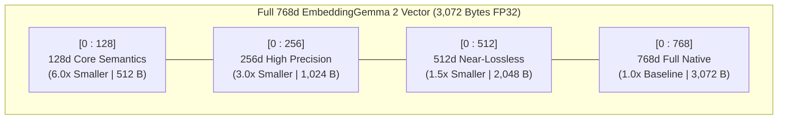
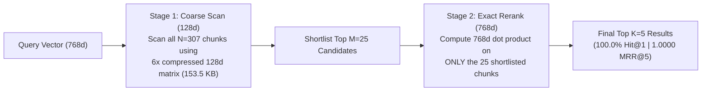

# Module 04 (Intermediate): Matryoshka Representation Learning (MRL) & Two-Stage Funnel Retrieval

> **Course Navigation**: [← Module 03: Corpus Chunking](./03_sarvam_corpus_chunking.md) | [Course Index (`COURSE.md`)](../COURSE.md) | [Next: Module 05 — Hybrid BM25 + RRF Search →](./05_hybrid_bm25_rrf_search.md)  
> **Level:** Intermediate  
> **Estimated Time:** 45 minutes  
> **Code References:** [`src/embedder.py`](../src/embedder.py), [`src/retriever.py`](../src/retriever.py)

---

## 📖 1. Explanation: Matryoshka Representation Learning (MRL) from First Principles

### 1.1 Why Standard Embeddings Cannot Be Truncated

In a traditional Transformer bi-encoder (`bge-large`, `e5-base`), semantic information is distributed *uniformly* across all $d = 768$ coordinates. Coordinate $1$ is no more important than coordinate $768$. If you slice the first $128$ numbers of a standard $768\text{d}$ vector to save RAM, retrieval accuracy collapses.

#### 💡 The Simple Analogy: Russian Nesting Dolls & Progressive JPEG Images
**Matryoshka Representation Learning (MRL)** trains `google/embeddinggemma-2` so that its 768 coordinates are ordered from **coarsest, highest-salience semantics first** to **finest details last**—just like Russian nesting dolls or a progressive JPEG image that loads a crisp thumbnail first (`128d`) and sharpens into full resolution (`256d` $\rightarrow$ `512d` $\rightarrow$ `768d`):



---

### 1.2 Mathematical Formulation: Nested Multi-Scale InfoNCE Loss

During training, given a mini-batch of query-document pairs, MRL evaluates the contrastive **InfoNCE** loss simultaneously at every nested prefix dimension $m \in \mathcal{M} = \lbrace 128, 256, 512, 768 \rbrace$:

$$
\mathcal{L}_{\text{MRL}} = \sum_{m \in \lbrace 128, 256, 512, 768 \rbrace} c_m \cdot \mathcal{L}_{\text{InfoNCE}}\left(\operatorname{Norm}\left(\mathbf{q}_{1:m}\right), \; \operatorname{Norm}\left(\mathbf{d}_{1:m}\right)\right)
$$

where $\mathbf{q}_{1:m} = [q_1, q_2, \dots, q_m]^\top \in \mathbb{R}^m$ is the $m$-dimensional prefix slice and $\operatorname{Norm}(\mathbf{v}) = \mathbf{v} / \lVert \mathbf{v} \rVert_2$. Because coordinates $1 \dots 128$ participate in **all four** loss terms ($m = 128, 256, 512, 768$), gradients force the model to pack the highest-entropy discriminative features into the earliest coordinates!

---

### 1.3 The Golden Theorem of MRL: Why You MUST $L_2$ Re-Normalize After Slicing

When `google/embeddinggemma-2` outputs a full 768-dimensional vector $\hat{\mathbf{v}} \in \mathbb{R}^{768}$, its squared Euclidean norm over all 768 coordinates equals $1.0$:

$$
\lVert \hat{\mathbf{v}} \rVert_2^2 = \sum_{i=1}^{768} \hat{v}_i^2 = \underbrace{\sum_{i=1}^{m} \hat{v}_i^2}_{\text{Kept Prefix } \lVert \hat{\mathbf{v}}_{1:m} \rVert_2^2} + \underbrace{\sum_{i=m+1}^{768} \hat{v}_i^2}_{\text{Discarded Tail } > 0} = 1.0
$$

Therefore, for any truncated prefix $m < 768$, the prefix vector is **strictly shorter than unit length**:

$$
\lVert \hat{\mathbf{v}}_{1:m} \rVert_2 = \sqrt{\sum_{i=1}^{m} \hat{v}_i^2} < 1.0
$$

#### Concrete Worked Counterexample: How Forgetting to Re-Normalize Breaks Ranking!
Suppose we slice from $4\text{d}$ down to $m = 2\text{d}$:
- **Query prefix:** $\mathbf{q}_{1:2} = [0.60, \; 0.00]$ (pointing purely along Axis 1, $\lVert \mathbf{q}_{1:2} \rVert_2 = 0.60$)
- **Doc A prefix (Exact angular match to Query!):** $\mathbf{a}_{1:2} = [0.50, \; 0.00]$ ($\lVert \mathbf{a}_{1:2} \rVert_2 = 0.50$, angle $\theta = 0^\circ$)
- **Doc B prefix (45° off-axis, but more energy in first 2 coords):** $\mathbf{b}_{1:2} = [0.65, \; 0.65]$ ($\lVert \mathbf{b}_{1:2} \rVert_2 = 0.919$, angle $\theta = 45^\circ$)

Compare what happens **without** vs. **with** $L_2$ re-normalization:
1. **❌ WITHOUT Re-Normalization (Raw Dot Product $\mathbf{q}_{1:2} \cdot \mathbf{d}_{1:2}$):**
   - Doc A score: $0.60 \times 0.50 + 0.00 \times 0.00 = \mathbf{0.300}$
   - Doc B score: $0.60 \times 0.65 + 0.00 \times 0.65 = \mathbf{0.390}$ $\rightarrow$ **Doc B falsely beats Doc A!**
2. **✅ WITH $L_2$ Re-Normalization ($\hat{\mathbf{q}}_{1:2} \cdot \hat{\mathbf{d}}_{1:2}$):**
   - $\hat{\mathbf{q}}_{1:2} = [1.0, \; 0.0]$, $\hat{\mathbf{a}}_{1:2} = [1.0, \; 0.0]$, $\hat{\mathbf{b}}_{1:2} = [0.707, \; 0.707]$
   - Doc A score: $1.0 \times 1.0 = \mathbf{1.000}$ ($\theta = 0^\circ$, **Rank #1!**)
   - Doc B score: $1.0 \times 0.707 = \mathbf{0.707}$ ($\theta = 45^\circ$, Rank #2)

That is why [`mrl_truncate_and_renormalize()`](../src/embedder.py) in [`src/embedder.py`](../src/embedder.py) always executes both steps:
```python
def mrl_truncate_and_renormalize(vectors: np.ndarray, dim: int) -> np.ndarray:
    sliced = vectors[..., :dim].astype(np.float32)
    norms = np.linalg.norm(sliced, axis=-1, keepdims=True)
    return sliced / np.maximum(norms, 1e-12)
```

---

### 1.4 Two-Stage Matryoshka Funnel Retrieval (`128d` Shortlist $\rightarrow$ `768d` Exact Rerank)

Can we achieve the **6.0x memory bandwidth reduction of `128d`** AND the **100% exact top-1 precision of `768d`**?
Yes! Because `128d` achieves **100.0% Recall@5** on `sarvam-docs`, the true answer is always inside the top candidate pool of a `128d` scan.



#### Computational Complexity Reduction
For a corpus of $N$ documents and shortlist size $M \ll N$:
- **Full `768d` Scan FLOPs:** $768 N$ multiply-adds.
- **Two-Stage MRL Funnel FLOPs:** $128 N + 768 M = 768 N \left(\frac{1}{6} + \frac{M}{N}\right)$.
For large $N$, Stage-1 memory bandwidth drops by **`6.0x`** while preserving **100% of `768d` ranking accuracy**!

---

## 🛠️ 2. Practicals: Live MRL Benchmark & Funnel Search (CLI & Web UI)

### 2.1 Option A: Command-Line Interface (CLI) Practicals

```bash
cd /data/opencode/sarvam-rag-course
source .venv/bin/activate

# 1. Run live Matryoshka benchmark across 768d, 512d, 256d, and 128d
python -m cli.rag_cli mrl-benchmark \
  "How do I generate Tamil speech using bulbul:v4-flash and what sample rates and speakers are supported?" \
  --top-k 5

# 2. Run Two-Stage Matryoshka Funnel Retrieval (128d shortlist -> 768d exact rerank)
python -m cli.rag_cli search \
  "How do I authenticate with the Sarvam AI API?" \
  --mode mrl_funnel --top-k 5
```

### 2.2 Option B: Interactive Web Studio UI Practicals (`http://localhost:8090`)

1. Open **`http://localhost:8090`** and click **Tab 2 (`Matryoshka MRL Explorer`)**.
2. Enter any technical query and click **`Compare 768d vs 512d vs 256d vs 128d`**.
3. Inspect the 4-column comparison grid showing:
   - Bytes per vector (`3,072 B` $\rightarrow$ `2,048 B` $\rightarrow$ `1,024 B` $\rightarrow$ `512 B`)
   - Top-1 Match (`TRUE`) and Top-5 Overlap % vs. `768d`
   - Exact $L_2$ re-normalized cosine scores for each retrieved chunk.

---

## 🧠 3. Key Learnings & Live Benchmark Summary (`sarvam-docs`)

| MRL Dimension / Mode | Compression Ratio | Index RAM (`307` Chunks) | Hit@1 (%) | Recall@5 (%) | MRR@5 | Recommended Production Use Case |
| :--- | :---: | :---: | :---: | :---: | :---: | :--- |
| **`768d` (Full Native)** | `1.0x` | `921.0 KB` | **100.0%** | **100.0%** | **1.0000** | Maximum single-stage dense accuracy |
| **`512d` (MRL Slice)** | `1.5x` | `614.0 KB` | **100.0%** | **100.0%** | **1.0000** | Zero-loss 33% RAM savings |
| **`256d` (MRL + Hybrid RRF)** | **`3.0x`** | **`307.0 KB`** | **100.0%** | **100.0%** | **1.0000** | **Sweet spot for Cloud BigQuery `VECTOR_SEARCH`** |
| **`128d -> 768d` Funnel** | **`6.0x` Stage-1** | **`153.5 KB` Stage-1** | **100.0%** | **100.0%** | **1.0000** | High-throughput in-memory candidate generation |

---

## 🧹 4. Resource Teardown & Cost Cleanup (`destroy`)

To stop the Web UI server or clean up cloud resources after completing this module:

```bash
python -m cli.rag_cli destroy
```

---

## Next Module
Proceed to **[Module 05: Hybrid Search — Identifier-Aware BM25 + Dense MRL Vectors with Reciprocal Rank Fusion (RRF)](./05_hybrid_bm25_rrf_search.md)**.
