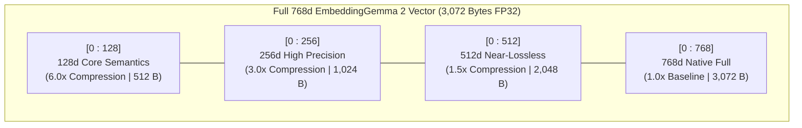
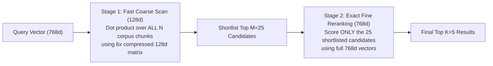

# Module 04 (Intermediate): Matryoshka Representation Learning (MRL) & Two-Stage Funnel Retrieval

**Level:** Intermediate  
**Estimated Time:** 45 minutes  
**Code Reference:** [`src/embedder.py`](../src/embedder.py), [`src/retriever.py`](../src/retriever.py)

---

## 1. What is Matryoshka Representation Learning (MRL)?

Standard embedding models distribute semantic information evenly across all output dimensions—slicing the first 128 dimensions of a standard 768d model destroys its representation quality.

**Matryoshka Representation Learning (MRL)**—named after Russian nesting dolls—trains `google/embeddinggemma-2` by simultaneously optimizing the contrastive retrieval loss across nested prefixes of the output vector:

$$\mathcal{L}_{\text{MRL}} = \sum_{m \in \{128, 256, 512, 768\}} c_m \cdot \mathcal{L}_{\text{InfoNCE}}\left(\text{Norm}(\mathbf{q}_{1:m}), \text{Norm}(\mathbf{d}_{1:m})\right)$$

As a result, the most coarse-grained, high-salience semantic features are packed into the leading **128** and **256** coordinates, while finer nuances are progressively added at **512** and **768** coordinates.



### Official MRL Benchmark vs. Storage Tradeoff Table

| MRL Dimension | Storage Compression | Bytes / Vector (`float32`) | RAM for 10M Vectors | MTEB Multilingual v2 | MTEB Code v1 | MIEB Vision Lite | MSEB Audio Retrieval |
| :---: | :---: | :---: | :---: | :---: | :---: | :---: | :---: |
| **768d (Full)** | **1.0x** | 3,072 B | 30.72 GB | **61.36** | **78.68** | **64.64** | **69.54** |
| **512d** | **1.5x** | 2,048 B | 20.48 GB | 61.17 | 77.24 | 64.32 | 69.18 |
| **256d** | **3.0x** | 1,024 B | 10.24 GB | 60.41 | 76.18 | 63.13 | 66.76 |
| **128d** | **6.0x** | 512 B | **5.12 GB** | 57.89 | 71.41 | 59.06 | 56.71 |

---

## 2. The Golden Rule of MRL: Always Re-Normalize After Slicing!

When `google/embeddinggemma-2` outputs a 768d vector $\mathbf{v}$, its L2 norm is $1.0$:
$$\sum_{i=1}^{768} v_i^2 = 1.0$$

When you slice the first $m < 768$ dimensions ($\mathbf{v}_{1:m}$), the remaining coordinates $[m+1 \dots 768]$ are discarded, so:
$$\|\mathbf{v}_{1:m}\|_2 = \sqrt{\sum_{i=1}^{m} v_i^2} < 1.0$$

> [!WARNING]
> **Silent Ranking Degradation:** If you compute dot products on truncated vectors **without** L2 re-normalizing them first, you are no longer computing cosine similarity! Passages that happen to concentrate more energy in coordinates $1\dots m$ will artificially outscore better-aligned passages.

### Correct Implementation (`src/embedder.py`)

```python
import numpy as np

def mrl_truncate_and_renormalize(vectors: np.ndarray, dim: int) -> np.ndarray:
    sliced = vectors[..., :dim].astype(np.float32)
    norms = np.linalg.norm(sliced, axis=-1, keepdims=True)
    return sliced / np.maximum(norms, 1e-12)
```

Or directly inside `SentenceTransformer.encode()`:
```python
q_emb_256 = model.encode(
    query,
    prompt_name="QuestionAnswering",
    truncate_dim=256,
    normalize_embeddings=True,
)
```

---

## 3. Two-Stage Matryoshka Funnel Retrieval (`mrl_funnel`)

Can we get the **6x memory bandwidth speedup of 128d** AND the **100% exact ranking accuracy of 768d**?
Yes! We implement **Two-Stage Matryoshka Funnel Retrieval** in [`src/retriever.py`](../src/retriever.py):



---

## 4. Hands-On CLI Lab: Benchmark All 4 MRL Dimensions Live

```bash
/data/opencode/sarvam-rag-course/.venv/bin/python -m cli.rag_cli mrl-benchmark \
  "How do I generate Tamil speech using bulbul:v4-flash and what sample rates are supported?" \
  --top-k 5
```

---

## Next Module
Proceed to **[Module 05: Hybrid Search — BM25 Lexical + Dense Vectors with Reciprocal Rank Fusion (RRF)](./05_hybrid_bm25_rrf_search.md)**.
