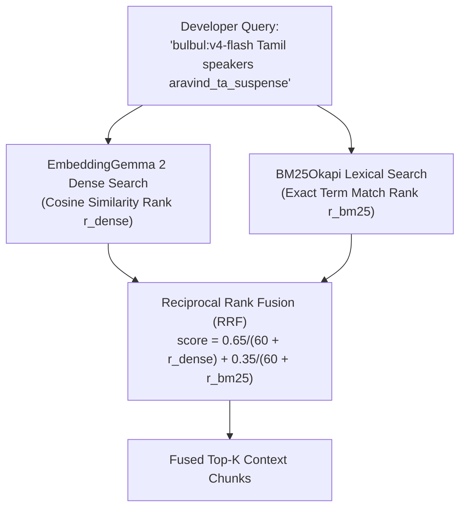

# Module 05 (Intermediate): Hybrid Search — BM25 Lexical + `EmbeddingGemma 2` Dense Vectors with Reciprocal Rank Fusion (RRF)

**Level:** Intermediate  
**Estimated Time:** 40 minutes  
**Code Reference:** [`src/retriever.py`](../src/retriever.py)

---

## 1. Why Dense Vectors Alone Are Not Enough for Technical API Docs

Dense embeddings (`google/embeddinggemma-2`) excel at semantic intent, synonyms, and cross-lingual matching (e.g., matching *"how to convert voice recording into English text"* to the `/speech-to-text-translate` documentation).

However, developer queries on `sarvam-docs` frequently contain **exact technical tokens**:
- Specific model strings: `bulbul:v4-flash`, `bulbul:v3`, `saaras:v3`, `mayura:v1`
- Exact header names: `api-subscription-key`
- Exact speaker IDs: `aravind_ta_suspense`, `vijay_ta_narration`, `ishita`
- HTTP status codes: `403 Forbidden` vs `401 Unauthorized`
- BCP-47 language codes: `ta-IN`, `hi-IN`, `kn-IN`, `ml-IN`

Combining **Dense Vector Search** (`EmbeddingGemma 2`) with **BM25Okapi Lexical Search** gives us the best of both worlds: semantic understanding + exact identifier precision.

---

## 2. Identifier-Preserving Tokenization for BM25

Standard NLP tokenizers strip colons, hyphens, and slashes—turning `bulbul:v4-flash` into disconnected tokens or dropping `v4`. In [`src/retriever.py`](../src/retriever.py), our custom tokenizer preserves technical API identifiers intact:

```python
import re
from typing import List

def tokenize_for_bm25(text: str) -> List[str]:
    """
    Preserve technical identifiers like `bulbul:v4-flash`, `api-subscription-key`, `ta-IN`, `/voices/clone`.
    """
    return re.findall(r"[a-zA-Z0-9_:\-/\.]{2,}", text.lower())
```

---

## 3. Reciprocal Rank Fusion (RRF)

Why can't we just add raw cosine similarity ($s_{\text{dense}} \in [-1, 1]$) and raw BM25 score ($s_{\text{bm25}} \in [0, \infty)$)? Because their numerical scales and distributions differ drastically across queries!

**Reciprocal Rank Fusion (RRF)** solves this cleanly without fragile score calibration by combining the **rank positions** ($r_{\text{dense}}(d) \in \{1, 2, \dots, N\}$ and $r_{\text{bm25}}(d) \in \{1, 2, \dots, N\}$) of each document $d$:

$$\text{RRF}(d) = \frac{w_{\text{dense}}}{k + r_{\text{dense}}(d)} + \frac{w_{\text{bm25}}}{k + r_{\text{bm25}}(d)}$$

where $k = 60$ is the smoothing constant and $(w_{\text{dense}}, w_{\text{bm25}}) = (0.65, 0.35)$.



---

## 4. Hands-On Lab: Compare `dense`, `bm25`, `hybrid`, and `mrl_funnel` via CLI

```bash
# 1. Dense-only search
/data/opencode/sarvam-rag-course/.venv/bin/python -m cli.rag_cli search \
  "Which Tamil speaker IDs work on bulbul:v4-flash?" --mode dense --dim 768

# 2. BM25 lexical search
/data/opencode/sarvam-rag-course/.venv/bin/python -m cli.rag_cli search \
  "Which Tamil speaker IDs work on bulbul:v4-flash?" --mode bm25

# 3. Hybrid RRF search (Dense + BM25)
/data/opencode/sarvam-rag-course/.venv/bin/python -m cli.rag_cli search \
  "Which Tamil speaker IDs work on bulbul:v4-flash?" --mode hybrid --dim 768

# 4. Two-Stage Matryoshka Funnel (128d shortlist -> 768d rerank)
/data/opencode/sarvam-rag-course/.venv/bin/python -m cli.rag_cli search \
  "Which Tamil speaker IDs work on bulbul:v4-flash?" --mode mrl_funnel
```

---

## Next Module
Proceed to **[Module 06: Multimodal & Interleaved RAG (Text + Code + Audio + Images in One 768d Space)](./06_multimodal_audio_image_rag.md)**.
