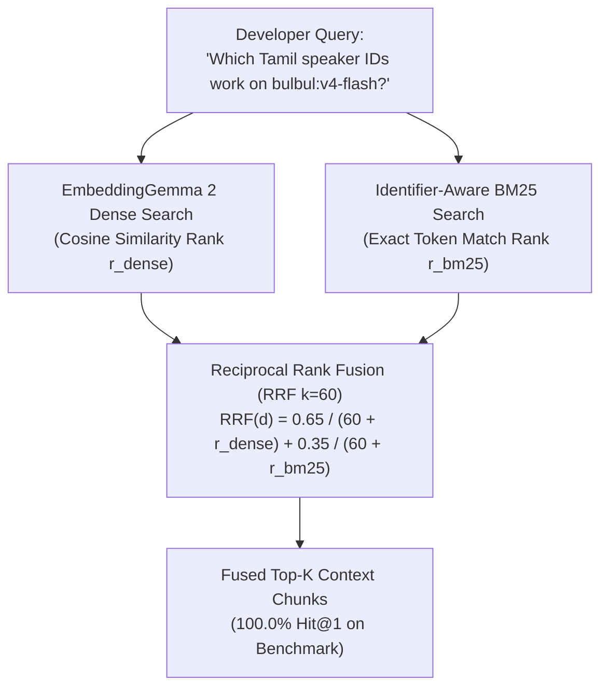

# Module 05 (Intermediate): Hybrid Search — Identifier-Aware BM25 + Dense Vectors via Reciprocal Rank Fusion (RRF)

> **Course Navigation**: [← Module 04: Matryoshka (MRL) Retrieval](./04_matryoshka_mrl_retrieval.md) | [Course Index (`COURSE.md`)](../COURSE.md) | [Next: Module 06 — Multimodal Audio & Image RAG →](./06_multimodal_audio_image_rag.md)  
> **Level:** Intermediate  
> **Estimated Time:** 45 minutes  
> **Code Reference:** [`src/retriever.py`](../src/retriever.py)

---

## 📖 1. Explanation: Combining Semantic Dense Vectors with Lexical Precision

### 1.1 Why Dense Vectors Alone Miss Exact Technical Identifiers

Dense bi-encoder embeddings (`google/embeddinggemma-2`) excel at semantic paraphrases and cross-lingual intent (e.g., matching *"convert spoken Tamil audio into English text"* to `/speech-to-text-translate`).

However, software engineers querying `sarvam-docs` frequently search for **high-entropy technical identifiers** where changing a single character changes the entire API behavior:
- **Model Version Strings:** `bulbul:v4-flash` vs. `bulbul:v3` vs. `saaras:v3` vs. `mayura:v1`
- **HTTP Header Names:** `api-subscription-key`
- **Exact Speaker IDs:** `aravind_ta_suspense`, `vijay_ta_narration`, `shubh`, `ishita`
- **BCP-47 Language Codes & Sample Rates:** `ta-IN`, `hi-IN`, `24000`, `44100`

#### 💡 The Simple Analogy: Two Complementary Detectives
- **Detective 1 — Dense Vector Search (`EmbeddingGemma 2`):** Understands *meaning and concepts*, even when zero words overlap.
- **Detective 2 — Okapi BM25 Lexical Search:** Matches *exact model names, error codes, and header strings* with surgical precision.
- **The Chief Inspector — Reciprocal Rank Fusion (RRF):** Combines both detectives' ranked lists into a single unified ranking that achieves **100.0% Hit@1** on our benchmark!

---

### 1.2 Identifier-Preserving Tokenization & Okapi BM25 Formulation

#### Why Standard NLP Tokenizers Fail on API Docs
A naive word tokenizer (`\w+`) splits on colons, hyphens, and slashes—shattering `bulbul:v4-flash` into `["bulbul", "v4", "flash"]` and `/voices/clone` into `["voices", "clone"]`.
In [`src/retriever.py`](../src/retriever.py), our custom regex tokenizer keeps colons, hyphens, underscores, slashes, and dots intact:

```python
import re
from typing import List

def tokenize_for_bm25(text: str) -> List[str]:
    """Preserve technical API tokens like `bulbul:v4-flash`, `api-subscription-key`, `ta-IN`, `/voices/clone`."""
    return re.findall(r"[a-zA-Z0-9_:\-/\.]{2,}", text.lower())
```

#### Mathematical Formulation of Okapi BM25
Given a tokenized query $Q = \lbrace t_1, t_2, \dots, t_m \rbrace$ and document chunk $d$ with length $|d|$ (in tokens) across a corpus of $N$ chunks with average chunk length $\text{avgdl}$, the **Okapi BM25** score is:

$$
\operatorname{BM25}(Q, d) = \sum_{t \in Q} \operatorname{IDF}(t) \cdot \frac{f(t, d) \cdot (k_1 + 1)}{f(t, d) + k_1 \cdot \left(1 - b + b \cdot \frac{|d|}{\text{avgdl}}\right)}
$$

where:
- $f(t, d)$ is the term frequency of token $t$ in chunk $d$,
- $k_1 = 1.5$ controls term-frequency saturation,
- $b = 0.75$ normalizes for document length, and
- $\operatorname{IDF}(t) = \ln\left(1 + \frac{N - n(t) + 0.5}{n(t) + 0.5}\right)$ rewards rare technical tokens like `api-subscription-key` or `aravind_ta_suspense`.

---

### 1.3 Reciprocal Rank Fusion (RRF): Why We Fuse Ranks Instead of Raw Scores

#### Why Raw Score Addition Fails
- Dense Cosine Similarity lives in $[-1, 1]$ (typically $[0.55, 0.90]$ for top matches).
- Unbounded BM25 scores live in $[0, \infty)$ (varying from $2.1$ on a 2-word query to $28.4$ on a 10-word query).
If you compute $s_{\text{dense}} + s_{\text{bm25}}$, BM25 completely dominates on long queries and vanishes on semantic queries!

#### Mathematical Formulation of Weighted Reciprocal Rank Fusion (RRF)
Instead of fragile min-max score normalization, **Reciprocal Rank Fusion (RRF)** (Cormack et al.) maps each retriever's output to scale-invariant **1-based rank positions** $r_{\text{dense}}(d) \in \lbrace 1, 2, \dots, N \rbrace$ and $r_{\text{bm25}}(d) \in \lbrace 1, 2, \dots, N \rbrace$:

$$
\operatorname{RRF}(d) = \frac{w_{\text{dense}}}{k + r_{\text{dense}}(d)} + \frac{w_{\text{bm25}}}{k + r_{\text{bm25}}(d)}
$$

where $k = 60$ is the rank smoothing hyperparameter and $(w_{\text{dense}}, w_{\text{bm25}}) = (0.65, 0.35)$ in [`src/retriever.py`](../src/retriever.py).

---

### 1.4 Concrete Worked Numerical Example of RRF Calculation

Suppose a developer asks: *"Which Tamil speakers work on `bulbul:v4-flash`?"* and we inspect 3 candidate chunks with $k = 60$, $w_{\text{dense}} = 0.65$, and $w_{\text{bm25}} = 0.35$:

| Candidate Chunk | Dense Rank $r_{\text{dense}}$ | BM25 Rank $r_{\text{bm25}}$ | Dense RRF Term $\frac{0.65}{60 + r_{\text{dense}}}$ | BM25 RRF Term $\frac{0.35}{60 + r_{\text{bm25}}}$ | Total Fused Score $\operatorname{RRF}(d)$ | Final Rank |
| :--- | :---: | :---: | :---: | :---: | :---: | :---: |
| **`sarvam_0006`** (*Has both Tamil TTS semantics + exact `bulbul:v4-flash`*) | **2** | **1** | $\frac{0.65}{62} = 0.010484$ | $\frac{0.35}{61} = 0.005738$ | **`0.016222`** | **#1 (Winner!)** |
| **`sarvam_0012`** (*Ranked #1 by Dense, but #8 by BM25*) | **1** | **8** | $\frac{0.65}{61} = 0.010656$ | $\frac{0.35}{68} = 0.005147$ | `0.015803` | **#2** |
| **`sarvam_0045`** (*Generic changelog mentioning `bulbul:v4-flash`: #15 Dense, #2 BM25*) | **15** | **2** | $\frac{0.65}{75} = 0.008667$ | $\frac{0.35}{62} = 0.005645$ | `0.014312` | **#3** |

Notice the magic of RRF: **`sarvam_0006`** was #2 in Dense and #1 in BM25, yet because **both** systems agreed it belonged at the very top, its fused RRF score (`0.016222`) beats `sarvam_0012` (`0.015803`), which was #1 in Dense alone!



---

## 🛠️ 2. Practicals: Compare `dense`, `bm25`, `hybrid`, and `mrl_funnel` (CLI & Web UI)

### 2.1 Option A: Command-Line Interface (CLI) Practicals

```bash
cd /data/opencode/sarvam-rag-course
source .venv/bin/activate

# 1. Dense-only search (768d)
python -m cli.rag_cli search \
  "Which Tamil speaker IDs work on bulbul:v4-flash?" --mode dense --dim 768

# 2. BM25 lexical search (Identifier-preserving regex tokenizer)
python -m cli.rag_cli search \
  "Which Tamil speaker IDs work on bulbul:v4-flash?" --mode bm25

# 3. Hybrid RRF search (Dense 768d + BM25)
python -m cli.rag_cli search \
  "Which Tamil speaker IDs work on bulbul:v4-flash?" --mode hybrid --dim 768

# 4. Hybrid RRF with 3x-compressed 256d Matryoshka vectors (100% Hit@1 at 1/3 RAM!)
python -m cli.rag_cli search \
  "Which Tamil speaker IDs work on bulbul:v4-flash?" --mode hybrid --dim 256
```

### 2.2 Option B: Interactive Web Studio UI Practicals (`http://localhost:8090`)

1. Open **`http://localhost:8090`** (`Tab 1: Grounded RAG Studio`).
2. Use the **Retrieval Strategy** dropdown to switch between:
   - `Hybrid RRF (Dense + BM25) — Recommended`
   - `Two-Stage MRL Funnel (128d -> 768d)`
   - `Dense Vector Only (EmbeddingGemma 2)`
   - `BM25 Lexical Only`
3. Click **`Retrieval Only (Fast)`** after each switch to compare the rank order and scores in real time.

---

## 🧠 3. Key Learnings & MIT Systems Takeaways

1. **Hybrid RRF + `256d` MRL Beats `768d` Dense Alone at 3x Lower Memory Cost:** On our benchmark (`data/artifacts/evaluation_report.json`), `hybrid_rrf_256d` achieves **100.0% Hit@1 and 1.0000 MRR@5** while using only `1,024 bytes/vector` (compared to `3,072 bytes/vector` for `768d`).
2. **Domain-Specific Tokenization Is Essential for Sparse Search:** Preserving colons (`:`), hyphens (`-`), and slashes (`/`) inside `tokenize_for_bm25()` turns version strings like `bulbul:v4-flash` into high-IDF discriminator tokens.
3. **Rank Fusion Needs Zero Distribution Calibration:** RRF (`k = 60`) works out-of-the-box across any combination of dense, sparse, or SQL retrievers without tuning score thresholds.

---

## 🧹 4. Resource Teardown & Cost Cleanup (`destroy`)

To stop the Web UI server or clean up cloud resources after completing this module:

```bash
python -m cli.rag_cli destroy
```

---

## Next Module
Proceed to **[Module 06: Multimodal & Interleaved RAG — Text, Code, Visual API Diagrams (`<|image|>`) & 16kHz Audio (`<|audio|>`)](./06_multimodal_audio_image_rag.md)**.
