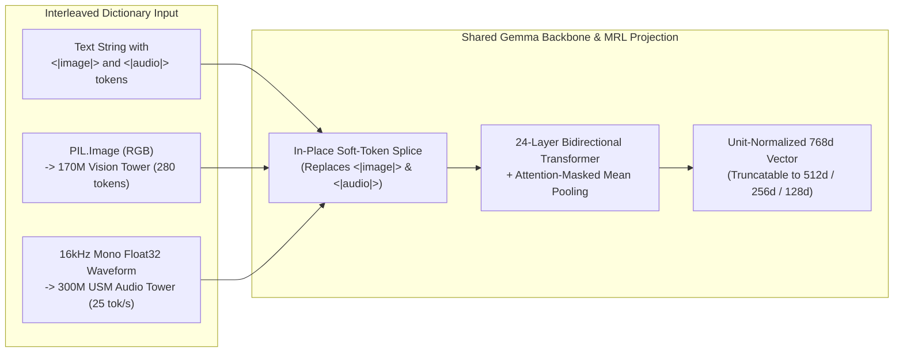

# Module 06 (Advanced): Multimodal & Interleaved RAG — Text, Visual API Diagrams (`<|image|>`) & 16kHz Audio (`<|audio|>`)

> **Course Navigation**: [← Module 05: Hybrid BM25 + RRF Search](./05_hybrid_bm25_rrf_search.md) | [Course Index (`COURSE.md`)](../COURSE.md) | [Next: Module 07 — Vertex AI Grounded Generation →](./07_vertex_ai_grounded_generation.md)  
> **Level:** Advanced  
> **Estimated Time:** 50 minutes  
> **Code Reference:** [`src/multimodal_rag.py`](../src/multimodal_rag.py)

---

## 📖 1. Explanation: Unified Cross-Modal Vector Spaces in `google/embeddinggemma-2`

### 1.1 Why Traditional Multimodal RAG Pipelines Are Brittle

In a conventional RAG system, if your knowledge base contains **architecture diagrams (`.png`)** and **speech/sound-effect audio files (`.wav`, `.mp3`)**, you must build a fragile multi-model cascade:
1. Run an external OCR / Vision-Language Model to caption every `.png` image into text.
2. Run an external Speech-to-Text (ASR) or Audio-Captioning model to transcribe every `.wav` file into text (which completely fails on non-speech sound effects like rainfall `rain.wav` or telephone rings `phone_ring.wav`!).
3. Embed the resulting captions with a text-only model.

#### 💡 The Simple Analogy: One Shared Map for Sight, Sound, and Text
**`google/embeddinggemma-2` (`740M` Full Multimodal Mode)** eliminates external OCR and ASR cascades by projecting **four modalities** directly into the **exact same 768-dimensional unit hypersphere $\mathbb{S}^{767}$**:
- **Text & Code** (via the `303M` Gemma text backbone)
- **Images (`<|image|>`)** (via the `170M` Vision Encoder)
- **Audio (`<|audio|>`)** (via the `300M` USM Audio Encoder at **16 kHz mono**)
- **Video (`<|video|>`)** (sampled at 1 frame/sec via the Vision Encoder)

Because all four towers feed into the **same 24-layer Transformer, Mean Pooler, and $768 \rightarrow 3072 \rightarrow 768$ Bottleneck Projection Head**, a natural-language text query $\hat{\mathbf{q}}_{\text{text}} \in \mathbb{S}^{767}$ can directly retrieve a raw `.wav` waveform $\hat{\mathbf{d}}_{\text{audio}} \in \mathbb{S}^{767}$ or `.png` diagram $\hat{\mathbf{d}}_{\text{image}} \in \mathbb{S}^{767}$ via standard cosine similarity:

$$
\operatorname{CosineSimilarity}\left(\hat{\mathbf{q}}_{\text{text}}, \; \hat{\mathbf{d}}_{\text{audio}}\right) = \hat{\mathbf{q}}_{\text{text}} \cdot \hat{\mathbf{d}}_{\text{audio}}
$$

---

### 1.2 Multimodal Token Budget Math (Shared 8,192-Token Context Window)

Inside `google/embeddinggemma-2`, every modality is converted into a sequence of continuous "soft tokens" in $\mathbb{R}^{768}$ that replace the `<|image|>`, `<|audio|>`, or `<|video|>` placeholder tokens before entering the 24-layer Transformer:

$$
N_{\text{total}} = N_{\text{text}} + 280 \cdot N_{\text{images}} + \lceil 25 \cdot T_{\text{audio}} \rceil + 140 \cdot N_{\text{frames}} \le 8192
$$

| Modality | Placeholder Token | Soft-Token Rate | Max Standalone Capacity in 8,192 Window |
| :--- | :---: | :--- | :--- |
| **Text / Code** | — | `1 token` per subword | **8,192 tokens** |
| **Image** | `<\|image\|>` | `280 soft tokens` per image (configurable `70–1120`) | **~29 images** (or up to ~114 at 70 tokens) |
| **Audio (16kHz Mono)** | `<\|audio\|>` | `25 soft tokens` per second of 16kHz audio | **~327 seconds** (~5.4 minutes) |
| **Video (1 FPS)** | `<\|video\|>` | `140 soft tokens` per frame | **~58 frames** (~1 minute of video) |



---

### 1.3 How [`src/multimodal_rag.py`](../src/multimodal_rag.py) Encodes Images, Audio & Interleaved Records

In `sentence-transformers >= 6.1.0`, we pass structured dictionaries containing `"text"` with `<|image|>` and/or `<|audio|>` placeholders alongside `"image"` (`PIL.Image`) and `"audio"` (`16kHz` mono `np.ndarray`):

```python
import librosa
import torch
from PIL import Image
from sentence_transformers import SentenceTransformer

model = SentenceTransformer(
    "google/embeddinggemma-2",
    model_kwargs={"torch_dtype": torch.bfloat16},
)

# 1. Load a Visual API Architecture Card (PIL RGB Image)
img = Image.open("data/multimodal_samples/sarvam_tts_bulbul_v4_card.png").convert("RGB")

# 2. Load a real 16kHz mono audio clip (Sarvam bulbul:v4-flash Tamil narration)
wav, sr = librosa.load("data/multimodal_samples/line_01_narrator.mp3", sr=16000, mono=True)

# 3. Encode an interleaved Text + Image + Audio record into ONE 768d vector
emb = model.encode(
    [
        {
            "text": "Complete Sarvam Bulbul v4 Flash Text-to-Speech specification card <|image|> paired with live synthesized Tamil narration audio output <|audio|>.",
            "image": img,
            "audio": wav[: 16000 * 6],
        }
    ],
    normalize_embeddings=True,
)
print("Unified 768d Multimodal Vector Shape:", emb.shape)  # (1, 768)
```

---

## 🛠️ 2. Practicals: Run Cross-Modal Search Over Audio & Diagrams (CLI & Web UI)

### 2.1 Option A: Command-Line Interface (CLI) Practicals

```bash
cd /data/opencode/sarvam-rag-course
source .venv/bin/activate

# Query 1: Retrieve a raw 16kHz rainfall sound effect (.wav) using a natural language text query
python -m cli.rag_cli multimodal "continuous heavy rainfall storm sound effect audio"

# Query 2: Retrieve a 16kHz telephone ring sound effect (.wav)
python -m cli.rag_cli multimodal "urgent telephone ringing sound effect in detective control room"

# Query 3: Retrieve an interleaved Text + Image + Tamil TTS Audio bundle
python -m cli.rag_cli multimodal "Synthesized Tamil speech narration from Sarvam bulbul:v4-flash TTS API"

# Query 4: Retrieve a visual PNG workflow diagram (<|image|>)
python -m cli.rag_cli multimodal "Instant voice cloning workflow diagram /voices/create and /voices/clone"
```

### 2.2 Option B: Interactive Web Studio UI Practicals (`http://localhost:8090`)

1. Open **`http://localhost:8090`** and select **Tab 3 (`Multimodal Lab: 740M Text + Image + Audio`)**.
2. Inspect the **10 indexed multimodal items** across `IMAGE` (`4` visual API cards), `AUDIO` (`5` real 16kHz `.wav`/`.mp3` clips), and `INTERLEAVED` (`1` combined Text+Image+Audio bundle).
3. Click any preset query pill or type your own query, choose any Matryoshka dimension (`768d`, `512d`, `256d`, `128d`), and click **`Search Multimodal Space`**.

---

## 🧠 3. Key Learnings & Live Cross-Modal Benchmark Results

| Text Query | Top-1 Retrieved Asset | Modality | Cosine Score (`768d`) | Rank |
| :--- | :--- | :---: | :---: | :---: |
| *"continuous heavy rainfall storm sound effect audio"* | `mm_aud_rain` (`sfx/rain.wav`) | **Audio (`<\|audio\|>`)** | **`0.78649`** | **#1** |
| *"urgent telephone ringing sound effect in detective control room"* | `mm_aud_phone` (`sfx/phone_ring.wav`) | **Audio (`<\|audio\|>`)** | **`0.87140`** | **#1** |
| *"Synthesized Tamil speech narration from Sarvam bulbul:v4-flash TTS API"* | `mm_interleaved_tts_bundle` | **Interleaved (`text+image+audio`)** | **`0.85529`** | **#1** |
| *"Instant voice cloning workflow diagram /voices/create and /voices/clone"* | `mm_img_cloning` (`sarvam_voice_cloning_card.png`) | **Image (`<\|image\|>`)** | **`0.80942`** | **#1** |

1. **Zero-ASR Acoustic Retrieval:** `google/embeddinggemma-2` retrieves non-speech acoustic events (`rain.wav`, `phone_ring.wav`) directly from raw 16kHz waveforms where traditional speech-to-text transcription returns an empty string!
2. **Matryoshka Works Across Modalities Too:** Because the MRL projection head sits *after* multimodal token fusion, even `<|image|>` and `<|audio|>` embeddings can be sliced to `256d` or `128d` and $L_2$ re-normalized.

---

## 🧹 4. Resource Teardown & Cost Cleanup (`destroy`)

To stop the Web UI server or clean up cloud resources after completing this module:

```bash
python -m cli.rag_cli destroy
```

---

## Next Module
Proceed to **[Module 07: Grounded Generation with GCP Vertex AI Gemini & Hallucination Guardrails](./07_vertex_ai_grounded_generation.md)**.
