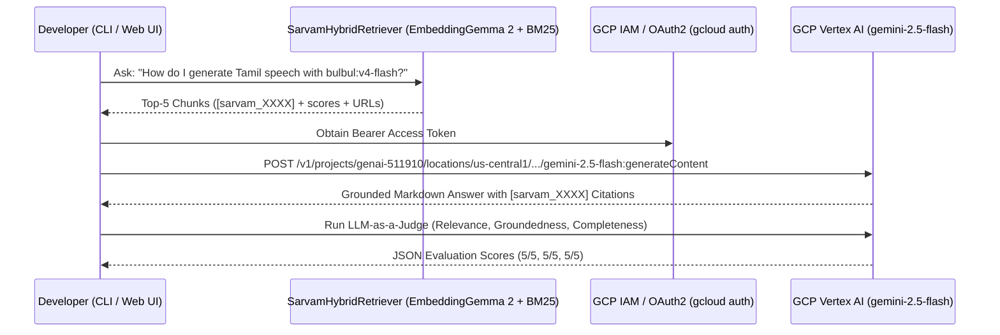

# Module 07 (Advanced): Grounded Generation with GCP Vertex AI Gemini & Hallucination Guardrails

**Level:** Advanced  
**Estimated Time:** 45 minutes  
**GCP Project:** `genai-511910` (`us-central1`)  
**Code Reference:** [`src/generator.py`](../src/generator.py)

---

## 1. Connecting Retrieval to GCP Vertex AI (`gemini-2.5-flash`)

Once `SarvamHybridRetriever` returns the Top-$K$ chunks from `sarvam-docs`, we pass those chunks to **Google Cloud Vertex AI (`gemini-2.5-flash`)** running in GCP project `genai-511910` (`us-central1`).



---

## 2. Prompt Engineering for Zero-Hallucination Citation Enforcement

In [`src/generator.py`](../src/generator.py), we enforce strict grounding via `systemInstruction` and low temperature (`temperature=0.1`):

1. **Explicit Source Framing:** Every retrieved chunk is wrapped with its `chunk_id`, `Title`, `URL`, and `Score`:
   ```text
   --- SOURCE [sarvam_0008] | Title: Authentication | URL: https://docs.sarvam.ai/api-reference/authentication/ | Score: 0.0161 ---
   ```
2. **Mandatory Inline Citations:** The model must cite every factual claim or parameter with `[sarvam_XXXX]`.
3. **Exact Technical Fidelity:** The system instruction requires preserving exact endpoint paths (`/text-to-speech`, `/voices/clone`), header names (`api-subscription-key`), model IDs (`bulbul:v4-flash`), and language codes (`ta-IN`).
4. **Abstention on Missing Evidence:** If the retrieved chunks do not contain the answer, the generator explicitly states what information is missing from the context instead of guessing.

---

## 3. Hands-On CLI Lab: Grounded RAG + LLM Judge on GCP Vertex AI

```bash
/data/opencode/sarvam-rag-course/.venv/bin/python -m cli.rag_cli ask \
  "How do I authenticate with the Sarvam AI API and what status code is returned on authentication failure?" \
  --mode hybrid --dim 768 --judge
```

---

## Next Module
Proceed to **[Module 08: Cloud-Native Vector Search on GCP (Cloud Storage + BigQuery `VECTOR_SEARCH` + Cloud Run)](./08_gcp_bigquery_cloudrun_rag.md)**.
