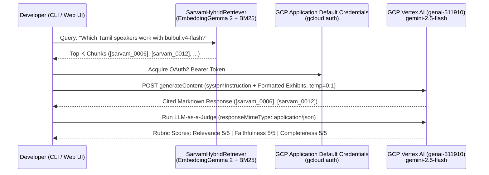

# Module 07 (Advanced): Grounded Generation with GCP Vertex AI (`gemini-2.5-flash`) & Hallucination Guardrails

> **Course Navigation**: [← Module 06: Multimodal Audio & Image RAG](./06_multimodal_audio_image_rag.md) | [Course Index (`COURSE.md`)](../COURSE.md) | [Next: Module 08 — GCP BigQuery & Cloud Run →](./08_gcp_bigquery_cloudrun_rag.md)  
> **Level:** Advanced  
> **Estimated Time:** 45 minutes  
> **GCP Project:** `genai-511910` (`us-central1`)  
> **Code Reference:** [`src/generator.py`](../src/generator.py)

---

## 📖 1. Explanation: Zero-Hallucination Synthesis & Automated Citation Auditing

### 1.1 The Faithfulness Problem in RAG Generation

Retrieving the right documentation chunks $\mathcal{Z}_K = \lbrace z_1, \dots, z_K \rbrace$ is only half the battle. If you pass $\mathcal{Z}_K$ to an LLM with a vague prompt like *"Answer the user's question using the context below"*, the LLM can still fail in two ways:
1. **Parametric Override:** The LLM ignores the retrieved `sarvam-docs` chunk and substitutes an outdated parameter from its pre-training weights.
2. **Unverifiable Attribution:** The LLM blends facts from three different APIs without indicating which source authorized which parameter.

#### 💡 The Simple Analogy: A Courtroom Brief Where Every Sentence Needs an Exhibit Number
In [`VertexAIGeminiGenerator`](../src/generator.py), we configure **Google Cloud Vertex AI (`gemini-2.5-flash`)** to act like an appellate lawyer:
- Every retrieved chunk is labeled as a numbered exhibit (`[sarvam_0017]`, `[sarvam_0006]`).
- The generator runs at low temperature (`temperature = 0.1`) and must attach an inline `[sarvam_XXXX]` citation to every technical claim, endpoint URL, model name, or code block.
- If the retrieved exhibits do not contain the answer, the generator **must abstain** rather than guess.



---

### 1.2 Mathematical & Algorithmic Formulation of Citation Precision & Judge Auditing

Let $R = \lbrace c_1, c_2, \dots, c_K \rbrace$ be the set of chunk IDs retrieved by `SarvamHybridRetriever`, and let $C(y)$ be the set of `[sarvam_XXXX]` citation tags extracted from the generated answer $y$ via regular expression `r"\[(sarvam_\d{4})\]"`.

1. **Deterministic Citation Hallucination Check:**
   We verify programmatically in [`src/generator.py`](../src/generator.py) that every cited chunk ID actually existed in the retrieved context window:

$$
\operatorname{CitationPrecision}(y, R) = \frac{\lvert C(y) \cap R \rvert}{\max\left(\lvert C(y) \rvert, \; 1\right)} = 1.0
$$

   Any citation $c \in C(y) \setminus R$ is immediately flagged as a hallucinated reference.

2. **Structured JSON LLM-as-a-Judge (`evaluate_rag_response`):**
   We invoke a second, independent call to Vertex AI `gemini-2.5-flash` at `temperature = 0.0` with `responseMimeType = "application/json"` to grade the triplet $(\text{Query } q, \text{Full Context } \mathcal{Z}_K, \text{Answer } y)$ across three orthogonal axes in $\lbrace 1, 2, 3, 4, 5 \rbrace$:
   - $\operatorname{Score}_{\text{rel}} \in [1, 5]$: **Context Relevance** (Did the retriever fetch chunks that address $q$?)
   - $\operatorname{Score}_{\text{faith}} \in [1, 5]$: **Groundedness / Faithfulness** (Is every claim in $y$ entailed by $\mathcal{Z}_K$ with zero fabricated facts?)
   - $\operatorname{Score}_{\text{comp}} \in [1, 5]$: **Answer Completeness** (Did $y$ fully answer all parts of $q$?)

---

### 1.3 Inside [`src/generator.py`](../src/generator.py): Context Framing & System Instructions

Each retrieved chunk is formatted with full provenance headers before being passed to Vertex AI:

```text
--- SOURCE [sarvam_0017] | Title: Authentication — Overview | URL: https://docs.sarvam.ai/api-reference-docs/authentication | Score: 0.0161 ---
All Sarvam AI REST API requests require the `api-subscription-key` HTTP header...
```

---

## 🛠️ 2. Practicals: Run Grounded Synthesis & LLM Judge on GCP Vertex AI (CLI & Web UI)

### 2.1 Option A: Command-Line Interface (CLI) Practicals

```bash
cd /data/opencode/sarvam-rag-course
source .venv/bin/activate

# 1. Ask a grounded developer question with live LLM-as-a-Judge evaluation (--judge)
python -m cli.rag_cli ask \
  "How do I authenticate with the Sarvam AI API and what HTTP header is required?" \
  --mode hybrid --dim 768 --top-k 4 --judge

# 2. Ask about Bulbul v4 Flash Tamil speakers & sample rates with Judge grading
python -m cli.rag_cli ask \
  "Which Tamil speakers and audio sample rates work with bulbul:v4-flash in Sarvam Text-to-Speech?" \
  --mode hybrid --dim 768 --top-k 4 --judge

# 3. Launch an interactive multi-turn terminal RAG chat session
python -m cli.rag_cli chat --mode hybrid --dim 768
```

### 2.2 Option B: Interactive Web Studio UI Practicals (`http://localhost:8090`)

1. Open **`http://localhost:8090`** (`Tab 1: Grounded RAG Studio`).
2. Enter your question (or click any preset pill) and click **`Ask Vertex AI Gemini (RAG)`**.
3. Inspect:
   - The **Grounded Vertex AI Answer** with highlighted `[sarvam_XXXX]` citations and copyable code blocks.
   - The **3 LLM-as-a-Judge Score Badges** (`Context Relevance: 5/5`, `Groundedness: 5/5`, `Completeness: 5/5`) and Judge rationale below the answer.
   - The **Retrieved Evidence Chunks** on the right panel.

---

## 🧠 3. Key Learnings & MIT Systems Takeaways

1. **Never Truncate Chunk Text Inside the Judge Prompt:** When auditing faithfulness (`evaluate_rag_response`), always pass the *complete* text of each retrieved chunk to the LLM Judge. If you truncate chunks to 300 characters in the Judge prompt, the Judge will falsely penalize valid facts that came from the bottom half of a chunk!
2. **Low Temperature (`0.1`) + Explicit Abstention Rules Eliminate Creative Drift:** Technical API assistants should optimize for deterministic fidelity (`T = 0.1`), not creative variation.
3. **Programmatic Citation Verification Complements Neural Judging:** Combining regex citation verification ($\lvert C(y) \cap R \rvert / \lvert C(y) \rvert$) with Vertex AI JSON rubric scoring catches both missing citations and subtle semantic drift.

---

## 🧹 4. Resource Teardown & Cost Cleanup (`destroy`)

To stop the Web UI server or clean up cloud resources after completing this module:

```bash
python -m cli.rag_cli destroy
```

---

## Next Module
Proceed to **[Module 08: Production Cloud RAG on GCP — Cloud Storage, BigQuery `VECTOR_SEARCH` & Cloud Run](./08_gcp_bigquery_cloudrun_rag.md)**.
