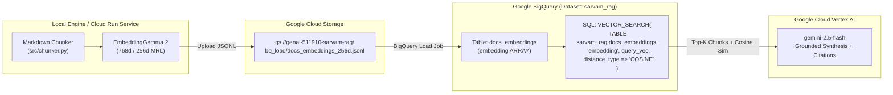

# Module 8: Production Cloud RAG on Google Cloud Platform (Cloud Storage, BigQuery `VECTOR_SEARCH`, and Cloud Run)

**Course Track:** Advanced — Cloud-Native Vector Databases & Serverless Deployment  
**GCP Project:** `genai-511910` (`us-central1`)  
**Implementation Reference:** [`src/gcp_integration.py`](file:///data/opencode/sarvam-rag-course/src/gcp_integration.py), [`Dockerfile`](file:///data/opencode/sarvam-rag-course/Dockerfile)

---

## 1. Learning Objectives

By the end of this module, you will be able to:
1. Architect a serverless enterprise RAG pipeline on Google Cloud Platform (GCP) combining **Cloud Storage (GCS)**, **BigQuery Vector Search**, **Vertex AI (`gemini-2.5-flash`)**, and **Cloud Run**.
2. Export local `google/embeddinggemma-2` Matryoshka (`256d` / `768d`) L2-normalized embeddings to newline-delimited JSON (`.jsonl`) with `ARRAY<FLOAT64>` columns.
3. Load embeddings into Google BigQuery and execute serverless `VECTOR_SEARCH(..., distance_type => 'COSINE')` SQL queries joining vector similarity with metadata filtering.
4. Perform every operation using **both** the **GCP CLI (`gcloud` & `bq`)** and the **Google Cloud Console Web UI**.

---

## 2. Cloud Architecture on GCP (`genai-511910`)



### Why BigQuery `VECTOR_SEARCH` + Matryoshka `256d`?
- **Zero-ops serverless scaling**: No dedicated vector database cluster to provision or pay for while idle.
- **SQL + Vector Analytical Joins**: Filter or join by `category`, `has_code`, `doc_path`, or `char_count` in standard GoogleSQL before or after vector scoring.
- **3x Faster & Cheaper Scans with MRL `256d`**: Storing EmbeddingGemma 2's L2-normalized `256d` Matryoshka slice inside `ARRAY<FLOAT64>` reduces BigQuery bytes scanned by **66.7%** compared to `768d` while retaining near-100% retrieval recall.

---

## 3. Step-by-Step: Cloud Storage & BigQuery Vector Search (CLI vs. UI)

### Step 3.1: Create the Cloud Storage Bucket

#### Option A: GCP CLI (`gcloud storage`)
```bash
# Verify active project
gcloud config set project genai-511910

# Create regional bucket in us-central1
gcloud storage buckets create gs://genai-511910-sarvam-rag \
  --project=genai-511910 \
  --location=us-central1 \
  --uniform-bucket-level-access
```

#### Option B: GCP Console Web UI
1. Open the [Google Cloud Storage Browser](https://console.cloud.google.com/storage/browser?project=genai-511910).
2. Click **+ CREATE** at the top bar.
3. Enter bucket name: `genai-511910-sarvam-rag`.
4. Under **Location type**, select **Region** and choose `us-central1 (Iowa)`.
5. Under **Access control**, select **Uniform** and click **Create**.

---

### Step 3.2: Upload Chunks & Matryoshka Embeddings and Load into BigQuery

Our [`GCPVectorPlatform.sync_to_gcs_and_bigquery()`](file:///data/opencode/sarvam-rag-course/src/gcp_integration.py#L46-L118) formats each chunk and its L2-normalized embedding vector into a BigQuery-ready JSONL row:

```json
{
  "chunk_id": "sarvam_0001",
  "doc_path": "api-reference/authentication.md",
  "url": "https://docs.sarvam.ai/api-reference-docs/authentication",
  "title": "Authentication — API Key Header",
  "section": "API Key Header",
  "category": "api-core",
  "has_code": true,
  "char_count": 412,
  "content": "All API requests to Sarvam AI require the `api-subscription-key` HTTP header...",
  "embedding_dim": 256,
  "embedding": [0.041821, -0.091204, 0.018442, "... 256 floats ..."]
}
```

#### Option A: Using Our RAG CLI (`cli/rag_cli.py`) or `bq` CLI
```bash
# 1. Automated sync via our RAG CLI (uploads to GCS + loads BigQuery table)
python3 cli/rag_cli.py gcp-sync --dim 256

# Equivalent raw gcloud + bq CLI commands:
gcloud storage cp data/artifacts/docs_embeddings_256d.jsonl \
  gs://genai-511910-sarvam-rag/bq_load/docs_embeddings_256d.jsonl

bq --location=us-central1 mk --dataset --if_not_exists genai-511910:sarvam_rag

bq --location=us-central1 load \
  --replace \
  --source_format=NEWLINE_DELIMITED_JSON \
  genai-511910:sarvam_rag.docs_embeddings \
  gs://genai-511910-sarvam-rag/bq_load/docs_embeddings_256d.jsonl
```

#### Option B: Using GCP BigQuery Console Web UI OR Our RAG Studio Web UI
- **In our Interactive RAG Studio Web UI (`http://localhost:8090`)**:
  1. Click **Tab 4: GCP BigQuery Vector Search & Cloud Console**.
  2. Select **BigQuery Embedding Dimension** (`256d (3x Compressed MRL)` or `768d (Full Native)`).
  3. Click **Sync Local Index -> GCS & BigQuery** to trigger the live upload and load job.
- **In the [GCP BigQuery Studio Web UI](https://console.cloud.google.com/bigquery?project=genai-511910)**:
  1. In the Explorer pane, click the three dots next to `genai-511910` $\rightarrow$ **Create dataset**.
  2. Set **Dataset ID** to `sarvam_rag`, Location to `us-central1`, and click **Create dataset**.
  3. Click the three dots next to `sarvam_rag` $\rightarrow$ **Create table**.
  4. Set **Create table from** to `Google Cloud Storage`, browse to `gs://genai-511910-sarvam-rag/bq_load/docs_embeddings_256d.jsonl`, set **File format** to `JSONL (Newline delimited JSON)`, set **Table name** to `docs_embeddings`, check **Auto-detect schema**, and click **Create table**.

---

### Step 3.3: Execute Serverless `VECTOR_SEARCH` Queries in BigQuery

Once loaded, BigQuery natively computes exact or ANN cosine distance over the `embedding` `ARRAY<FLOAT64>` column:

```sql
WITH query_vec AS (
  SELECT [0.041821, -0.091204, /* ... 256d query vector from EmbeddingGemma 2 ... */] AS q_emb
)
SELECT
  base.chunk_id,
  base.title,
  base.section,
  base.category,
  base.doc_path,
  base.url,
  SUBSTR(base.content, 1, 500) AS snippet,
  ROUND(1.0 - distance, 4) AS cosine_similarity,
  ROUND(distance, 4) AS cosine_distance
FROM VECTOR_SEARCH(
  TABLE `genai-511910.sarvam_rag.docs_embeddings`,
  'embedding',
  TABLE query_vec,
  query_column_to_search => 'q_emb',
  top_k => 5,
  distance_type => 'COSINE'
)
ORDER BY distance ASC;
```

#### Option A: Run from our RAG CLI
```bash
python3 cli/rag_cli.py bq-search \
  --query "How do I authenticate with the Sarvam AI API using api-subscription-key?" \
  --dim 256 --top-k 5
```

#### Option B: Run from our RAG Studio Web UI
1. Open **Tab 4: GCP BigQuery Vector Search & Cloud Console** (`http://localhost:8090`).
2. Enter your natural-language query and click **Run BigQuery VECTOR_SEARCH**.
3. The UI encodes your query with `google/embeddinggemma-2`, executes the BigQuery SQL job on `genai-511910.sarvam_rag.docs_embeddings`, and displays both the ranked results and the exact executed GoogleSQL query.

---

## 4. Deploying the RAG Studio to Google Cloud Run (CLI vs. UI)

Our repository includes a production [`Dockerfile`](file:///data/opencode/sarvam-rag-course/Dockerfile) that packages the FastAPI RAG Studio, CLI, and pre-built index for Google Cloud Run.

### Option A: Deploy via `gcloud run deploy` CLI
```bash
# Build container image in Cloud Build & push to Artifact Registry / GCR
gcloud builds submit --tag gcr.io/genai-511910/sarvam-embeddinggemma2-rag:latest \
  --project=genai-511910

# Deploy serverless container to Cloud Run in us-central1
gcloud run deploy sarvam-embeddinggemma2-rag \
  --image gcr.io/genai-511910/sarvam-embeddinggemma2-rag:latest \
  --project=genai-511910 \
  --region=us-central1 \
  --memory=8Gi \
  --cpu=4 \
  --port=8080 \
  --set-env-vars="GCP_PROJECT_ID=genai-511910,GCP_LOCATION=us-central1" \
  --allow-unauthenticated
```

### Option B: Deploy via Google Cloud Run Console Web UI
1. Open the [Google Cloud Run Console](https://console.cloud.google.com/run?project=genai-511910).
2. Click **+ CREATE SERVICE**.
3. Select **Deploy one revision from an existing container image** (`gcr.io/genai-511910/sarvam-embeddinggemma2-rag:latest`) or **Continuously deploy from a repository** (connect `ajithvnr2001/sarvam-embeddinggemma2-rag-course`).
4. Set **Service name** to `sarvam-embeddinggemma2-rag` and **Region** to `us-central1`.
5. Under **Authentication**, choose **Allow unauthenticated invocations** (or require IAM authentication for internal teams).
6. Expand **Container(s), Volumes, Networking, Security**:
   - Set **Container port** to `8080`.
   - Under **Capacity**, set **Memory** to `8 GiB` and **CPU** to `4` (to hold `google/embeddinggemma-2` comfortably in RAM).
   - Under **Variables & Secrets**, add `GCP_PROJECT_ID=genai-511910` and `GCP_LOCATION=us-central1`.
7. Click **Create** to launch your HTTPS Cloud Run endpoint.

---

## 5. Next Module
Continue to **[Module 9: End-to-End RAG Evaluation, MRL Benchmarking & Vertex AI LLM-as-a-Judge](./09_evaluation_benchmarking.md)** to analyze the quantitative benchmark results from our live execution.
