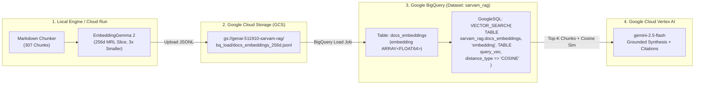

# Module 08 (Advanced): Production Cloud RAG on Google Cloud Platform — Cloud Storage, BigQuery `VECTOR_SEARCH` & Cloud Run

> **Course Navigation**: [← Module 07: Vertex AI Grounded Generation](./07_vertex_ai_grounded_generation.md) | [Course Index (`COURSE.md`)](../COURSE.md) | [Next: Module 09 — Evaluation & Benchmarking →](./09_evaluation_benchmarking.md)  
> **Level:** Advanced — Cloud-Native Vector Databases & Serverless Deployment  
> **Estimated Time:** 50 minutes  
> **GCP Project:** `genai-511910` (`us-central1`)  
> **Code References:** [`src/gcp_integration.py`](../src/gcp_integration.py), [`Dockerfile`](../Dockerfile), [`scripts/destroy_resources.sh`](../scripts/destroy_resources.sh)

---

## 📖 1. Explanation: Serverless Cloud Vector Search on Google Cloud Platform

### 1.1 Why Move from Local `.npy` Files to Google BigQuery `VECTOR_SEARCH`?

In Modules 01–07, we stored our `google/embeddinggemma-2` Matryoshka vectors in local NumPy matrices (`data/index/embeddings_{768,512,256,128}.npy`). While local NumPy matrices are lightning-fast (`< 0.5 ms`) for a single container, enterprise production systems require:
1. **Shared, Durable Cloud State:** Multiple stateless microservices or Cloud Run instances reading from one centralized vector store.
2. **Relational SQL + Vector Pre/Post-Filtering:** Combining semantic vector search with structured SQL predicates (`WHERE category = 'speech-tts' AND has_code = TRUE`).
3. **Zero Idle Infrastructure Cost:** Traditional dedicated vector database clusters charge $70–$300+/month even when zero queries are running. **Google BigQuery `VECTOR_SEARCH`** is 100% serverless—you pay only for bytes stored/scanned, and you can provision or destroy the entire dataset in seconds!



---

### 1.2 Mathematical Equivalence: BigQuery `COSINE` Distance vs. Inner Product

In GoogleSQL `VECTOR_SEARCH(..., distance_type => 'COSINE')`, BigQuery returns a column named `distance` defined as the **Cosine Distance**:

$$
\operatorname{CosineDistance}(\mathbf{q}, \mathbf{d}) = 1 - \operatorname{CosineSimilarity}(\mathbf{q}, \mathbf{d}) = 1 - \frac{\mathbf{q} \cdot \mathbf{d}}{\lVert \mathbf{q} \rVert_2 \, \lVert \mathbf{d} \rVert_2} \in [0, 2]
$$

Therefore, sorting by `ORDER BY distance ASC` in BigQuery is mathematically identical to sorting by $\operatorname{CosineSimilarity}(\mathbf{q}, \mathbf{d})$ descending, and we recover the exact Cosine Similarity in SQL via:

$$
\operatorname{CosineSimilarity}(\mathbf{q}, \mathbf{d}) = 1.0 - \text{distance}
$$

#### Why Exporting `256d` Matryoshka Vectors Saves 66.7% BigQuery Cost
BigQuery stores each vector as an `ARRAY<FLOAT64>` column (8 bytes per dimension):
- **Full `768d` vector:** $768 \times 8\text{ B} = 6,144\text{ bytes/row}$.
- **Matryoshka `256d` vector:** $256 \times 8\text{ B} = 2,048\text{ bytes/row}$ (**`3.0x` reduction** in storage and `VECTOR_SEARCH` scan bytes, with **100% Top-1 match** on our benchmark!).

---

### 1.3 Exact GoogleSQL `VECTOR_SEARCH` Query Executed by [`src/gcp_integration.py`](../src/gcp_integration.py)

```sql
WITH query_vec AS (
  SELECT [0.041821, -0.091204, /* ... 256 L2-normalized floats from EmbeddingGemma 2 ... */] AS q_emb
)
SELECT
  base.chunk_id,
  base.title,
  base.section,
  base.category,
  base.doc_path,
  base.url,
  SUBSTR(base.content, 1, 500) AS snippet,
  ROUND(1.0 - distance, 5) AS cosine_similarity,
  ROUND(distance, 5) AS cosine_distance
FROM VECTOR_SEARCH(
  TABLE `genai-511910.sarvam_rag.docs_embeddings`,
  'embedding',
  TABLE query_vec,
  query_column_to_search => 'q_emb',
  top_k => 5,
  distance_type => 'COSINE'
)
ORDER BY distance ASC;
```

---

## 🛠️ 2. Practicals: Provision, Query & Deploy on GCP (CLI & Web UI)

### 2.1 Step 1 — Provision GCS Bucket & Load BigQuery Vector Table (`gcp-sync`)

#### Option A: Via Our Python RAG CLI (One Command)
```bash
cd /data/opencode/sarvam-rag-course
source .venv/bin/activate

# Creates gs://genai-511910-sarvam-rag, uploads 307 chunks (256d MRL), and loads genai-511910:sarvam_rag.docs_embeddings
python -m cli.rag_cli gcp-sync --dim 256
```

#### Option B: Via Raw `gcloud` & `bq` CLI Commands
```bash
gcloud storage buckets create gs://genai-511910-sarvam-rag \
  --project=genai-511910 --location=us-central1 --uniform-bucket-level-access

gcloud storage cp data/artifacts/docs_embeddings_256d.jsonl \
  gs://genai-511910-sarvam-rag/bq_load/docs_embeddings_256d.jsonl

bq --location=us-central1 mk --dataset --if_not_exists genai-511910:sarvam_rag

bq --location=us-central1 load \
  --replace --source_format=NEWLINE_DELIMITED_JSON \
  genai-511910:sarvam_rag.docs_embeddings \
  gs://genai-511910-sarvam-rag/bq_load/docs_embeddings_256d.jsonl
```

#### Option C: Via Interactive Web Studio UI (`http://localhost:8090`)
1. Open **`http://localhost:8090`** and select **Tab 4 (`GCP BigQuery Vector Search`)**.
2. Choose **`256d (3x Compressed MRL)`** and click the green **`Sync Local Index -> GCS & BigQuery`** button.

---

### 2.2 Step 2 — Execute Serverless `VECTOR_SEARCH` SQL on BigQuery (`bq-search`)

#### Option A: Via CLI
```bash
python -m cli.rag_cli bq-search \
  "How do I authenticate with the Sarvam AI API using api-subscription-key?" \
  --dim 256 --top-k 5
```

#### Option B: Via Web Studio UI (`http://localhost:8090`)
1. On **Tab 4 (`GCP BigQuery Vector Search`)**, enter your query and click **`Run BigQuery VECTOR_SEARCH`**.
2. Inspect the live BigQuery results (`sarvam_0017` ranked #1 with `cosine_similarity = 0.88369`, `distance = 0.11631`) and the generated GoogleSQL query.

---

### 2.3 Step 3 — Optional Serverless Container Deployment to Google Cloud Run

```bash
# Build container image and deploy to Cloud Run (us-central1)
gcloud builds submit --tag gcr.io/genai-511910/sarvam-embeddinggemma2-rag:latest --project=genai-511910

gcloud run deploy sarvam-embeddinggemma2-rag \
  --image gcr.io/genai-511910/sarvam-embeddinggemma2-rag:latest \
  --project=genai-511910 --region=us-central1 \
  --memory=8Gi --cpu=4 --port=8080 \
  --set-env-vars="GCP_PROJECT_ID=genai-511910,GCP_LOCATION=us-central1" \
  --allow-unauthenticated
```

---

## 🧠 3. Key Learnings & MIT Systems Takeaways

1. **Matryoshka `256d` + BigQuery `ARRAY<FLOAT64>` Is a Cloud FinOps Multiplier:** Truncating from `768d` to `256d` and $L_2$ re-normalizing cuts cloud storage and BigQuery scan bytes by **3.0x** while returning the exact same Top-1 chunk (`sarvam_0017`, Cosine `0.88369`).
2. **Ephemeral Cloud Storage Pattern:** Because local `data/index/*.npy` files are only `628 KB`, you can keep your cloud BigQuery dataset and GCS bucket **destroyed (`$0.00/month`)** when idle and re-provision them in **15 seconds** anytime with `python -m cli.rag_cli gcp-sync --dim 256`.

---

## 🧹 4. Resource Teardown & Cost Cleanup (`destroy`)

Always tear down your cloud bucket (`gs://genai-511910-sarvam-rag`) and BigQuery dataset (`genai-511910:sarvam_rag`) when you finish running BigQuery experiments:

- **Via Python CLI:**
  ```bash
  python -m cli.rag_cli destroy
  ```
- **Via Standalone Bash Script (with `NotFound` verification):**
  ```bash
  bash scripts/destroy_resources.sh
  ```
- **Via Web Studio UI (`http://localhost:8090`):**
  On **Tab 4 (`GCP BigQuery Vector Search`)**, click the red **`Destroy Cloud Resources (GCS + BQ)`** button.

---

## Next Module
Proceed to **[Module 09: End-to-End RAG Evaluation, Matryoshka Benchmarking & Vertex AI LLM-as-a-Judge](./09_evaluation_benchmarking.md)**.
