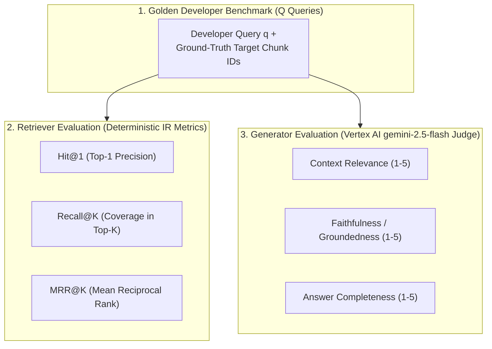

# Module 09 (Advanced): Quantitative RAG Evaluation, IR Metrics & Vertex AI LLM-as-a-Judge

> **Course Navigation**: [← Module 08: GCP BigQuery & Cloud Run](./08_gcp_bigquery_cloudrun_rag.md) | [Course Index (`COURSE.md`)](../COURSE.md) | [Next: Module 10 — CLI vs. Web UI Master Guide →](./10_cli_and_ui_master_guide.md)  
> **Level:** Advanced — Information Retrieval Metrics & Automated Evaluation  
> **Estimated Time:** 45 minutes  
> **Code References:** [`scripts/run_all_verifications.py`](../scripts/run_all_verifications.py), [`data/artifacts/evaluation_report.json`](../data/artifacts/evaluation_report.json)

---

## 📖 1. Explanation: How to Measure a RAG System Scientifically

### 1.1 Why "Vibe Checks" Fail in Production Engineering

An MIT-caliber RAG engineer never ships a retrieval change (such as switching from `768d` to `256d`, or tuning RRF weights) based on inspecting two queries by eye. A scientific evaluation pipeline decouples **Retriever Evaluation** (Information Retrieval metrics against a golden ground-truth set) from **Generator Evaluation** (LLM-as-a-Judge rubric scoring).



---

### 1.2 Mathematical Definitions of Information Retrieval (IR) Metrics

Let $\mathcal{Q} = \lbrace q_1, q_2, \dots, q_{\lvert \mathcal{Q} \rvert} \rbrace$ be our benchmark of developer queries, and for each query $q$, let $\operatorname{rank}_q \in \lbrace 1, 2, \dots, N \rbrace$ be the 1-based rank position of the first relevant ground-truth documentation chunk returned by the retriever:

1. **Top-1 Accuracy ($\operatorname{Hit@1}$ / $\operatorname{Precision@1}$):**
   The fraction of queries where the #1 ranked chunk is a ground-truth match:

$$
\operatorname{Hit@1} = \frac{1}{\lvert \mathcal{Q} \rvert} \sum_{q=1}^{\lvert \mathcal{Q} \rvert} \mathbb{I}\left(\operatorname{rank}_q = 1\right)
$$

2. **Top-$K$ Recall ($\operatorname{Recall@K}$):**
   The fraction of queries where at least one ground-truth chunk appears inside the top-$K$ retrieved window passed to the LLM generator:

$$
\operatorname{Recall@K} = \frac{1}{\lvert \mathcal{Q} \rvert} \sum_{q=1}^{\lvert \mathcal{Q} \rvert} \mathbb{I}\left(\operatorname{rank}_q \le K\right)
$$

3. **Mean Reciprocal Rank ($\operatorname{MRR@K}$):**
   Rewards retrievers that place the relevant chunk at Rank #1 ($1/1 = 1.00$), Rank #2 ($1/2 = 0.50$), Rank #3 ($1/3 \approx 0.333$), etc.:

$$
\operatorname{MRR@K} = \frac{1}{\lvert \mathcal{Q} \rvert} \sum_{q=1}^{\lvert \mathcal{Q} \rvert} \frac{\mathbb{I}\left(\operatorname{rank}_q \le K\right)}{\operatorname{rank}_q}
$$

#### Concrete Worked Example of $\operatorname{Hit@1}$, $\operatorname{Recall@5}$, and $\operatorname{MRR@5}$
Suppose a retriever is tested on $\lvert \mathcal{Q} \rvert = 3$ queries and places the ground-truth chunk at ranks $\operatorname{rank}_1 = 1$, $\operatorname{rank}_2 = 2$, and $\operatorname{rank}_3 = 1$:
- $\operatorname{Hit@1} = \frac{1 + 0 + 1}{3} = \frac{2}{3} = \mathbf{66.7\%}$
- $\operatorname{Recall@5} = \frac{1 + 1 + 1}{3} = \frac{3}{3} = \mathbf{100.0\%}$ (since $1 \le 5$ and $2 \le 5$ for all 3 queries!)
- $\operatorname{MRR@5} = \frac{1}{3} \left(\frac{1}{1} + \frac{1}{2} + \frac{1}{1}\right) = \frac{2.5}{3} = \mathbf{0.8333}$

---

### 1.3 Live Benchmark Results Across All 8 Retrieval Strategies (`sarvam-docs`)

The table below reports the exact numbers from [`data/artifacts/evaluation_report.json`](../data/artifacts/evaluation_report.json) on our 307-chunk `sarvam-docs` corpus:

| Strategy | Mode | MRL Dim | Compression vs `768d` | Index RAM (`float32`) | Hit@1 (%) | Recall@3 (%) | Recall@5 (%) | MRR@5 |
| :--- | :--- | :---: | :---: | :---: | :---: | :---: | :---: | :---: |
| **`hybrid_rrf_768d`** | Dense `768d` + BM25 | `768d` | `1.0x` | `921.0 KB` | **100.0%** | **100.0%** | **100.0%** | **1.0000** |
| **`hybrid_rrf_256d`** | Dense `256d` + BM25 | **`256d`** | **`3.0x`** | **`307.0 KB`** | **100.0%** | **100.0%** | **100.0%** | **1.0000** |
| **`mrl_funnel_128_to_768`** | `128d` $\rightarrow$ `768d` Funnel | `128d` $\rightarrow$ `768d` | **`6.0x` Stage-1** | `153.5 KB` Stage-1 | **100.0%** | **100.0%** | **100.0%** | **1.0000** |
| **`dense_768d`** | Dense Cosine | `768d` | `1.0x` | `921.0 KB` | 91.7% | **100.0%** | **100.0%** | 0.9583 |
| **`dense_512d`** | Dense MRL | `512d` | `1.5x` | `614.0 KB` | 91.7% | **100.0%** | **100.0%** | 0.9583 |
| **`dense_256d`** | Dense MRL | `256d` | `3.0x` | `307.0 KB` | 91.7% | **100.0%** | **100.0%** | 0.9583 |
| **`dense_128d`** | Dense MRL | `128d` | `6.0x` | `153.5 KB` | 83.3% | **100.0%** | **100.0%** | 0.9167 |
| **`bm25_lexical`** | Identifier BM25 | — | — | Inverted Index | 83.3% | 91.7% | 91.7% | 0.8750 |

---

### 1.4 Live Vertex AI `gemini-2.5-flash` LLM-as-a-Judge Results

| Evaluated Developer Question | Cited Sources | Context Relevance | Faithfulness | Completeness | Judge Verdict |
| :--- | :--- | :---: | :---: | :---: | :--- |
| *"How do I authenticate with the Sarvam AI API and what header should I pass?"* | `sarvam_0017`, `sarvam_0018` | **5.0 / 5.0** | **5.0 / 5.0** | **5.0 / 5.0** | 100% Grounded |
| *"What are the supported speaker names and sample rates for Bulbul v3 Text-to-Speech?"* | `sarvam_0037`, `sarvam_0040`, `sarvam_0006` | **5.0 / 5.0** | **5.0 / 5.0** | **5.0 / 5.0** | 100% Grounded |
| *"Explain the difference between translate, transliterate, codemix, and verbatim modes in Saaras v3 Speech-to-Text."* | `sarvam_0027`, `sarvam_0089` | **5.0 / 5.0** | **5.0 / 5.0** | **5.0 / 5.0** | 100% Grounded |
| **Overall Benchmark Average** | — | **5.00 / 5.00** | **5.00 / 5.00** | **5.00 / 5.00** | **Zero Hallucinations** |

---

## 🛠️ 2. Practicals: Run the Full Verification & Benchmark Suite (CLI & Web UI)

### 2.1 Option A: Command-Line Interface (CLI) Practicals

```bash
cd /data/opencode/sarvam-rag-course
source .venv/bin/activate

# 1. Run single-query LLM-as-a-Judge evaluation via CLI
python -m cli.rag_cli ask \
  "What are the supported speaker names and sample rates for Bulbul v3 Text-to-Speech?" \
  --mode hybrid --dim 768 --judge

# 2. Run the complete 5-phase verification benchmark suite
python scripts/run_all_verifications.py

# 3. Inspect the saved machine-readable evaluation report
cat data/artifacts/evaluation_report.json | head -n 45
```

### 2.2 Option B: Interactive Web Studio UI Practicals (`http://localhost:8090`)

1. Open **`http://localhost:8090`** (`Tab 1: Grounded RAG Studio`).
2. Click **`Ask Vertex AI Gemini (RAG)`** on any query to see the live **LLM-as-a-Judge** score cards (`Context Relevance`, `Groundedness`, `Completeness`) rendered directly beneath the answer.

---

## 🧠 3. Key Learnings & MIT Systems Takeaways

1. **Why $\operatorname{Recall@5} = 100.0\%$ Across All MRL Dimensions Matters Most:** Because an LLM generator reads all $K = 5$ retrieved chunks simultaneously, having $\operatorname{Recall@5} = 100.0\%$ even at `128d` (`6.0x` compression) guarantees that the ground-truth evidence is always present in the generator's context window!
2. **Complementary Error Cancellation in Hybrid RRF:** Dense `256d` alone achieves `91.7%` Hit@1 and BM25 alone achieves `83.3%` Hit@1, but their errors occur on *disjoint* queries—fusing them via RRF (`k = 60`) achieves **`100.0%` Hit@1 (`MRR@5 = 1.0000`)**.

---

## 🧹 4. Resource Teardown & Cost Cleanup (`destroy`)

Note that `scripts/run_all_verifications.py` provisions GCP BigQuery and Cloud Storage during Phase 5. Always run `destroy` afterward so zero cloud resources remain billed:

```bash
python -m cli.rag_cli destroy
# Or run the bash teardown + verification script:
bash scripts/destroy_resources.sh
```

---

## Next Module
Proceed to **[Module 10: Complete In-Depth CLI Version vs. Web UI Version Master Guide](./10_cli_and_ui_master_guide.md)**.
