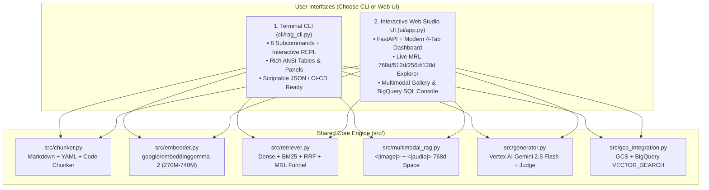

# Module 10: Complete In-Depth CLI Version vs. UI Version Master Guide

**Course Track:** All Levels (Beginner $\rightarrow$ Advanced Operational Reference)  
**CLI Entrypoint:** [`cli/rag_cli.py`](file:///data/opencode/sarvam-rag-course/cli/rag_cli.py)  
**Web Studio UI Entrypoint:** [`ui/app.py`](file:///data/opencode/sarvam-rag-course/ui/app.py)

---

## 1. Overview: Dual-Interface Architecture (CLI + Web UI)

Every capability in this course is accessible through **two complete, production-grade interfaces** that share the exact same underlying core engine (`src/`):



---

## 2. Part I: Google Cloud Platform (GCP) Setup — CLI vs. Web UI

### 2.1 Authenticate & Select Project (`genai-511910`)

| Step | CLI Version (`gcloud`) | Web UI Version (Google Cloud Console) |
| :--- | :--- | :--- |
| **1. Sign In** | `gcloud auth login`<br>`gcloud auth application-default login` | Sign in at [console.cloud.google.com](https://console.cloud.google.com/) with `ajithkumar1962vnr@gmail.com` |
| **2. Select Project** | `gcloud config set project genai-511910` | Click the **Project Picker** dropdown in the top navigation bar $\rightarrow$ Select **`genai-511910`** |
| **3. Verify Billing** | `gcloud billing projects describe genai-511910` | Navigate to **Billing** in the left sidebar and confirm `billingEnabled: true` |

### 2.2 Enable Required GCP Services

#### CLI Version
```bash
gcloud services enable \
  aiplatform.googleapis.com \
  bigquery.googleapis.com \
  storage.googleapis.com \
  run.googleapis.com \
  cloudbuild.googleapis.com \
  --project=genai-511910
```

#### Web UI Version
1. Open [APIs & Services $\rightarrow$ Library](https://console.cloud.google.com/apis/library?project=genai-511910).
2. Search for and click **Enable** on each of the following:
   - **Vertex AI API** (`aiplatform.googleapis.com`)
   - **BigQuery API** (`bigquery.googleapis.com`)
   - **Cloud Storage API** (`storage.googleapis.com`)
   - **Cloud Run Admin API** (`run.googleapis.com`)

---

## 3. Part II: Hugging Face & `google/embeddinggemma-2` Setup — CLI vs. Web UI

### 3.1 Create Hugging Face Access Token & Accept Model License

#### CLI Version
```bash
# Install Hugging Face CLI (included in .venv)
source .venv/bin/activate

# Authenticate non-interactively using your token from .env
export HF_TOKEN="hf_YOUR_TOKEN_HERE"
hf auth whoami

# Pre-download google/embeddinggemma-2 weights & processor
python3 -c "
from sentence_transformers import SentenceTransformer
m = SentenceTransformer('google/embeddinggemma-2', config_kwargs={'vision_config': None, 'audio_config': None})
print('Successfully cached google/embeddinggemma-2!')
"
```

#### Web UI Version
1. Visit [huggingface.co/settings/tokens](https://huggingface.co/settings/tokens).
2. Click **Create new token** $\rightarrow$ select **Read** permissions $\rightarrow$ copy the `hf_...` token into your local `.env` file (`HF_TOKEN=hf_...`).
3. Visit the model page at [huggingface.co/google/embeddinggemma-2](https://huggingface.co/google/embeddinggemma-2).
4. Review the **Files and versions** tab (`model.safetensors` 1.49 GB, `tokenizer.json` 32.2 MB, `config.json`, `prompts`) and accept the Gemma license terms if prompted.

---

## 4. Part III: GitHub Corpus & Repository Workflow — CLI vs. Web UI

### 4.1 Clone `sarvam-docs` & Configure Environment

#### CLI Version (`git` & `gh`)
```bash
# Clone the Sarvam documentation corpus
git clone https://github.com/ajithvnr2001/sarvam-docs.git /data/opencode/sarvam

# Clone this RAG Course repository
git clone https://github.com/ajithvnr2001/sarvam-embeddinggemma2-rag-course.git
cd sarvam-embeddinggemma2-rag-course

# Copy environment template and fill in your local credentials
cp .env.example .env
```

#### Web UI Version (GitHub Web Interface)
1. Open [github.com/ajithvnr2001/sarvam-docs](https://github.com/ajithvnr2001/sarvam-docs) in your browser.
2. Click the green **<> Code** button $\rightarrow$ **Download ZIP** (or **Open with GitHub Desktop**).
3. To create a Personal Access Token via UI:
   - Click your profile icon $\rightarrow$ **Settings** $\rightarrow$ **Developer settings** $\rightarrow$ **Personal access tokens** $\rightarrow$ **Tokens (classic)**.
   - Click **Generate new token (classic)**, check the `repo` scope, and store the token strictly in your local `.env` file (never commit it to git).

---

## 5. Part IV: Running the RAG System — Complete CLI Guide (`cli/rag_cli.py`)

Activate the virtual environment before running CLI commands:
```bash
cd /data/opencode/sarvam-rag-course
source .venv/bin/activate
```

### Command 1: `ingest` — Chunk & Encode `sarvam-docs` with EmbeddingGemma 2
Parses Markdown frontmatter, cleans navigation boilerplate, preserves code blocks, formats chunks with `title: {title} | text: {content}`, encodes `768d` vectors with `google/embeddinggemma-2` (`270M` `text_only` mode), and generates L2-normalized Matryoshka (`512d`, `256d`, `128d`) indices.

```bash
python3 cli/rag_cli.py ingest --max-files 35
```

### Command 2: `search` — Run Dense, BM25, Hybrid RRF, or MRL Funnel Retrieval
Test retrieval directly from the terminal across any strategy (`dense`, `bm25`, `hybrid`, `mrl_funnel`), any Matryoshka dimension (`768`, `512`, `256`, `128`), and any EmbeddingGemma 2 task prefix (`QuestionAnswering`, `SearchQuery`, `CodeRetrieval`, `FactChecking`).

```bash
# Hybrid RRF (Dense 768d + Identifier-Aware BM25)
python3 cli/rag_cli.py search \
  --query "Which Tamil speakers and sample rates work with bulbul:v4-flash?" \
  --mode hybrid \
  --dim 768 \
  --prompt-name QuestionAnswering \
  --top-k 5

# Two-Stage Matryoshka Funnel (128d shortlist -> 768d exact rerank)
python3 cli/rag_cli.py search \
  --query "How do I authenticate with api-subscription-key header?" \
  --mode mrl_funnel \
  --top-k 5
```

### Command 3: `ask` — End-to-End Grounded RAG with Vertex AI `gemini-2.5-flash` + LLM Judge
Retrieves top-K chunks, synthesizes a citation-backed answer (`[sarvam_XXXX]`) via Google Cloud Vertex AI `gemini-2.5-flash`, and optionally runs the automated LLM-as-a-Judge evaluator (`--judge`).

```bash
python3 cli/rag_cli.py ask \
  --query "How do I authenticate with the Sarvam AI API and what HTTP header is required?" \
  --mode hybrid \
  --dim 768 \
  --top-k 4 \
  --judge
```

### Command 4: `mrl-benchmark` — Live Matryoshka Representation Learning (MRL) Dimension Comparison
Compares `768d (1.0x)`, `512d (1.5x)`, `256d (3.0x)`, and `128d (6.0x)` side-by-side on any query, showing cosine similarity retention, top-1/top-5 rank overlap, and vector compression ratios.

```bash
python3 cli/rag_cli.py mrl-benchmark \
  --query "How do I generate Tamil speech using bulbul:v4-flash and what sample rates and speakers are supported?" \
  --top-k 5
```

### Command 5: `multimodal` — Full 740M Multimodal RAG (Text + Image + 16kHz Audio + Interleaved)
Builds (if `--rebuild` is passed) and searches the unified `768d` multimodal embedding gallery containing visual API architecture diagrams (`<|image|>`), real 16kHz audio waveforms (`<|audio|>`), and interleaved bundles.

```bash
# Query acoustic rain sound effects and visual API cards with natural language text
python3 cli/rag_cli.py multimodal \
  --query "continuous heavy rainfall storm sound effect audio" \
  --dim 768 \
  --top-k 4
```

### Command 6: `gcp-sync` — Sync Chunks & MRL Vectors to Cloud Storage + BigQuery
Uploads the JSONL embedding dataset to `gs://genai-511910-sarvam-rag/bq_load/` and loads the `genai-511910.sarvam_rag.docs_embeddings` table in BigQuery.

```bash
python3 cli/rag_cli.py gcp-sync --dim 256
```

### Command 7: `bq-search` — Execute Live Serverless `VECTOR_SEARCH` SQL on Google BigQuery
Encodes your query with `google/embeddinggemma-2` and runs `VECTOR_SEARCH(..., distance_type => 'COSINE')` on `genai-511910.sarvam_rag.docs_embeddings`.

```bash
python3 cli/rag_cli.py bq-search \
  --query "How do I authenticate with the Sarvam AI API using api-subscription-key?" \
  --dim 256 \
  --top-k 5
```

### Command 8: `chat` — Interactive Terminal RAG Session (REPL)
Starts an interactive conversational loop in your terminal where every turn retrieves grounded `sarvam-docs` context and streams a cited answer from Vertex AI `gemini-2.5-flash`.

```bash
python3 cli/rag_cli.py chat --mode hybrid --dim 768
```

---

## 6. Part V: Running the RAG System — Complete Web Studio UI Guide (`ui/app.py`)

### 6.1 Starting the Web Studio UI Server

```bash
cd /data/opencode/sarvam-rag-course
source .venv/bin/activate

# Launch FastAPI + Uvicorn server on port 8090
uvicorn ui.app:app --host 0.0.0.0 --port 8090
```

Open your browser to **`http://localhost:8090`** (or your Cloud Run HTTPS URL).

### 6.2 Step-by-Step Tour of All 4 Interactive Studio Tabs

#### Tab 1: Grounded RAG & Vertex AI Studio
1. **Preset Query Pills**: Click any of the 4 one-click preset questions (Authentication, Bulbul v4 Tamil TTS, Instant Voice Cloning, Cinematic Audio + ffmpeg) or type any custom question in the **Developer Question** input box.
2. **Retrieval Strategy Selector**:
   - `Hybrid RRF (Dense + BM25) — Recommended`: Combines semantic understanding with exact API identifier matching (`bulbul:v4-flash`, `api-subscription-key`).
   - `Two-Stage MRL Funnel (128d -> 768d)`: Uses 6x compressed `128d` vectors for candidate generation and `768d` for exact reranking.
   - `Dense Vector Only (EmbeddingGemma 2)`: Pure cosine similarity in `768d`/`512d`/`256d`/`128d`.
   - `BM25 Lexical Only`: Pure keyword matching.
3. **Matryoshka Dimension Selector**: Switch dynamically between `768d (1.0x)`, `512d (1.5x)`, `256d (3.0x)`, and `128d (6.0x)` to observe real-time score and rank changes.
4. **EmbeddingGemma 2 Prompt Prefix**: Select `QuestionAnswering`, `SearchQuery`, `CodeRetrieval`, or `FactChecking`.
5. **Action Buttons**:
   - Click **Ask Vertex AI Gemini (RAG)** to run retrieval + Vertex AI `gemini-2.5-flash` grounded generation + automated **LLM-as-a-Judge** scoring (displaying Context Relevance, Faithfulness, and Completeness `/5` badges).
   - Click **Retrieval Only (Fast)** to inspect the retrieved `sarvam-docs` chunks, categories, cosine scores, and source links in `<10 ms`.

#### Tab 2: Matryoshka (MRL) Live Explorer
1. Enter any technical query (e.g., *"How do I generate Tamil speech using bulbul:v4-flash and what sample rates and speakers are supported?"*).
2. Click **Compare 768d vs 512d vs 256d vs 128d**.
3. Inspect the **4-column side-by-side comparison grid**:
   - Column 1: **768d** (`1.0x` compression, `3,072 bytes/vec`)
   - Column 2: **512d** (`1.5x` compression, `2,048 bytes/vec`)
   - Column 3: **256d** (`3.0x` compression, `1,024 bytes/vec`)
   - Column 4: **128d** (`6.0x` compression, `512 bytes/vec`)
4. Each card shows **Top-1 Match (`TRUE`/`FALSE`)**, **Top-K Overlap % vs. 768d**, and the exact cosine similarity for every retrieved chunk after truncation and L2 re-normalization.

#### Tab 3: Multimodal Lab (740M Text + Image + Audio)
1. Explore the **Unified 768d Multimodal Gallery**, which displays all indexed items across three modalities:
   - `IMAGE`: Visual API specification cards (`sarvam_tts_bulbul_v4_card.png`, `sarvam_stt_saaras_card.png`, `sarvam_voice_cloning_card.png`, `sarvam_doc_translate_card.png`) encoded via the 170M vision tower (`<|image|>`).
   - `AUDIO`: Real 16kHz mono `.wav`/`.mp3` audio clips (`rain.wav`, `thunder.wav`, `phone_ring.wav`, `door_knock.wav`, `line_01_narrator.mp3`) encoded via the 300M USM audio tower (`<|audio|>`).
   - `INTERLEAVED`: Combined Text + Image + Audio record encoded into a single `768d` vector.
2. Click any preset cross-modal query pill or enter a custom query, select a Matryoshka dimension (`768d`, `512d`, `256d`, `128d`), and click **Search Multimodal Space** to watch text queries retrieve raw audio files and visual diagrams.

#### Tab 4: GCP BigQuery Vector Search & Cloud Console
1. Choose your **BigQuery Embedding Dimension** (`256d` or `768d`).
2. Click **Sync Local Index -> GCS & BigQuery** to upload JSONL embeddings to `gs://genai-511910-sarvam-rag` and load `genai-511910.sarvam_rag.docs_embeddings`.
3. Enter a query in **BigQuery `VECTOR_SEARCH` SQL Query** and click **Run BigQuery VECTOR_SEARCH**.
4. View the ranked results returned directly from Google BigQuery along with the exact executed `VECTOR_SEARCH(TABLE ..., 'embedding', TABLE query_vec, distance_type => 'COSINE')` SQL statement.

---

## 7. Quick Reference: CLI vs. REST API vs. Web UI Mapping

| Operation | CLI Command (`cli/rag_cli.py`) | FastAPI REST Endpoint (`ui/app.py`) | Web Studio UI Tab |
| :--- | :--- | :--- | :--- |
| **Index Stats & Health** | `python3 cli/rag_cli.py ingest` | `GET /api/status` | Header Status Pills |
| **Hybrid / Dense / BM25 Search** | `python3 cli/rag_cli.py search -q "..."` | `POST /api/search` | Tab 1 (Retrieval Only) |
| **Grounded RAG + LLM Judge** | `python3 cli/rag_cli.py ask -q "..." --judge` | `POST /api/ask` | Tab 1 (Ask Vertex AI Gemini) |
| **MRL Dimension Comparison** | `python3 cli/rag_cli.py mrl-benchmark -q "..."` | `POST /api/mrl-compare` | Tab 2 (MRL Live Explorer) |
| **Multimodal 740M Search** | `python3 cli/rag_cli.py multimodal -q "..."` | `POST /api/multimodal-search` | Tab 3 (Multimodal Lab) |
| **GCS + BigQuery Sync** | `python3 cli/rag_cli.py gcp-sync --dim 256` | `POST /api/gcp-sync` | Tab 4 (Sync Local Index) |
| **BigQuery `VECTOR_SEARCH`** | `python3 cli/rag_cli.py bq-search -q "..."` | `POST /api/bq-search` | Tab 4 (Run BigQuery VECTOR_SEARCH) |
