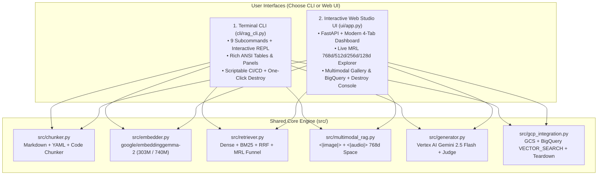

# Module 10 (All Levels): Complete In-Depth CLI Version vs. Web UI Version Master Guide

> **Course Navigation**: [← Module 09: Evaluation & Benchmarking](./09_evaluation_benchmarking.md) | [Course Index (`COURSE.md`)](../COURSE.md) | [Next: Module 11 — Production Resource Teardown (`destroy`) →](./11_teardown_and_cost_cleanup.md)  
> **Course Track:** All Levels (Beginner $\rightarrow$ Production Operational Reference)  
> **CLI Entrypoint:** [`cli/rag_cli.py`](../cli/rag_cli.py) (9 Subcommands)  
> **Web Studio UI Entrypoint:** [`ui/app.py`](../ui/app.py) (4 Interactive Tabs)

---

## 📖 1. Explanation: Dual-Interface Architecture (9-Command CLI + 4-Tab Web UI)

Every capability in this course is accessible through **two complete, production-grade interfaces** that call the exact same underlying Python engine in [`src/`](../src/):



---

## 🛠️ 2. Practicals: Side-by-Side CLI vs. Web UI Instructions

### 2.1 Part I: Google Cloud Platform (GCP `genai-511910`) — CLI vs. Web UI

| Operation | CLI Version (`gcloud` / `bq`) | Web UI Version (Google Cloud Console) |
| :--- | :--- | :--- |
| **1. Sign In** | `gcloud auth login`<br/>`gcloud auth application-default login` | Sign in at [console.cloud.google.com](https://console.cloud.google.com/) |
| **2. Select Project** | `gcloud config set project genai-511910` | Click the **Project Picker** dropdown at the top bar $\rightarrow$ Select **`genai-511910`** |
| **3. Enable APIs** | `gcloud services enable aiplatform.googleapis.com bigquery.googleapis.com storage.googleapis.com run.googleapis.com --project=genai-511910` | Open [APIs & Services $\rightarrow$ Library](https://console.cloud.google.com/apis/library?project=genai-511910) and click **Enable** on Vertex AI, BigQuery, Cloud Storage, and Cloud Run |

---

### 2.2 Part II: Hugging Face & `google/embeddinggemma-2` — CLI vs. Web UI

| Operation | CLI Version (`hf` / Python) | Web UI Version (Hugging Face Hub) |
| :--- | :--- | :--- |
| **1. Configure Token** | Add `HF_TOKEN=hf_...` to `.env` and run `hf auth whoami` | Visit [huggingface.co/settings/tokens](https://huggingface.co/settings/tokens) $\rightarrow$ **Create new token (Read)** |
| **2. Inspect / Cache Model** | `python -c "from src.embedder import EmbeddingGemma2Engine; EmbeddingGemma2Engine('text_only')"` | Open [huggingface.co/google/embeddinggemma-2](https://huggingface.co/google/embeddinggemma-2) and inspect **Files and versions** (`model.safetensors`, `config.json`, `prompts`) |

---

### 2.3 Part III: All 9 Subcommands of the RAG CLI (`cli/rag_cli.py`)

Note that every query subcommand (`search`, `ask`, `mrl-benchmark`, `multimodal`, `bq-search`) accepts your query **either positionally** (`python -m cli.rag_cli search "My query"`) **or via `-q` / `--query`** (`python -m cli.rag_cli search --query "My query"`):

```bash
cd /data/opencode/sarvam-rag-course
source .venv/bin/activate

# 1. ingest — Chunk sarvam-docs (38 files -> 307 chunks) & build 768d/512d/256d/128d MRL matrices
python -m cli.rag_cli ingest

# 2. search — Run Dense, BM25, Hybrid RRF, or Two-Stage MRL Funnel retrieval
python -m cli.rag_cli search "Which Tamil speakers and sample rates work with bulbul:v4-flash?" --mode hybrid --dim 768 --top-k 5
python -m cli.rag_cli search "How do I authenticate with api-subscription-key?" --mode mrl_funnel --top-k 5

# 3. ask — Grounded synthesis with Vertex AI gemini-2.5-flash + LLM-as-a-Judge (--judge / --evaluate)
python -m cli.rag_cli ask "How do I authenticate with the Sarvam AI API and what HTTP header is required?" --mode hybrid --dim 768 --judge

# 4. mrl-benchmark — Live Matryoshka 768d vs 512d vs 256d vs 128d comparison
python -m cli.rag_cli mrl-benchmark "How do I generate Tamil speech using bulbul:v4-flash?" --top-k 5

# 5. multimodal — Cross-modal search across Text, PNG Diagrams (<|image|>), and 16kHz Audio (<|audio|>)
python -m cli.rag_cli multimodal "continuous heavy rainfall storm sound effect audio" --dim 768 --top-k 4

# 6. gcp-sync — Provision GCS bucket + BigQuery dataset and upload 256d MRL vectors
python -m cli.rag_cli gcp-sync --dim 256

# 7. bq-search — Execute live serverless SQL VECTOR_SEARCH on Google BigQuery
python -m cli.rag_cli bq-search "How do I authenticate with the Sarvam AI API?" --dim 256 --top-k 5

# 8. chat — Interactive multi-turn RAG terminal REPL
python -m cli.rag_cli chat --mode hybrid --dim 768

# 9. destroy — Tear down GCP BigQuery dataset, GCS bucket, and stop local Web UI server
python -m cli.rag_cli destroy
```

---

### 2.4 Part IV: All 4 Interactive Tabs of the Web Studio UI (`ui/app.py`)

Start the server:
```bash
cd /data/opencode/sarvam-rag-course
.venv/bin/python -m uvicorn ui.app:app --host 0.0.0.0 --port 8090
```

Open **`http://localhost:8090`** in your browser:

1. **Tab 1 — `Grounded RAG & Vertex AI Studio`:**
   - One-click preset developer questions, **Retrieval Strategy** selector (`Hybrid RRF`, `Two-Stage MRL Funnel`, `Dense Only`, `BM25 Only`), **MRL Dimension** selector (`768d`, `512d`, `256d`, `128d`), **Task Prompt Prefix** selector, grounded Vertex AI `gemini-2.5-flash` synthesis with `[sarvam_XXXX]` citations, and `/5` LLM-as-a-Judge badges.
2. **Tab 2 — `Matryoshka (MRL) Live Explorer`:**
   - 4-column live comparison grid (`768d 1.0x`, `512d 1.5x`, `256d 3.0x`, `128d 6.0x`) showing byte compression, Top-1 match (`TRUE`/`FALSE`), Top-K overlap %, and $L_2$ re-normalized cosine scores.
3. **Tab 3 — `Multimodal Lab (740M Text + Image + Audio)`:**
   - Interactive gallery and cross-modal search across 4 visual API architecture PNG cards (`<|image|>`), 5 real 16kHz `.wav`/`.mp3` audio clips (`<|audio|>`), and 1 interleaved bundle.
4. **Tab 4 — `GCP BigQuery Vector Search & Cloud Console`:**
   - Green **`Sync Local Index -> GCS & BigQuery`** provisioning button, live **`Run BigQuery VECTOR_SEARCH`** SQL runner + SQL query viewer, and red **`Destroy Cloud Resources (GCS + BQ)`** teardown button.

---

## 🧠 3. Key Learnings: Complete CLI $\leftrightarrow$ REST API $\leftrightarrow$ Web UI Mapping

| Capability | CLI Command (`cli/rag_cli.py`) | FastAPI Endpoint (`ui/app.py`) | Web Studio UI Control |
| :--- | :--- | :--- | :--- |
| **Index Health & Stats** | `python -m cli.rag_cli ingest` | `GET /api/status` | Top Header Status Bar |
| **Hybrid / Dense / BM25 Search** | `python -m cli.rag_cli search "..."` | `POST /api/search` | Tab 1 (`Retrieval Only`) |
| **Grounded RAG + LLM Judge** | `python -m cli.rag_cli ask "..." --judge` | `POST /api/ask` | Tab 1 (`Ask Vertex AI Gemini`) |
| **MRL 4-Dim Benchmark** | `python -m cli.rag_cli mrl-benchmark "..."` | `POST /api/mrl-compare` | Tab 2 (`Compare 768d..128d`) |
| **Multimodal 740M Search** | `python -m cli.rag_cli multimodal "..."` | `POST /api/multimodal-search` | Tab 3 (`Search Multimodal Space`) |
| **GCP GCS + BigQuery Sync** | `python -m cli.rag_cli gcp-sync --dim 256` | `POST /api/gcp-sync` | Tab 4 (`Sync Local Index -> GCS & BigQuery`) |
| **BigQuery `VECTOR_SEARCH`** | `python -m cli.rag_cli bq-search "..."` | `POST /api/bq-search` | Tab 4 (`Run BigQuery VECTOR_SEARCH`) |
| **Cloud & Runtime Teardown** | `python -m cli.rag_cli destroy` | `POST /api/gcp-destroy` | Tab 4 (`Destroy Cloud Resources (GCS + BQ)`) |

---

## 🧹 4. Resource Teardown & Cost Cleanup (`destroy`)

Proceed to **[Module 11: Production Resource Teardown, Cost Governance & Clean Destroy (`destroy`)](./11_teardown_and_cost_cleanup.md)** for a complete deep-dive into tearing down all cloud and local resources.
