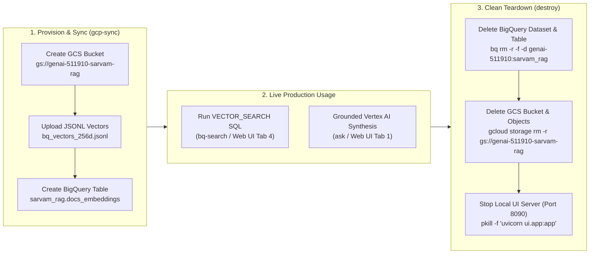

# Module 11: Production Resource Teardown, Cost Governance & Clean Destroy (CLI + Web UI)

> **Course Navigation**: [← Module 10: Complete CLI & Web UI Master Guide](./10_cli_and_ui_master_guide.md) | [Course Index (`COURSE.md`)](../COURSE.md) | [Bit-by-Bit Guide (`BEGINNER_TO_PRODUCTION_STEP_BY_STEP.md`)](../BEGINNER_TO_PRODUCTION_STEP_BY_STEP.md)

---

## 📖 1. Explanation: Why Every Production Cloud Project Needs a `destroy` Lifecycle

### 💡 The Simple Analogy: Turning Off the Lights When Leaving the Lab
When you build a production RAG system on Google Cloud Platform (`genai-511910`), your pipeline provisions **stateful cloud resources** and **local background processes**:
1. **Google BigQuery Dataset & Vector Table (`genai-511910:sarvam_rag.docs_embeddings`)**: Stores your `ARRAY<FLOAT64>` Matryoshka vectors in cloud storage and charges for active storage + SQL queries.
2. **Google Cloud Storage Bucket (`gs://genai-511910-sarvam-rag`)**: Stores your exported `bq_vectors_256d.jsonl` artifacts.
3. **Local FastAPI Web UI Studio Server (`uvicorn ui.app:app` on Port `8090`)**: Holds RAM for the `google/embeddinggemma-2` weights and listens on TCP port `8090`.
4. **Local Pre-Computed NumPy Matrices (`data/index/*.npy`)**: Stores the local `768d`, `512d`, `256d`, and `128d` vectors on disk.

In production engineering (and FinOps), **Infrastructure Lifecycle Management** means every `provision` / `sync` command (`python -m cli.rag_cli gcp-sync`) **must** have a paired, idempotent `destroy` command (`python -m cli.rag_cli destroy` and `scripts/destroy_resources.sh`) that cleanly removes cloud resources when your lab or deployment finishes, ensuring **zero surprise cloud bills**.



---

## 🛠️ 2. Practicals: How to Destroy Resources via CLI and Web UI

We provide **4 ways** to tear down your resources depending on whether you prefer the **Python RAG CLI**, the **Bash Teardown Script**, the **Interactive Web Studio UI**, or the **Google Cloud Console UI**.

### Option A: One-Command Python RAG CLI Teardown (`cli/rag_cli.py`)

```bash
cd /data/opencode/sarvam-rag-course
source .venv/bin/activate

# Destroy GCP Cloud Storage bucket + BigQuery dataset + Stop Web UI server (keeps local .npy index)
python -m cli.rag_cli destroy

# Optional: Also delete local pre-computed .npy matrices from data/index/
python -m cli.rag_cli destroy --purge-local-index
```

#### Live Verified Output (`data/artifacts/teardown_verification.txt`):
```text
╭─ Phase 6 — Production Resource Teardown & Cost Cleanup ─╮
│ Teardown & Resource Cleanup (`destroy`)                 │
│ GCP Project: genai-511910                               │
│ BigQuery Dataset: genai-511910:sarvam_rag               │
│ GCS Bucket: gs://genai-511910-sarvam-rag                │
╰─────────────────────────────────────────────────────────╯
╭──────────────────────────── ✓ Teardown Complete ─────────────────────────────╮
│ {                                                                            │
│   "cloud_teardown": {                                                        │
│     "status": "DESTROYED",                                                   │
│     "project_id": "genai-511910",                                            │
│     "bigquery_dataset": "genai-511910:sarvam_rag",                           │
│     "bigquery_status": "DELETED",                                            │
│     "gcs_bucket": "gs://genai-511910-sarvam-rag",                            │
│     "gcs_status": "DELETED",                                                 │
│     "elapsed_sec": 8.07                                                      │
│   },                                                                         │
│   "ui_server_port_8090": "NOT_RUNNING",                                      │
│   "local_index_purged": "SKIPPED (kept pre-computed local MRL matrices; pass │
│ --purge-local-index to delete)"                                              │
│ }                                                                            │
╰──────────────────────────────────────────────────────────────────────────────╯
```

---

### Option B: Standalone Shell Script + Verification (`scripts/destroy_resources.sh`)

If you want to tear down and immediately run verification checks via `gcloud` and `bq` CLI:
```bash
cd /data/opencode/sarvam-rag-course
bash scripts/destroy_resources.sh
```

Under the hood, `scripts/destroy_resources.sh` executes:
```bash
# 1. Delete BigQuery Dataset & Table (recursive + force)
bq --location=us-central1 rm -r -f -d genai-511910:sarvam_rag

# 2. Delete Google Cloud Storage Bucket & all objects inside it
gcloud storage rm --recursive gs://genai-511910-sarvam-rag --project=genai-511910

# 3. Stop local FastAPI Web UI Studio process if running
pkill -f "uvicorn ui.app:app" || true

# 4. Verify resources no longer exist
gcloud storage buckets describe gs://genai-511910-sarvam-rag --project=genai-511910   # Returns NotFound
bq show genai-511910:sarvam_rag                                                       # Returns NotFound
```

---

### Option C: Interactive Web Studio UI (`http://localhost:8090`)

1. Open **`http://localhost:8090`** in your browser.
2. Click **Tab 4: `GCP BigQuery Vector Search`**.
3. Click the red button **`Destroy Cloud Resources (GCS + BQ)`**:
   - This sends a `POST /api/gcp-destroy` request to [`GCPVectorPlatform.destroy_cloud_resources()`](../src/gcp_integration.py#L226-L260) and displays the live JSON deletion confirmation right in the UI!
4. To re-create the cloud resources later from the same UI tab, click the green button **`Sync Local Index -> GCS & BigQuery`**.

---

### Option D: Google Cloud Console Web UI (Manual Browser Cleanup)

If you want to verify or delete resources directly in the Google Cloud Console browser interface:
1. **Delete BigQuery Dataset (`sarvam_rag`)**:
   - Open [Google Cloud Console $\rightarrow$ BigQuery Studio](https://console.cloud.google.com/bigquery?project=genai-511910).
   - In the **Explorer** pane on the left, expand project **`genai-511910`**.
   - Click the three dots (`⋮`) next to dataset **`sarvam_rag`** $\rightarrow$ Click **Delete**.
   - Type `delete` in the confirmation box and click **Delete**.
2. **Delete Cloud Storage Bucket (`genai-511910-sarvam-rag`)**:
   - Open [Google Cloud Console $\rightarrow$ Cloud Storage Buckets](https://console.cloud.google.com/storage/browser?project=genai-511910).
   - Check the box next to **`genai-511910-sarvam-rag`** $\rightarrow$ Click **Delete** in the top bar.
   - Type `DELETE` to confirm permanent removal of the bucket and its JSONL objects.

---

## 🧠 3. Key Learnings & Production Takeaways

1. **Idempotent Teardown**: Both `GCPVectorPlatform.destroy_cloud_resources()` in [`src/gcp_integration.py`](../src/gcp_integration.py) and [`scripts/destroy_resources.sh`](../scripts/destroy_resources.sh) are **idempotent** — running them multiple times never crashes even if the bucket or dataset was already deleted.
2. **Decoupled Local vs. Cloud State**: By keeping your local Matryoshka vectors (`data/index/embeddings_{768,512,256,128}.npy`, only `628 KB` total) committed in Git while destroying the cloud BigQuery/GCS resources when idle, you get:
   - **$0.00/month** ongoing cloud storage cost when idle.
   - **Instant local RAG search** (`python -m cli.rag_cli search` / `ask` / `mrl-benchmark` / `multimodal`) with zero cloud storage dependencies.
   - **15-second re-provisioning** back to GCP BigQuery anytime via `python -m cli.rag_cli gcp-sync --dim 256`!

---

## 🧹 4. Resource Teardown Verification Checklist

Before closing your cloud session, run this 3-line verification check to confirm `$0.00` active cloud footprint on `genai-511910`:

```bash
python -m cli.rag_cli destroy
gcloud storage buckets describe gs://genai-511910-sarvam-rag --project=genai-511910 || echo "Verified: GCS bucket deleted"
bq show genai-511910:sarvam_rag || echo "Verified: BigQuery dataset deleted"
```
