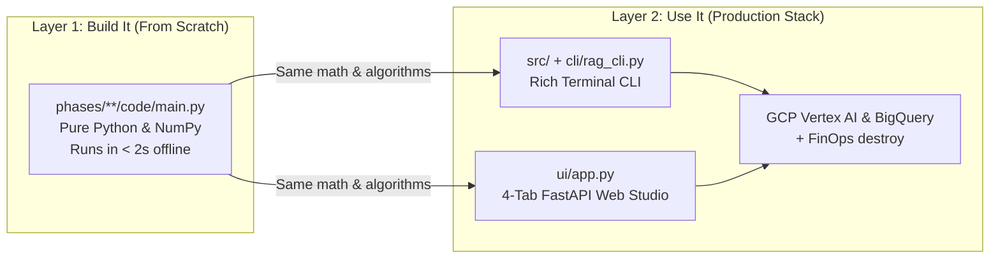

# Dev Environment & Route Preflight

> Verify your runtime before you debug your math.

**Type:** Build | Learn
**Languages:** Python
**Prerequisites:** None
**Time:** ~30 minutes

---

## Learning Objectives

By the end of this lesson, you will be able to:

- Verify your Python 3.10+ environment, Git installation, and the 64-document Sarvam AI Markdown corpus using a route-aware preflight probe
- Distinguish between local zero-dependency from-scratch execution (`phases/**/code/main.py`) and full cloud production execution (`src/`, `cli/`, `ui/`)
- Select the right learning path (`beginner`, `rag-foundations`, `multimodal`, or `gcp-production`) for your current goal

---

## The Problem

Nothing kills momentum faster than cloning an AI engineering repository, running a command on page one, and hitting a cryptic `ModuleNotFoundError`, an incompatible Python version, or a missing cloud credential before you have even learned what an embedding vector is. Worse, many RAG tutorials force you to provision expensive cloud vector databases and download multi-gigabyte weights just to see how cosine similarity or BM25 works.

In a production engineering curriculum, **from-scratch conceptual code** and **production cloud integration** should be cleanly decoupled. You should be able to run every mathematical and algorithmic lesson in under two seconds on a laptop CPU with zero external API keys—and then, when you are ready for the **"Use It"** beat, switch seamlessly into the production `google/embeddinggemma-2` + Google Cloud Vertex AI + BigQuery stack via CLI or Web UI.

To make that guarantee concrete, we start by building a **route-aware environment preflight tool** that inspects your machine, checks only what your chosen learning route requires, and gives exact copy-paste fixes if anything is missing.

---

## The Concept

### Dual-Layer Curriculum Architecture

Every lesson in this repository operates on two layers:



### Route-Based Preflight Matrix

Rather than checking every possible cloud tool up front, our preflight script groups probes by **learning route**:

| Route Slug | Target Phases | Required Probes | Optional / Production Probes |
| :--- | :--- | :--- | :--- |
| `beginner` | Phases 0–2 | `python`, `git`, `corpus` | `numpy`, `accelerator` |
| `rag-foundations` | Phases 0–2 | `python`, `git`, `corpus` | `numpy`, `torch`, `transformers`, `accelerator` |
| `multimodal` | Phase 3 | `python`, `git`, `corpus` | `numpy`, `torch`, `transformers`, `fastapi` |
| `gcp-production` | Phases 0–4 | `python`, `git`, `corpus` | `numpy`, `torch`, `transformers`, `fastapi`, `gcloud` |

Each probe returns an immutable `Result(ok: bool, detail: str)`:

$$
\operatorname{RouteStatus}(R) = \bigwedge_{p \in \operatorname{required}(R)} \operatorname{probe}(p).\text{ok}
$$

In plain English: a route passes preflight if and only if **every required probe** for that route returns `ok = True`. Optional probes report `READY` or `INFO` without blocking your progress.

---

## Build It

### Step 1: Model Probes and Routes as Frozen Dataclasses

We represent each environment check as a `Probe` with three fields: a human-readable `label`, a zero-argument callable `run` that returns `Result(ok, detail)`, and a specific `fix` command string.

```python
@dataclass(frozen=True)
class Result:
    ok: bool
    detail: str

@dataclass(frozen=True)
class Probe:
    label: str
    run: Callable[[], Result]
    fix: str
```

### Step 2: Check Python Version, Corpus Integrity, and Compute Backends

Run the preflight script directly from the repository root:

```bash
python3 phases/00-setup-and-tooling/01-dev-environment-and-preflight/code/main.py --route beginner
```

Expected output:

```text
========================================================================
SARVAM AI x EMBEDDINGGEMMA-2 RAG PREFLIGHT — Route: Beginner From-Scratch Route (Phases 0-2)
========================================================================

[Required Checks]
  [PASS] Python 3.10+                 -> Python 3.12.x at /usr/bin/python3
  [PASS] Git CLI                      -> git version 2.x at /usr/bin/git
  [PASS] Sarvam AI Corpus             -> 64 Sarvam AI Markdown documents ready in data/sarvam_docs

[Optional / Production Checks]
  [READY] NumPy                        -> importable by /usr/bin/python3
  [READY] Compute Backend              -> CPU mode active (100% supported for EmbeddingGemma-2 & from-scratch labs)
------------------------------------------------------------------------
Result: All required checks passed! Your environment is ready.
Next step:
  python3 phases/01-math-and-embeddings/01-vectors-norms-and-cosine-similarity/code/main.py
```

---

## Use It

Once your preflight passes, set up the production virtual environment so both the **CLI** and **Web UI Studio** have access to `google/embeddinggemma-2`, FastAPI, and the Google Cloud SDKs:

### 1. CLI Workflow

```bash
# Activate the virtual environment
python3 -m venv .venv
source .venv/bin/activate
pip install -r requirements.txt

# Run the production system status command
python -m cli.rag_cli status
```

### 2. Web UI Studio Workflow

```bash
# Launch the 4-Tab Interactive Web Studio on port 8090
python -m cli.rag_cli serve --host 0.0.0.0 --port 8090
```

Open `http://localhost:8090` in your browser to inspect corpus statistics, active embedding backend, and index health in the top telemetry bar.

---

## Ship It

This lesson produces two reusable artifacts in `outputs/`:

- **Prompt (`outputs/prompt-env-check.md`)**: A structured diagnostic system prompt for troubleshooting Python, PyTorch, Hugging Face, and `gcloud` environment issues.
- **Skill (`outputs/skill-rag-preflight-auditor.md`)**: An installable agent skill that audits a local or cloud workspace before deploying RAG pipelines.

Install the skill into your agent workspace with:

```bash
python3 scripts/install_skills.py .agents/skills --phase 0 --force
```

> [!NOTE]
> **Cloud FinOps Check:** Preflight checks run 100% locally and create zero Google Cloud resources (`$0.00` cost).

---

## Exercises

1. **[Easy]** Run `code/main.py --list-routes` and then run preflight for `--route gcp-production`. Inspect which additional probes are executed.
2. **[Medium]** Add a new probe `"disk_space"` to `PROBES` in `code/main.py` using `shutil.disk_usage(".")` that checks for at least 5 GB of free disk space for Hugging Face model caching.
3. **[Hard]** Extend `code/main.py` with a `--json` flag that outputs a machine-readable JSON preflight report suitable for a GitHub Actions CI pipeline.

---

## Key Terms

| Term | What people say | What it actually means |
|------|----------------|----------------------|
| **Preflight Probe** | "Environment health check" | A deterministic function that tests one runtime dependency and returns pass/fail plus an exact remediation command |
| **Virtual Environment (`.venv`)** | "Isolated Python sandbox" | A directory containing its own Python binary and `site-packages` so project libraries never clash with OS packages |
| **ADC (Application Default Credentials)** | "Google Cloud login" | A standard credential lookup chain used by Google Cloud client libraries to authenticate without hardcoding JSON keys in code |

---

## Further Reading

- [Python `venv` Documentation](https://docs.python.org/3/library/venv.html)
- [Google Cloud Application Default Credentials Guide](https://cloud.google.com/docs/authentication/application-default-credentials)
- [Production CLI Implementation (`cli/rag_cli.py`)](../../../../cli/rag_cli.py)
