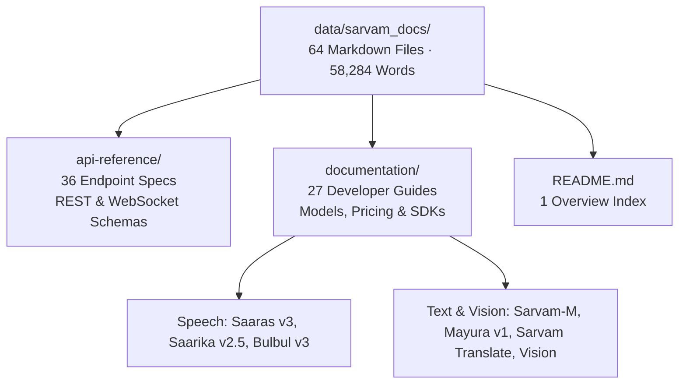

# GCP, Hugging Face & Sarvam Corpus Setup

> Never chunk a corpus you haven't profiled, and never log a secret you haven't masked.

**Type:** Build | Learn
**Languages:** Python
**Prerequisites:** [01 — Dev Environment & Route Preflight](../../01-dev-environment-and-preflight/docs/en.md)
**Time:** ~35 minutes

---

## Learning Objectives

By the end of this lesson, you will be able to:

- Profile the 64-file `sarvam-docs` developer documentation corpus to quantify its structural density (headings, pricing tables, code blocks, and word counts)
- Configure Hugging Face authentication (`HF_TOKEN`) for `google/embeddinggemma-2` and Google Cloud Application Default Credentials (`gcloud auth application-default login`)
- Implement deterministic secret masking so API tokens (`hf_...`, `ghp_...`) never leak into terminal logs or Git commits

---

## The Problem

Two mistakes derail production RAG projects on day one:

1. **Blind Ingestion**: Engineers feed raw files into a generic text splitter without profiling the corpus first. If your corpus is 64 Markdown files of Sarvam AI developer documentation containing hundreds of parameter tables (`| Parameter | Type | Required |`), curl snippets, and model version codes (`saaras:v3`, `bulbul:v3`, `mayura:v1`), a blind character splitter will slice right through the middle of pricing tables and API schemas.
2. **Credential Leakage**: Engineers hardcode Hugging Face tokens or Google Cloud project settings into source files or print raw `.env` dictionaries during startup diagnostics, accidentally committing tokens to GitHub.

Before we touch embeddings or vector databases, we must **profile our exact dataset** and establish **zero-leak credential hygiene**.

---

## The Concept

### Anatomy of the `sarvam-docs` Corpus

Our knowledge base comes from [`ajithvnr2001/sarvam-docs`](https://github.com/ajithvnr2001/sarvam-docs), covering Sarvam AI's multilingual speech and language APIs for Indian languages:



### Corpus Structural Statistics

Let $D = \{d_1, d_2, \dots, d_N\}$ be our document collection ($N = 64$). For each document $d_i$, we extract four structural signals before designing our chunker:

$$
\text{profile}(d_i) = \bigl(W(d_i),\, H(d_i),\, T(d_i),\, C(d_i)\bigr)
$$

where:
- $W(d_i)$ is the lexical word count,
- $H(d_i)$ is the count of ATX Markdown headings (`#` through `######`),
- $T(d_i)$ is the count of Markdown pipe-table rows (`| ... |`), and
- $C(d_i)$ is the count of fenced code blocks (` ``` `).

| Metric | Value Across `sarvam-docs` | Architectural Implication |
| :--- | :--- | :--- |
| **Documents ($N$)** | `64` | Small enough to index on CPU in ~32 seconds; rich enough for rigorous IR evaluation |
| **Total Words ($\sum W$)** | `58,284` | Produces `244` structure-aware chunks at 900-char target window |
| **Markdown Headings ($\sum H$)** | `580+` | Strong section hierarchy — ideal for heading-aware splitting with breadcrumbs |
| **Table Rows ($\sum T$)** | `950+` | High density of pricing/parameter tables — requires keeping table rows intact |

---

## Build It

### Step 1: Profile Every Markdown File for Headings, Tables, and Code Fences

In `code/main.py`, we scan `data/sarvam_docs/` using regular expressions to measure the structural composition of each file and rank the most information-dense documents.

### Step 2: Audit `.env` Schema with Deterministic Secret Masking

Never print raw tokens in startup logs. Our `mask_secret()` helper preserves only the first 4 and last 3 characters:

```python
def mask_secret(value: str) -> str:
    value = value.strip()
    if not value:
        return "<EMPTY>"
    if len(value) <= 8:
        return "***"
    return f"{value[:4]}...{value[-3:]} (len={len(value)})"
```

Run the standalone profiler:

```bash
python3 phases/00-setup-and-tooling/02-gcp-hf-and-corpus-setup/code/main.py
```

Expected output:

```text
========================================================================
PHASE 00 · LESSON 02: SARVAM AI CORPUS & CLOUD CONFIG PROFILER
========================================================================

1. Corpus Summary (data/sarvam_docs):
   - Total Markdown Documents : 64
   - Total Words              : 58,284
   ...
Verification passed: Corpus profiled and secret masking verified.
```

---

## Use It

### 1. Configure `.env` and Authenticate GCP

Copy `.env.example` to `.env` and configure your Hugging Face and Google Cloud settings:

```bash
cp .env.example .env
# Authenticate Google Cloud Application Default Credentials
gcloud auth application-default login
gcloud config set project genai-511910
```

### 2. CLI Workflow: Verify Corpus & Config Status

```bash
python -m cli.rag_cli status
```

### 3. Web UI Studio Workflow

Launch `python -m cli.rag_cli serve --port 8090` and open `http://localhost:8090`. The top status bar displays the live count of `64` Markdown documents, `244` indexed chunks, and active GCP project metadata.

---

## Ship It

- **Prompt (`outputs/prompt-corpus-audit.md`)**: System prompt for analyzing a new technical documentation corpus and recommending chunking & retrieval parameters.
- **Skill (`outputs/skill-corpus-readiness-checker.md`)**: Agent skill that inspects any documentation folder for Markdown table density, heading hierarchy depth, and secret hygiene before indexing.

> [!NOTE]
> **Cloud FinOps Check:** Corpus profiling and `.env` validation run locally with `$0.00` cloud cost.

---

## Exercises

1. **[Easy]** Modify `code/main.py` to also count how many times the exact model identifier `saaras:v3` appears across all 64 Markdown files.
2. **[Medium]** Add a check to `code/main.py` that flags any Markdown file with more than 1,000 words but zero `#` or `##` headings (an "unstructured wall of text").
3. **[Hard]** Write a pre-commit hook script that scans staged files for patterns matching `hf_[A-Za-z0-9]{20,}` or `ghp_[A-Za-z0-9]{20,}` and blocks the commit with exit code 1.

---

## Key Terms

| Term | What people say | What it actually means |
|------|----------------|----------------------|
| **Corpus Profiling** | "EDA for text" | Quantifying document lengths, heading hierarchies, tables, and code blocks before choosing a chunking strategy |
| **Gated Model** | "Protected Hugging Face repo" | A model repository (like `google/embeddinggemma-2`) that requires accepting a license agreement and passing an `HF_TOKEN` header |
| **Secret Masking** | "Redacting API keys" | Transforming sensitive strings into `hf_W...EMj` before logging so credentials never appear in plaintext logs |

---

## Further Reading

- [Sarvam AI Developer Documentation Repository (`ajithvnr2001/sarvam-docs`)](https://github.com/ajithvnr2001/sarvam-docs)
- [Google EmbeddingGemma-2 Model Card on Hugging Face](https://huggingface.co/google/embeddinggemma-2)
- [Production Config & Chunker (`src/chunker.py`)](../../../../src/chunker.py)
