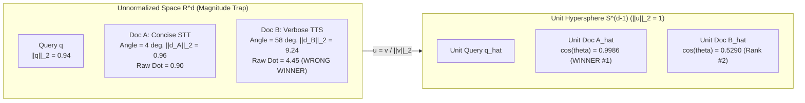

# Vectors, L2 Norms & Cosine Similarity

> Meaning lives in the angle between vectors, not their length.

**Type:** Build | Learn
**Languages:** Python
**Prerequisites:** [Phase 00 — GCP, Hugging Face & Sarvam Corpus Setup](../../../00-setup-and-tooling/02-gcp-hf-and-corpus-setup/docs/en.md)
**Time:** ~45 minutes

---

## Learning Objectives

By the end of this lesson, you will be able to:

- Implement the inner (dot) product, Euclidean $\ell_2$ norm, unit-sphere projection, and cosine similarity in pure Python from scratch
- Prove mathematically why unnormalized dot product fails on variable-length documents (the **Magnitude Trap**)
- Verify why pre-normalizing `google/embeddinggemma-2` vectors to $\lVert\mathbf{v}\rVert_2 = 1$ reduces cosine similarity to a single hardware-accelerated matrix-vector multiply ($\mathbf{E}\mathbf{q}$)

---

## The Problem

Suppose a developer searches your Sarvam AI documentation for `"How does Saaras v3 speech-to-text work?"`. Your corpus contains two candidate chunks:

- **Document A (`creative-speech-to-text.md`)**: A concise, 80-word section explaining the `saaras:v3` Speech-to-Text REST API.
- **Document B (`sarvam-api-docs.md`)**: A sprawling, 1,500-word overview mostly about Text-to-Speech (`bulbul:v3`) that mentions the word `"speech"` twenty times.

If your embedding pipeline sums or pools token representations without normalizing vector lengths, Document B's vector $\mathbf{d}_B$ will have a much larger Euclidean magnitude ($\lVert\mathbf{d}_B\rVert_2 \gg \lVert\mathbf{d}_A\rVert_2$) simply because it is longer. If you rank documents by raw dot product $\mathbf{q} \cdot \mathbf{d}$, Document B wins—even though it points in the wrong semantic direction!

To build a reliable semantic retriever, we must separate **semantic direction** (the angle $\theta$ between vectors) from **vector magnitude** ($\lVert\mathbf{d}\rVert_2$).

---

## The Concept

### Geometric Intuition: Projecting Onto the Unit Hypersphere $\mathbb{S}^{d-1}$



### 1. The Inner (Dot) Product

Given a query vector $\mathbf{q} \in \mathbb{R}^d$ and a document vector $\mathbf{d} \in \mathbb{R}^d$ (where $d = 768$ for full-dimensional `google/embeddinggemma-2`), their inner product is:

$$
\mathbf{q} \cdot \mathbf{d} = \langle \mathbf{q}, \mathbf{d} \rangle = \sum_{i=1}^{d} q_i d_i
$$

In plain English: multiply matching coordinates pair-by-pair and add them all up.

### 2. The Euclidean ($\ell_2$) Norm

The length (magnitude) of a vector $\mathbf{v} \in \mathbb{R}^d$ is the square root of its dot product with itself:

$$
\lVert \mathbf{v} \rVert_2 = \sqrt{\sum_{i=1}^{d} v_i^2}
$$

### 3. Cosine Similarity & The Cauchy-Schwarz Guarantee

By the law of cosines in Euclidean space, $\mathbf{q} \cdot \mathbf{d} = \lVert \mathbf{q} \rVert_2 \lVert \mathbf{d} \rVert_2 \cos\theta$. Solving for $\cos\theta$ yields **cosine similarity**:

$$
\text{cosine\_similarity}(\mathbf{q}, \mathbf{d}) = \cos(\theta) = \frac{\mathbf{q} \cdot \mathbf{d}}{\lVert \mathbf{q} \rVert_2 \lVert \mathbf{d} \rVert_2} = \frac{\sum_{i=1}^{d} q_i d_i}{\sqrt{\sum_{i=1}^{d} q_i^2} \sqrt{\sum_{i=1}^{d} d_i^2}}
$$

By the **Cauchy-Schwarz inequality** ($|\mathbf{q} \cdot \mathbf{d}| \le \lVert \mathbf{q} \rVert_2 \lVert \mathbf{d} \rVert_2$), cosine similarity is strictly bounded in $[-1, +1]$:

| Cosine Value | Geometric Angle $\theta$ | Semantic Meaning in RAG |
| :--- | :--- | :--- |
| $\cos\theta = +1.0$ | $0^\circ$ (collinear) | Identical semantic direction |
| $\cos\theta \in [0.65, 0.90]$ | $25^\circ\text{--}49^\circ$ | Strong topical relevance (typical top-5 RAG hit) |
| $\cos\theta = 0.0$ | $90^\circ$ (orthogonal) | Completely unrelated concepts |
| $\cos\theta < 0.0$ | $> 90^\circ$ (opposing) | Opposite directional activation |

> [!TIP]
> **Production Speed Optimization:** If we normalize every document vector once at index time ($\hat{\mathbf{d}} = \mathbf{d} / \lVert \mathbf{d} \rVert_2$) and normalize the query vector at search time ($\hat{\mathbf{q}} = \mathbf{q} / \lVert \mathbf{q} \rVert_2$), then $\lVert \hat{\mathbf{q}} \rVert_2 = \lVert \hat{\mathbf{d}} \rVert_2 = 1$. The denominator vanishes, and cosine similarity over all $N$ documents reduces to a single BLAS matrix-vector product: $\mathbf{s} = \hat{\mathbf{D}}\hat{\mathbf{q}}$.

---

## Build It

### Step 1: Write Dot Product, $\ell_2$ Norm, and Cosine Similarity From Scratch

In `code/main.py`, we write each operation without calling `np.linalg.norm` or `scipy` so every floating-point operation is visible:

```python
def dot_product_scratch(a: list[float], b: list[float]) -> float:
    total = 0.0
    for x, y in zip(a, b):
        total += x * y
    return total

def l2_norm_scratch(v: list[float]) -> float:
    return math.sqrt(dot_product_scratch(v, v))

def cosine_similarity_scratch(q: list[float], d: list[float]) -> float:
    q_unit = [x / max(l2_norm_scratch(q), 1e-12) for x in q]
    d_unit = [x / max(l2_norm_scratch(d), 1e-12) for x in d]
    return dot_product_scratch(q_unit, d_unit)
```

### Step 2: Run the Magnitude Trap Experiment & Verify Real 768-D Vectors

```bash
python3 phases/01-math-and-embeddings/01-vectors-norms-and-cosine-similarity/code/main.py
```

Expected output:

```text
========================================================================
PHASE 01 · LESSON 01: VECTORS, L2 NORMS & COSINE SIMILARITY FROM SCRATCH
========================================================================

1. The Magnitude Trap (Unnormalized Dot Product vs. Cosine Similarity):
   [BROKEN] Raw Dot Product <q, d_A>: 0.9032  vs  <q, d_B>: 4.4550  --> Picks WRONG Doc B!
   [FIXED ] Cosine Sim cos(q, d_A)  : 0.9986  vs  cos(q, d_B) : 0.5290  --> Picks RIGHT Doc A!
...
Verification passed: Pure-Python cosine similarity matches unit-sphere inner product.
```

---

## Use It

Now see how our production `src/embedder.py` and `src/retriever.py` use unit-normalized cosine similarity across all 244 chunks of the `sarvam-docs` corpus:

### 1. CLI Workflow

```bash
# Run a pure Dense (cosine similarity) search at 768 dimensions
python -m cli.rag_cli search "How does Saaras v3 speech-to-text work?" --mode dense --dim 768 --top-k 5
```

### 2. Web UI Studio Workflow

Open `http://localhost:8090` (**Tab 1: RAG Studio**):
1. Select **Retrieval Mode:** `Dense Only (Cosine)` and **MRL Dimension:** `768-D`.
2. Enter `"How does Saaras v3 speech-to-text work?"` and click **Run RAG Pipeline**.
3. Inspect the **Cosine Score** badge (`0.78+`) on each retrieved card.

---

## Ship It

- **Prompt (`outputs/prompt-similarity-debugger.md`)**: Diagnostic prompt for debugging why a vector search engine returns long boilerplate documents or NaN similarity scores.
- **Skill (`outputs/skill-vector-space-auditor.md`)**: Agent skill that inspects `.npy` or vector database dumps for unnormalized vectors, zero-norm rows, and cosine collapse.

---

## Exercises

1. **[Easy]** Prove algebraically that for two unit vectors $\hat{\mathbf{u}}, \hat{\mathbf{v}} \in \mathbb{S}^{d-1}$, squared Euclidean distance is monotonically related to cosine similarity: $\lVert \hat{\mathbf{u}} - \hat{\mathbf{v}} \rVert_2^2 = 2(1 - \cos\theta)$. Verify this identity in `code/main.py`.
2. **[Medium]** What happens in `l2_normalize_scratch` if an empty string produces the zero vector $\mathbf{0} = [0, 0, \dots, 0]$? Test why the $\epsilon = 10^{-12}$ guard prevents `ZeroDivisionError`.
3. **[Hard]** Load `data/index/embeddings_768.npy` ($244 \times 768$), compute the full $244 \times 244$ pairwise cosine similarity matrix $\mathbf{S} = \mathbf{E}\mathbf{E}^\top$, and find the pair of distinct chunks ($i \neq j$) with the highest semantic similarity in `sarvam-docs`.

---

## Key Terms

| Term | What people say | What it actually means |
|------|----------------|----------------------|
| **Inner (Dot) Product** | "Vector similarity multiply" | $\sum_{i=1}^d q_i d_i$ — measures directional alignment scaled by both vectors' lengths |
| **$\ell_2$ Norm ($\lVert\mathbf{v}\rVert_2$)** | "Vector magnitude" | Euclidean length $\sqrt{\sum v_i^2}$ from the origin to $\mathbf{v}$ |
| **Unit Hypersphere ($\mathbb{S}^{d-1}$)** | "Normalized embedding space" | The set of all vectors in $\mathbb{R}^d$ whose Euclidean length is exactly $1.0$ |
| **Cosine Similarity** | "Semantic similarity score" | The cosine of the angle between two vectors, invariant to positive scalar rescaling |

---

## Further Reading

- [Production Embedder Normalization (`src/embedder.py`)](../../../../src/embedder.py)
- [Dense Matrix-Vector Retrieval (`src/retriever.py`)](../../../../src/retriever.py)
