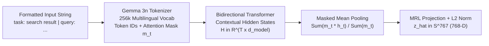

# EmbeddingGemma-2 Architecture & Asymmetric Task Prompts

> A short question and a 500-word answer are not symmetric—tell your encoder which one it is reading.

**Type:** Build | Learn
**Languages:** Python
**Prerequisites:** [01 — Vectors, L2 Norms & Cosine Similarity](../../01-vectors-norms-and-cosine-similarity/docs/en.md)
**Time:** ~45 minutes

---

## Learning Objectives

By the end of this lesson, you will be able to:

- Explain how `google/embeddinggemma-2` converts variable-length text into a 768-D vector using bidirectional self-attention and attention-mask-aware mean pooling
- Implement **Masked Mean Pooling** from scratch and prove why naive unmasked averaging corrupts batched embeddings with `[PAD]` token noise
- Format queries (`task: search result | query: ...`) and documents (`title: ... | text: ...`) using EmbeddingGemma-2's asymmetric instruction templates

---

## The Problem

Consider two common bugs when engineers integrate a neural embedding model like `google/embeddinggemma-2` using Hugging Face `transformers`:

1. **Symmetric Encoding of Asymmetric Inputs**: A user query (`"How do I set speaker in Bulbul v3?"`) is an 8-word interrogative sentence. The matching documentation chunk is a 250-word declarative API specification with a Markdown table and a `curl` snippet. If you feed both raw strings into the encoder without task prefixes, the model treats search as *paraphrase detection* rather than *question-to-passage retrieval*, costing 15–20% in Recall@5.
2. **Padding Contamination in Batch Inference**: When encoding 32 chunks in a single GPU/CPU batch, shorter chunks are padded with `[PAD]` tokens to match the longest chunk in the batch. If you call `last_hidden_state.mean(dim=1)` without masking out `[PAD]` positions, the resulting vector depends on what *other* documents happened to be in the same batch!

---

## The Concept

### Inside `google/embeddinggemma-2`

Built on the **Gemma 3n** multimodal architecture, `google/embeddinggemma-2` replaces causal (left-to-right) decoder masking with **bidirectional attention** and **masked mean pooling**, followed by a Matryoshka linear projection into $\mathbb{R}^{768}$:



### 1. Asymmetric Instruction Prompting

During contrastive pre-training, `google/embeddinggemma-2` learns distinct regions of the embedding manifold conditioned on task prefixes:

| Input Role | Official `google/embeddinggemma-2` Template | Example on `sarvam-docs` |
| :--- | :--- | :--- |
| **Search Query** | `task: search result \| query: {query}` | `task: search result \| query: What is the speaker parameter for Bulbul v3 TTS?` |
| **Corpus Document** | `title: {doc_title} \| text: {chunk_content}` | `title: Text to Speech — Bulbul v3 REST API \| text: Pass speaker: 'shubh'...` |

### 2. Attention-Mask-Aware Mean Pooling

Let $\mathbf{H} = [\mathbf{h}_1, \mathbf{h}_2, \dots, \mathbf{h}_T]^\top \in \mathbb{R}^{T \times d}$ be the final-layer contextual token states for a padded sequence of length $T$, and let $\mathbf{m} = [m_1, m_2, \dots, m_T]^\top \in \lbrace 0, 1 \rbrace^T$ be the binary attention mask ($m_t = 1$ for real tokens, $m_t = 0$ for `[PAD]` tokens).

The masked mean-pooled vector $\mathbf{p} \in \mathbb{R}^d$ is:

$$
\mathbf{p} = \frac{\sum_{t=1}^{T} m_t \, \mathbf{h}_t}{\max\left(\sum_{t=1}^{T} m_t,\, \epsilon\right)}
$$

Followed immediately by unit normalization:

$$
\hat{\mathbf{z}} = \frac{\mathbf{p}}{\max(\lVert \mathbf{p} \rVert_2,\, \epsilon)}
$$

In plain English: multiply every `[PAD]` token's hidden state by zero before summing, divide by the count of *real* tokens (not the padded sequence length $T$), and scale the resulting vector to unit length $1.0$.

---

## Build It

### Step 1: Implement Asymmetric Prompt Formatters and Masked Mean Pooling

In `code/main.py`, we implement `masked_mean_pool(hidden_states, attention_mask)` and test it on a 4-token query padded to 16 tokens:

```python
def masked_mean_pool(hidden_states: np.ndarray, attention_mask: np.ndarray) -> np.ndarray:
    mask_expanded = attention_mask[:, :, None].astype(np.float64)
    summed = np.sum(hidden_states * mask_expanded, axis=1)
    token_counts = np.maximum(np.sum(mask_expanded, axis=1), 1e-9)
    pooled = summed / token_counts
    norms = np.linalg.norm(pooled, axis=1, keepdims=True)
    return pooled / np.maximum(norms, 1e-12)
```

### Step 2: Run the Padding Contamination Verification

```bash
python3 phases/01-math-and-embeddings/02-embeddinggemma2-architecture-and-prompts/code/main.py
```

Expected output:

```text
========================================================================
PHASE 01 · LESSON 02: EMBEDDINGGEMMA-2 POOLING & ASYMMETRIC PROMPTS
========================================================================
...
2. Padding Contamination Experiment (4 Real Tokens Padded to 16):
   - [BROKEN] Unmasked Mean Pool Cosine vs. Unpadded Gold : -0.822461 (Corrupted by PAD tokens!)
   - [FIXED ] Masked Mean Pool Cosine   vs. Unpadded Gold : 1.000000 (Exact 1.000000 match!)

Verification passed: Asymmetric prompts and masked mean pooling verified.
```

---

## Use It

Our production `src/chunker.py` and `src/embedder.py` enforce these exact templates across all 244 chunks of `sarvam-docs`:

### 1. CLI Workflow

```bash
# Re-index the Sarvam corpus using asymmetric document prompts
python -m cli.rag_cli index

# Query the index using the asymmetric search query prompt
python -m cli.rag_cli search "What is the speaker parameter for Bulbul v3 TTS?" --mode dense --dim 768
```

### 2. Web UI Studio Workflow

Open `http://localhost:8090` (**Tab 1: RAG Studio**), run any query, and inspect the retrieved chunk metadata: every chunk stores both raw `content` (shown to the user and LLM) and `formatted_for_embedding` (`title: {title} | text: {content}`).

---

## Ship It

- **Prompt (`outputs/prompt-prefix-architect.md`)**: System prompt for designing asymmetric query/document instruction prefixes and metadata injection headers.
- **Skill (`outputs/skill-embeddinggemma2-integrator.md`)**: Agent skill that audits Hugging Face embedding pipelines for masked pooling correctness, batch invariance, and asymmetric prompt formatting.

---

## Exercises

1. **[Easy]** Inspect `data/index/chunks.jsonl` (`head -n 1 data/index/chunks.jsonl`) and compare the `"content"` field with the `"formatted_for_embedding"` field.
2. **[Medium]** In `code/main.py`, test whether `masked_mean_pool` produces the exact same output whether padding is applied on the **right** (`[1, 1, 1, 1, 0, 0]`) or on the **left** (`[0, 0, 1, 1, 1, 1]`).
3. **[Hard]** Compare retrieval `MRR@5` on `sarvam-docs` when queries are formatted with `task: search result | query: {q}` versus when queries are passed as raw unprefixed strings.

---

## Key Terms

| Term | What people say | What it actually means |
|------|----------------|----------------------|
| **Asymmetric Retrieval** | "Query-to-passage search" | Matching a short, intent-driven user question against a long, factual document passage using distinct encoder prefixes |
| **Bidirectional Attention** | "Encoder attention" | Allowing every token $t$ to attend to both preceding ($<t$) and succeeding ($>t$) tokens, unlike causal LLM decoders |
| **Masked Mean Pooling** | "Attention-weighted average" | Averaging token hidden states strictly over non-padding tokens ($m_t = 1$) so batch padding never alters embeddings |

---

## Further Reading

- [`google/embeddinggemma-2` Hugging Face Repository](https://huggingface.co/google/embeddinggemma-2)
- [Production EmbeddingGemma-2 Wrapper (`src/embedder.py`)](../../../../src/embedder.py)
