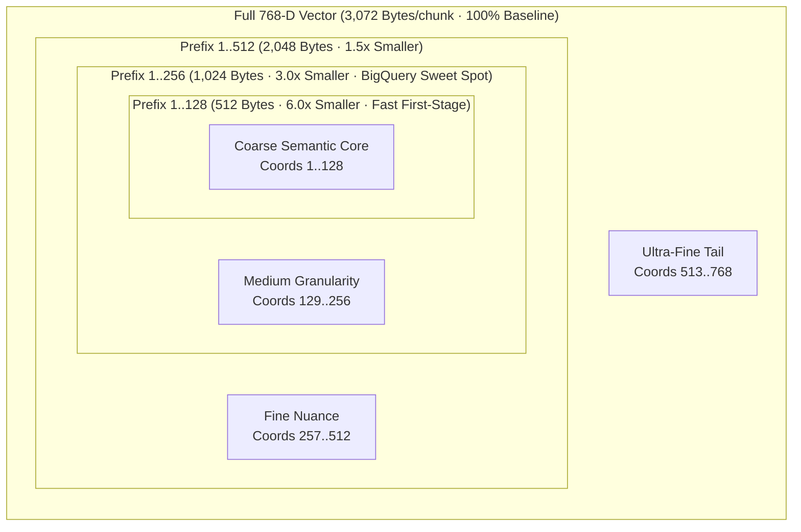

# Matryoshka Representation Learning (MRL)

> One forward pass, four nested vector sizes—slice the prefix, re-normalize, and cut vector RAM by 3x to 6x.

**Type:** Build | Learn
**Languages:** Python
**Prerequisites:** [02 — EmbeddingGemma-2 Architecture & Prompts](../../02-embeddinggemma2-architecture-and-prompts/docs/en.md)
**Time:** ~50 minutes

---

## Learning Objectives

By the end of this lesson, you will be able to:

- Explain the multi-scale **Matryoshka Representation Learning (MRL)** contrastive training objective used by `google/embeddinggemma-2`
- Implement runtime prefix truncation and $\ell_2$ re-normalization across $\mathcal{M} = \lbrace 768, 512, 256, 128 \rbrace$ from scratch
- Prove why slicing a unit vector produces a sub-unit vector ($\lVert\mathbf{z}_{1:m}\rVert_2 < 1$) that **must** be re-normalized before computing inner products

---

## The Problem

In a standard Transformer embedding model, semantic information is smeared uniformly across all 768 coordinates. If you want to shrink your BigQuery or HNSW vector index by $3\times$ to save RAM and speed up search, you cannot simply take the first 256 numbers (`vec[:256]`) of a standard embedding—doing so destroys retrieval accuracy because coordinates $1\dots 256$ were never trained to stand on their own. You would have to either train a separate PCA projection matrix (which drifts as your corpus changes) or run a second, smaller embedding model.

**Matryoshka Representation Learning (MRL)** (Kusupati et al., NeurIPS 2022), baked natively into `google/embeddinggemma-2`, solves this at training time. Like nested Russian Matryoshka dolls, the first $128$ coordinates sit inside the first $256$, which sit inside $512$, which sit inside $768$—and every prefix is independently trained to be a high-accuracy embedding space!

---

## The Concept

### Nested Subspace Geometry in `google/embeddinggemma-2`



### 1. The Multi-Scale Matryoshka Loss Function

Let $\mathcal{M} = \lbrace 128, 256, 512, 768 \rbrace$ be the set of nested nesting dimensions. For a full embedding vector $\mathbf{z} \in \mathbb{R}^{768}$, let $\mathbf{z}_{1:m} \in \mathbb{R}^m$ denote its first $m$ coordinates. During training, `google/embeddinggemma-2` minimizes the sum of InfoNCE contrastive losses at **every nesting dimension simultaneously**:

$$
\mathcal{L}_{\text{MRL}}(\mathbf{q}, \mathbf{d}^+, \lbrace \mathbf{d}_j^- \rbrace) = \sum_{m \in \mathcal{M}} c_m \cdot \mathcal{L}_{\text{InfoNCE}}\left(\hat{\mathbf{q}}_{1:m},\, \hat{\mathbf{d}}^+_{1:m},\, \lbrace \hat{\mathbf{d}}^-_{j,1:m} \rbrace\right)
$$

where for each prefix dimension $m \in \lbrace 128, 256, 512, 768 \rbrace$:

$$
\mathcal{L}_{\text{InfoNCE}}^{(m)} = -\log \frac{\exp\left(\frac{\hat{\mathbf{q}}_{1:m} \cdot \hat{\mathbf{d}}^+_{1:m}}{\tau}\right)}{\exp\left(\frac{\hat{\mathbf{q}}_{1:m} \cdot \hat{\mathbf{d}}^+_{1:m}}{\tau}\right) + \sum_{j=1}^{B-1} \exp\left(\frac{\hat{\mathbf{q}}_{1:m} \cdot \hat{\mathbf{d}}^-_{j,1:m}}{\tau}\right)}
$$

In plain English: Because coordinates $1\dots 128$ appear in **all four** loss terms ($m=128, 256, 512, 768$), while coordinates $513\dots 768$ appear in **only one** loss term ($m=768$), gradient descent automatically packs the highest-variance semantic information into the earliest coordinates!

### 2. Runtime Prefix Slicing & Mandatory Re-Normalization

At inference time, even though the full 768-D vector satisfies $\lVert\mathbf{z}\rVert_2^2 = \sum_{i=1}^{768} z_i^2 = 1$, dropping coordinates $m+1 \dots 768$ removes positive squared energy:

$$
\lVert \mathbf{z}_{1:m} \rVert_2 = \sqrt{\sum_{i=1}^{m} z_i^2} = \sqrt{1 - \sum_{i=m+1}^{768} z_i^2} < 1
$$

Therefore, to project the truncated prefix onto the lower-dimensional unit hypersphere $\mathbb{S}^{m-1}$, you **must** re-normalize after slicing:

$$
\hat{\mathbf{z}}^{(m)} = \frac{\mathbf{z}_{1:m}}{\max(\lVert \mathbf{z}_{1:m} \rVert_2,\, \epsilon)} \in \mathbb{S}^{m-1}
$$

| MRL Dimension ($m$) | Bytes per Chunk (`float32`) | RAM Compression | Sarvam Benchmark `Hit@5` | Recommended Production Role |
| :--- | :--- | :--- | :--- | :--- |
| **768-D** | `3,072 B` | `1.0x` | `100.0%` | High-precision local reranking & multimodal fusion |
| **512-D** | `2,048 B` | `1.5x` | `100.0%` | Memory-conscious GPU/CPU in-memory index |
| **256-D** | `1,024 B` | `3.0x` | `100.0%` | **BigQuery Vector Search sweet spot** (3x lower scan bytes) |
| **128-D** | `512 B` | `6.0x` | `91.7%` | Ultra-fast mobile/edge or two-stage funnel candidate retrieval |

---

## Build It

### Step 1: Implement `mrl_truncate_and_renormalize` From Scratch

In `code/main.py`, we slice `matrix_768[:, :dim]` and re-normalize every row:

```python
def mrl_truncate_and_renormalize(matrix_768: np.ndarray, dim: int, eps: float = 1e-12) -> np.ndarray:
    sliced = matrix_768[:, :dim].astype(np.float32, copy=True)
    norms = np.linalg.norm(sliced, axis=1, keepdims=True)
    return sliced / np.maximum(norms, eps)
```

### Step 2: Run the Multi-Scale Benchmark

```bash
python3 phases/01-math-and-embeddings/03-matryoshka-representation-learning/code/main.py
```

Expected output:

```text
========================================================================
PHASE 01 · LESSON 03: MATRYOSHKA REPRESENTATION LEARNING (MRL) FROM SCRATCH
========================================================================

1. Why Re-Normalization After Prefix Slicing is Mandatory:
   - Unnormalized 256-D slice ||z_{1:256}||_2 range : [0.5426, 0.6388] (NOT unit vectors!)
   - Re-normalized 256-D slice ||z_hat||_2 range    : [1.000000, 1.000000] (Exact S^255 unit sphere!)
...
Verification passed: MRL prefix slicing and L2 re-projection verified across all 4 dimensions.
```

---

## Use It

### 1. CLI Workflow: Run the Live MRL Benchmark Across All 4 Dimensions

```bash
python -m cli.rag_cli mrl-benchmark "How does Saaras v3 speech-to-text handle code-mixed Indian audio?"
```

### 2. Web UI Studio Workflow (Tab 2: MRL Explorer)

Open `http://localhost:8090` and switch to **Tab 2: Matryoshka (MRL) Explorer**:
1. Enter any Sarvam technical query and click **Run MRL Benchmark**.
2. Inspect the live 4-column comparison (`768-D`, `512-D`, `256-D`, `128-D`) showing byte storage savings, query latency, and top-K rank overlap percentages.

---

## Ship It

- **Prompt (`outputs/prompt-mrl-capacity-planner.md`)**: System prompt for sizing vector database RAM, BigQuery scan costs, and two-stage MRL retrieval funnels for any corpus scale.
- **Skill (`outputs/skill-mrl-dimension-optimizer.md`)**: Agent skill that benchmarks an MRL embedding index across $\lbrace 768, 512, 256, 128 \rbrace$ and selects the smallest dimension that meets a target `Recall@K` or `MRR@K` SLA.

---

## Exercises

1. **[Easy]** Compute how much RAM is saved when storing 10,000,000 chunks in `float32` at `256-D` instead of `768-D`.
2. **[Medium]** In `code/main.py`, compare the top-5 overlap when taking the **first 128 coordinates** (`emb[:, :128]`) versus the **last 128 coordinates** (`emb[:, -128:]`). Why do the first 128 coordinates retain much higher overlap?
3. **[Hard]** Implement a **Two-Stage Matryoshka Funnel**: first retrieve the top-25 candidates using fast `128-D` dot products, then re-score only those 25 candidates using full `768-D` dot products. Measure the exact FLOP reduction and verify whether top-5 accuracy matches full `768-D` exhaustive search!

---

## Key Terms

| Term | What people say | What it actually means |
|------|----------------|----------------------|
| **Matryoshka Representation Learning (MRL)** | "Resizable embeddings" | Training a neural encoder with nested contrastive losses so prefixes $1..m$ form standalone embedding spaces |
| **Prefix Truncation (`z[:m]`)** | "Slicing an embedding" | Keeping only the first $m$ coordinates of a $d$-dimensional MRL vector |
| **Unit Re-Projection** | "Re-normalizing after slicing" | Dividing $\mathbf{z}_{1:m}$ by $\lVert\mathbf{z}_{1:m}\rVert_2$ so the truncated vector has unit length $1.0$ on $\mathbb{S}^{m-1}$ |
| **Two-Stage MRL Funnel** | "Coarse-to-fine vector search" | Filtering candidates with $128$-D vectors and reranking the top-M shortlist with $768$-D vectors |

---

## Further Reading

- [Matryoshka Representation Learning (Kusupati et al., NeurIPS 2022)](https://arxiv.org/abs/2205.13147)
- [Production MRL Indexer & Benchmark (`src/embedder.py`, `src/retriever.py`)](../../../../src/retriever.py)
