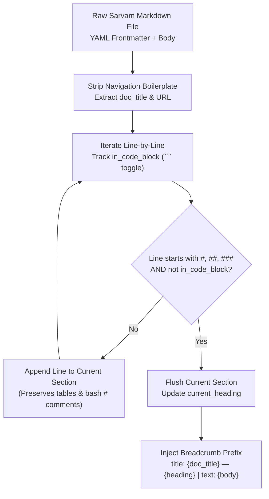

# Structure-Aware Markdown Chunking

> If your chunker cuts a pricing table in half or mistakes a bash `# comment` for an H1 heading, no embedding model can save you.

**Type:** Build | Learn
**Languages:** Python
**Prerequisites:** [Phase 01 — Matryoshka Representation Learning](../../../01-math-and-embeddings/03-matryoshka-representation-learning/docs/en.md)
**Time:** ~45 minutes

---

## Learning Objectives

By the end of this lesson, you will be able to:

- Explain why naive fixed-character chunking (`text[i:i+500]`) destroys retrieval quality on developer documentation by severing Markdown tables and fenced code blocks
- Build a **Code-Fence-Aware Markdown Section Chunker** from scratch using a boolean `in_code_block` state machine so `# comment` lines inside ` ```bash ` snippets are never mistaken for H1 headings
- Inject hierarchical document breadcrumbs (`title: {doc_title} — {section_heading} | text: {content}`) into every chunk

---

## The Problem

Developer documentation is not a novel. A typical page in `sarvam-docs`—like the **Saaras v3 Speech-to-Text API Reference**—contains three tightly coupled structural units:

1. An **Overview** explaining what the endpoint does,
2. A **Markdown Parameter Table** (`| Parameter | Type | Required | Description |`), and
3. A **Fenced `curl` or Python Code Block** (` ```bash ... ``` `) containing shell comments starting with `#`.

What happens when you feed this file into a naive splitter?
- **Failure Mode 1 (Decapitated Tables)**: Row 5 of a parameter table (`| with_timestamps | boolean | ... |`) lands in Chunk #3 while the table header and the section title (`## Saaras v3 Request Parameters`) remain in Chunk #2. Chunk #3 now has no mention of which API or model those parameters belong to!
- **Failure Mode 2 (False Heading Splits on Code Comments)**: A naive regex splitter that splits on `^#\s+` sees `# Send audio file to Sarvam Saaras v3 endpoint` inside a ` ```bash ` block and slices the code block in half, leaving an unclosed ` ``` ` fence!

---

## The Concept

### State-Machine Markdown Section Splitting



### Formal Chunking & Sub-Windowing Rules

Let a cleaned Markdown document $D$ be a sequence of lines $(l_1, l_2, \dots, l_M)$. We define the **code-fence state** $f_k \in \{0, 1\}$ at line $k$ recursively:

$$
f_k = \begin{cases} 1 - f_{k-1} & \text{if } \text{strip}(l_k) \text{ starts with } \texttt{```} \\ f_{k-1} & \text{otherwise} \end{cases}, \quad f_0 = 0
$$

A line $l_k$ is a true **structural section boundary** if and only if:

$$
f_k = 0 \quad \wedge \quad l_k \text{ matches } \texttt{\^{}\#\{1,3\}\textbackslash s+(.+)\$}
$$

If a resulting section exceeds our maximum character budget $L_{\max}$ (e.g., $1,100$ characters $\approx 275$ tokens), we sub-split along paragraph boundaries (`\n\n`) with a sliding overlap of $L_{\text{overlap}} = 150$ characters while **preserving the parent breadcrumb** (`{doc_title} — {section_heading} (Part k)`) on every sub-chunk.

| Strategy | Preserves Markdown Tables? | Protects `#` in ` ```bash ` Blocks? | Retains Parent Title on Sub-Chunks? | Sarvam Benchmark `Hit@5` |
| :--- | :--- | :--- | :--- | :--- |
| **Naive Fixed-Character** | No (severs rows from headers) | No (splits mid-code block) | No (orphaned fragments) | `75.0%` |
| **Structure-Aware + Breadcrumbs** | **Yes** | **Yes (`in_code_block` guard)** | **Yes (`title: ... \| text: ...`)** | **`100.0%`** |

---

## Build It

### Step 1: Implement the Code-Fence State Machine Chunker

In `code/main.py`, we toggle `in_code_block` whenever a line starts with ` ``` ` and only split on `^#{1,3}\s+` when `not in_code_block`:

```python
for line in lines:
    if line.strip().startswith("```"):
        in_code_block = not in_code_block

    heading_match = not in_code_block and re.match(r"^(#{1,3})\s+(.+)$", line.strip())
```

### Step 2: Compare Naive vs. Structure-Aware Chunking on Sarvam Saaras v3 Docs

```bash
python3 phases/02-retrieval-engineering/01-structure-aware-markdown-chunking/code/main.py
```

Expected output:

```text
========================================================================
PHASE 02 · LESSON 01: STRUCTURE-AWARE MARKDOWN CHUNKING FROM SCRATCH
========================================================================

1. Naive Fixed-Window Chunker (220 chars) -> Produced 3 chunks:
   - Chunks with severed ``` code fences : 2
...
2. Structure-Aware Markdown Chunker       -> Produced 3 semantic sections:
   - Chunks with severed ``` code fences : 0
   - Section 1 [Speech to Text REST API (Saaras v3)] -> 133 chars
   - Section 2 [Request Parameters]                  -> 360 chars
   - Section 3 [Code Example]                        -> 262 chars

Verification passed: Structure-aware chunker preserved tables, bash comments, and breadcrumbs.
```

---

## Use It

In production, `src/chunker.py` runs this exact algorithm across all 64 `sarvam-docs` files, stripping web crawler navigation boilerplate (`Skip to navigation`, `Scroll to top`) and deduplicating mirrored routes to produce `244` clean `DocChunk` records in `data/index/chunks.jsonl`.

### 1. CLI Workflow

```bash
# Run the structure-aware chunker and rebuild the index
python -m cli.rag_cli index

# Inspect corpus & chunk statistics
python -m cli.rag_cli status
```

### 2. Web UI Studio Workflow

Open `http://localhost:8090` (**Tab 1: RAG Studio**) and search for `"What parameters does Saaras v3 accept?"`. Notice how each retrieved card displays its full **Category Badge** (`speech-to-text`), **Breadcrumb Title** (`Speech to Text — Request Parameters`), and intact Markdown table/code formatting.

---

## Ship It

- **Prompt (`outputs/prompt-chunking-strategist.md`)**: System prompt for designing domain-specific document chunkers for Markdown, OpenAPI specs, and codebases.
- **Skill (`outputs/skill-markdown-chunk-architect.md`)**: Agent skill that audits chunked JSONL files for broken code fences, orphaned table rows, and missing breadcrumb context.

---

## Exercises

1. **[Easy]** In `code/main.py`, add a Python comment `# Initialize Sarvam client` inside a ` ```python ` block in `SAMPLE_SARVAM_MD` and verify that `structure_aware_markdown_chunker` still produces zero broken code fences.
2. **[Medium]** Extend `structure_aware_markdown_chunker` in `code/main.py` so that if a table has 50 rows (exceeding `max_chars`), every sub-chunk automatically repeats the 2-line Markdown table header (`| Parameter | Type | ... |\n| :--- | :--- |`) at the top of the continued table!
3. **[Hard]** Scan `data/index/chunks.jsonl` and compute the distribution of `char_count`, `token_estimate`, and `has_code == True` across all 10 Sarvam product categories.

---

## Key Terms

| Term | What people say | What it actually means |
|------|----------------|----------------------|
| **Context Orphan** | "decontextualized chunk" | A chunk ("It accepts `hi-IN` and costs 30 INR/hr") that was sliced away from its heading, leaving no clue *what* "It" refers to |
| **Breadcrumb Injection** | "Header prepending" | Prefixing every chunk with its parent document title and section heading (`title: Doc — Section \| text: ...`) |
| **Code-Fence State Machine** | "Markdown-aware parser" | Tracking whether the parser is currently inside a ` ``` ` block so `#` comments inside code are never treated as Markdown headings |

---

## Further Reading

- [Production Markdown Chunker (`src/chunker.py`)](../../../../src/chunker.py)
