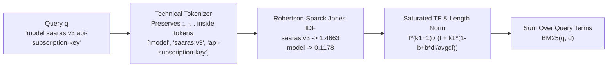

# Okapi BM25 From Scratch

> Dense embeddings capture meaning, but BM25 captures exact model codes like `saaras:v3` and `api-subscription-key`.

**Type:** Build | Learn
**Languages:** Python
**Prerequisites:** [01 — Structure-Aware Markdown Chunking](../../01-structure-aware-markdown-chunking/docs/en.md)
**Time:** ~50 minutes

---

## Learning Objectives

By the end of this lesson, you will be able to:

- Explain why dense neural embeddings struggle with rare versioned identifiers (`saaras:v3`, `saarika:v2.5`, `bulbul:v3`, `api-subscription-key`)
- Derive **Robertson–Spärck Jones Inverse Document Frequency (IDF)**, **Term Saturation ($k_1$)**, and **Length Normalization ($b$)** in Okapi BM25
- Implement a complete **Okapi BM25** search engine and technical tokenizer from scratch in pure Python

---

## The Problem

Suppose an engineer asks your RAG system: `"Which endpoint accepts model saaras:v3 and header api-subscription-key?"`.
- In a **dense-only** embedding system, subword tokenizers split `"saaras:v3"` into `["saa", "ras", ":", "v", "3"]` and `"saarika:v2.5"` into `["saa", "rika", ":", "v", "2", ".", "5"]`. Because both strings occur in almost identical Speech-to-Text contexts, their 768-D embeddings have a cosine similarity above $0.91$, frequently confusing `saaras:v3` with `saarika:v2.5`!
- Conversely, if you try to fix this with **naive keyword counting (Raw Term Frequency)**, a long general guide that repeats common words like `"how"`, `"to"`, `"use"`, and `"model"` ten times will outscore the concise chunk that mentions `"saaras:v3"` once!

We need a lexical scoring function that:
1. Weights rare technical identifiers (`saaras:v3`) exponentially higher than common words (`model`),
2. Exhibits **diminishing returns (saturation)** when a word is repeated many times, and
3. Penalizes bloated documents that match only because they are long.

That exact mathematical formula is **Okapi BM25**.

---

## The Concept

### Anatomy of the Okapi BM25 Scoring Pipeline



### 1. Robertson–Spärck Jones Inverse Document Frequency (IDF)

Given a corpus of $N$ documents where $n(t) = \text{df}(t)$ documents contain term $t$, the smoothed IDF score is:

$$
\text{IDF}(t) = \ln\!\left(1 + \frac{N - \text{df}(t) + 0.5}{\text{df}(t) + 0.5}\right)
$$

In plain English: if a term like `"model"` appears in every document ($\text{df}(t) = N$), its IDF drops near zero ($\ln(1 + 0.5/(N+0.5)) \approx 0$). If a term like `"saaras:v3"` appears in only 1 document out of 244, its IDF is high ($\ln(1 + 243.5/1.5) \approx 5.10$).

### 2. The Complete Okapi BM25 Equation

For a query $q = \{t_1, t_2, \dots, t_m\}$ and a document $d$ with token length $|d|$ and corpus average document length $\text{avgdl} = \frac{1}{N}\sum_{i=1}^N |d_i|$:

$$
\text{BM25}(q, d) = \sum_{t \in q} \text{IDF}(t) \cdot \frac{f(t, d) \cdot (k_1 + 1)}{f(t, d) + k_1 \cdot \left(1 - b + b \cdot \frac{|d|}{\text{avgdl}}\right)}
$$

where $f(t, d)$ is the frequency of term $t$ in document $d$, and the two hyperparameters control saturation and length normalization:

| Hyperparameter | Standard Value | Mathematical Role | What Happens at Extremes |
| :--- | :--- | :--- | :--- |
| **$k_1$ (Term Saturation)** | `1.5` | Controls how quickly extra occurrences of the same term hit diminishing returns (asymptote is $k_1 + 1 = 2.5$) | $k_1 \to 0$: binary presence/absence only; $k_1 \to \infty$: raw linear TF |
| **$b$ (Length Normalization)** | `0.75` | Penalizes documents longer than $\text{avgdl}$ ($|d|/\text{avgdl} > 1$) | $b = 0$: no length penalty; $b = 1$: full proportional length division |

> [!IMPORTANT]
> **Technical Tokenization Rule:** Standard NLP tokenizers split on `:` and `-`, turning `"saaras:v3"` into `["saaras", "v3"]` and `"hi-IN"` into `["hi", "in"]` (where `"in"` gets deleted as an English stopword!). Always use a regex like `[a-z0-9_]+(?:[:.-][a-z0-9_]+)*` on developer documentation so version tags, headers, and BCP-47 language codes stay intact as single tokens.

---

## Build It

### Step 1: Implement Technical Tokenization and `OkapiBM25Scratch`

In `code/main.py`, we preserve internal colons, hyphens, and dots during tokenization and compute exact RSJ IDF and BM25 scores:

```python
def tokenize_technical(text: str) -> list[str]:
    return re.findall(r"[a-z0-9_]+(?:[:.-][a-z0-9_]+)*", text.lower())
```

### Step 2: Run the Raw TF vs. Okapi BM25 Experiment

```bash
python3 phases/02-retrieval-engineering/02-okapi-bm25-from-scratch/code/main.py
```

Expected output:

```text
========================================================================
PHASE 02 · LESSON 02: OKAPI BM25 & TECHNICAL TOKENIZATION FROM SCRATCH
========================================================================

1. Inverse Document Frequency (IDF) — Rare Technical Codes vs. Common Words:
   - IDF(saaras:v3             ) = 1.2040
   - IDF(api-subscription-key  ) = 1.2040
   - IDF(model                 ) = 0.1054
...
   [BROKEN] Raw TF Winner    -> Doc 1 (Fooled by repeated common words 'use', 'model', 'with'!)
   [FIXED ] Okapi BM25 Winner-> Doc 0 (Correctly ranks exact `saaras:v3` & `api-subscription-key` #1!)

Verification passed: Technical tokenizer, RSJ IDF, and Okapi BM25 verified.
```

---

## Use It

### 1. CLI Workflow: Run Lexical BM25 Search on `sarvam-docs`

```bash
# Search the 244-chunk Sarvam corpus using pure BM25 lexical matching
python -m cli.rag_cli search "saaras:v3 api-subscription-key" --mode bm25 --top-k 5
```

### 2. Web UI Studio Workflow

Open `http://localhost:8090` (**Tab 1: RAG Studio**):
1. Set **Retrieval Mode** to `BM25 Only (Lexical)`.
2. Search for exact identifiers like `"saaras:v3"`, `"bulbul:v3"`, or `"hi-IN"`.
3. Inspect the **BM25 Score** badge on each retrieved card.

---

## Ship It

- **Prompt (`outputs/prompt-lexical-tuner.md`)**: System prompt for designing domain-specific tokenizers and tuning BM25 $(k_1, b)$ hyperparameters for technical corpora.
- **Skill (`outputs/skill-bm25-index-builder.md`)**: Agent skill that audits lexical tokenizers to ensure model version codes, HTTP headers, and BCP-47 locale tags are never mangled by stopword filters or punctuation splitters.

---

## Exercises

1. **[Easy]** In `code/main.py`, compute the BM25 TF saturation factor $\frac{f \cdot (k_1 + 1)}{f + k_1}$ (assuming $|d| = \text{avgdl}$) for $f \in \{1, 2, 5, 10, 100\}$ with $k_1 = 1.5$. Verify that even at $f = 100$, the multiplier never exceeds $k_1 + 1 = 2.5$.
2. **[Medium]** Test what happens to `"hi-IN"` (Hindi BCP-47 code) and `"or-IN"` (Odia BCP-47 code) if a naive tokenizer splits on `-` and removes standard English stopwords (`"in"`, `"or"`, `"hi"`).
3. **[Hard]** Load all 244 chunks from `data/index/chunks.jsonl` into `OkapiBM25Scratch` and print the top 15 highest-IDF technical tokens in the entire Sarvam AI documentation corpus.

---

## Key Terms

| Term | What people say | What it actually means |
|------|----------------|----------------------|
| **IDF (Inverse Document Frequency)** | "Rarity weight" | $\ln(1 + \frac{N - \text{df} + 0.5}{\text{df} + 0.5})$ — rewards rare domain terms (`saaras:v3`) and zeroes out ubiquitous words (`the`, `model`) |
| **Term Saturation ($k_1$)** | "Sublinear TF scaling" | Bounding repeated term contributions by an upper asymptote of $k_1 + 1$ so keyword stuffing cannot game rankings |
| **Document Length Normalization ($b$)** | "Verbose doc penalty" | Scaling the TF denominator by $|d|/\text{avgdl}$ so a 2,000-word page must have proportionally more matches than a 100-word section |

---

## Further Reading

- [The Probabilistic Relevance Framework: BM25 and Beyond (Robertson & Zaragoza, 2009)](https://www.staff.city.ac.uk/~sbrp622/papers/foundations_bm25_review.pdf)
- [Production BM25 + Hybrid Retriever (`src/retriever.py`)](../../../../src/retriever.py)
