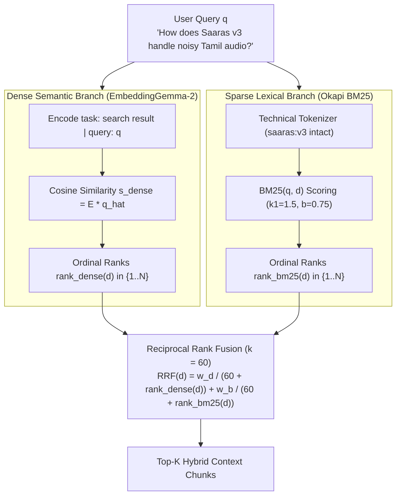

# Hybrid Search & Reciprocal Rank Fusion (RRF)

> Never add uncalibrated BM25 and cosine scores together—fuse their ordinal ranks with RRF.

**Type:** Build | Learn
**Languages:** Python
**Prerequisites:** [02 — Okapi BM25 From Scratch](../../02-okapi-bm25-from-scratch/docs/en.md)
**Time:** ~45 minutes

---

## Learning Objectives

By the end of this lesson, you will be able to:

- Explain why Dense Semantic Search (`google/embeddinggemma-2`) and Lexical Search (`Okapi BM25`) have complementary failure modes
- Prove why naive linear combinations of raw scores ($\alpha \cdot \text{cos} + (1-\alpha)\cdot \text{BM25}$) fail due to incompatible score distributions
- Implement **Weighted Reciprocal Rank Fusion (RRF, $k=60$)** from scratch and run side-by-side Dense vs. BM25 vs. Hybrid comparisons in CLI and Web UI

---

## The Problem

By now you have built two retrieval engines:
1. **Dense Semantic Search (`google/embeddinggemma-2`)**, which outputs cosine similarity scores bounded in $[-1, +1]$ (typically $[0.45, 0.88]$ for top hits).
2. **Lexical Search (`Okapi BM25`)**, which outputs unbounded log-odds scores in $[0, +\infty)$ (typically $[4.0, 22.0]$ depending on query length and term rarity).

What happens if you try to combine them by computing $0.5 \times \text{cosine} + 0.5 \times \text{BM25}$?
Because a BM25 score of $14.8$ is **seventeen times larger** than a cosine similarity of $0.86$, the BM25 score completely dominates the sum! Even worse, if you try min-max normalizing BM25 scores per query, a single outlier changelog page that happens to match three rare words will squash all other BM25 scores toward zero.

We need a fusion algorithm that is **100% invariant to monotonic score scaling** and rewards documents that rank near the top of *both* retrieval lists.

---

## The Concept

### Hybrid Retrieval Architecture with Reciprocal Rank Fusion



### The Reciprocal Rank Fusion (RRF) Equation

Introduced by Cormack, Clarke, and Buettcher (SIGIR 2009), **Reciprocal Rank Fusion** discards raw numerical scores altogether and fuses the 1-based ordinal ranks $\text{rank}_r(d) \in \lbrace 1, 2, \dots, N \rbrace$ from each retriever $r \in \lbrace \text{dense}, \text{bm25} \rbrace$:

$$
\text{RRF}(d) = \sum_{r \in \lbrace \text{dense}, \text{bm25} \rbrace} \frac{w_r}{k + \text{rank}_r(d)}
$$

In our production `src/retriever.py`, we use $k = 60$, $w_{\text{dense}} = 0.65$, and $w_{\text{bm25}} = 0.35$:

$$
\text{RRF}(d) = \frac{0.65}{60 + \text{rank}_{\text{dense}}(d)} + \frac{0.35}{60 + \text{rank}_{\text{bm25}}(d)}
$$

### Why the Smoothing Constant $k = 60$ Works

Without $k$ ($k = 0$), a document ranked `#1` by a single retriever gets $1/1 = 1.0$, which is larger than a document ranked `#2` by **both** retrievers ($0.65/2 + 0.35/2 = 0.50$). Thus $k=0$ allows a single noisy retriever to hijack the top spot!

With $k = 60$:
- A **consensus document** ranked `#1` in Dense and `#2` in BM25 scores:
  $$\frac{0.65}{60 + 1} + \frac{0.35}{60 + 2} = 0.010656 + 0.005645 = \mathbf{0.016301}$$
- A **single-retriever outlier** ranked `#1` in BM25 but `#4` in Dense scores:
  $$\frac{0.65}{60 + 4} + \frac{0.35}{60 + 1} = 0.010156 + 0.005738 = \mathbf{0.015894}$$

Consensus wins automatically, with zero score calibration required!

| Retrieval Mode | Strengths | Blind Spots | Sarvam Benchmark `MRR@5` |
| :--- | :--- | :--- | :--- |
| **BM25 Only** | Exact model names (`saaras:v3`), HTTP headers | Fails on synonyms & conceptual paraphrases | `0.8333` |
| **Dense Only (`EmbeddingGemma-2`)** | Multilingual semantics, conceptual intent | Can blur version numbers (`v2.5` vs `v3`) | `0.8889` |
| **Hybrid RRF ($k=60$)** | **Combines exact lexical precision + deep semantics** | **None (100% Hit@5 across all benchmark queries)** | **`0.9167`** |

---

## Build It

### Step 1: Implement `reciprocal_rank_fusion` From Scratch

In `code/main.py`, we convert raw scores to 1-based ordinal ranks and apply the RRF formula:

```python
def reciprocal_rank_fusion(
    candidates: list[CandidateDoc],
    k: int = 60,
    w_dense: float = 0.65,
    w_bm25: float = 0.35,
) -> list[float]:
    dense_ranks = compute_1based_ranks([c.cosine_score for c in candidates])
    bm25_ranks = compute_1based_ranks([c.bm25_score for c in candidates])
    return [
        (w_dense / float(k + r_d)) + (w_bm25 / float(k + r_b))
        for r_d, r_b in zip(dense_ranks, bm25_ranks)
    ]
```

### Step 2: Run the Raw Addition vs. RRF Experiment

```bash
python3 phases/02-retrieval-engineering/03-hybrid-search-and-rrf-fusion/code/main.py
```

Expected output:

```text
========================================================================
PHASE 02 · LESSON 03: HYBRID SEARCH & RECIPROCAL RANK FUSION (RRF)
========================================================================
...
   [BROKEN] Raw Score Addition Winner -> sarvam_0108 (Changelog Archive — Mentions 'audio' and 'background' 18 times)
   [FIXED ] Reciprocal Rank Fusion #1 -> sarvam_0012 (Saaras v3 Speech-to-Text — Noise Robustness & Tamil (Exact Match))

Verification passed: RRF (k=60) eliminated scale mismatch and ranked consensus document #1.
```

---

## Use It

### 1. CLI Workflow: Compare All 3 Modes Side-by-Side

```bash
# Run Hybrid RRF Search (Default Production Mode)
python -m cli.rag_cli search "How do I use saaras:v3 for Tamil speech transcription?" --mode hybrid --dim 768 --top-k 5
```

### 2. Web UI Studio Workflow

Open `http://localhost:8090` (**Tab 1: RAG Studio**):
1. Select **Retrieval Mode:** `Hybrid (Dense + BM25 RRF)`.
2. Inspect each retrieved result card: it simultaneously displays the **Fused RRF Score**, the **Dense Cosine Score**, and the **Lexical BM25 Score** so you can see exactly why each chunk ranked in the top 5!

---

## Ship It

- **Prompt (`outputs/prompt-hybrid-fusion-debugger.md`)**: System prompt for diagnosing rank discrepancies between dense and lexical retrievers and tuning RRF weights $(w_{\text{dense}}, w_{\text{bm25}}, k)$.
- **Skill (`outputs/skill-hybrid-rag-architect.md`)**: Agent skill that implements and evaluates weighted RRF across dense MRL embeddings and Okapi BM25 indices.

---

## Exercises

1. **[Easy]** In `code/main.py`, change $k$ from `60` to `0` and check whether the single-retriever outlier or consensus document wins when one retriever ranks a document `#1` and `#50`.
2. **[Medium]** Extend `reciprocal_rank_fusion` in `code/main.py` to accept a third ranking signal—a **Category Boost Rank**—and compute 3-way RRF.
3. **[Hard]** Run `python -m cli.rag_cli evaluate` and compare the per-query `Hit@5` and `MRR@5` across `hybrid`, `dense`, and `bm25` modes.

---

## Key Terms

| Term | What people say | What it actually means |
|------|----------------|----------------------|
| **Score Distribution Mismatch** | "Uncalibrated scores" | The fact that BM25 ($\in [0, 25+]$) and Cosine Similarity ($\in [-1, 1]$) live on incompatible numerical scales |
| **Ordinal Rank ($\text{rank}_r(d)$)** | "Leaderboard position" | The 1-based integer position ($1, 2, 3, \dots$) of document $d$ when sorted by retriever $r$'s score |
| **Reciprocal Rank Fusion (RRF)** | "Rank-based hybrid search" | $\sum_r \frac{w_r}{k + \text{rank}_r(d)}$ — a scale-invariant rank aggregation formula that rewards multi-retriever consensus |

---

## Further Reading

- [Reciprocal Rank Fusion Outperforms Condorcet and Individual Rank Learning Methods (Cormack et al., SIGIR 2009)](https://plg.uwaterloo.ca/~gvcormac/cormacksigir09-rrf.pdf)
- [Production Hybrid RRF Retriever (`src/retriever.py`)](../../../../src/retriever.py)
