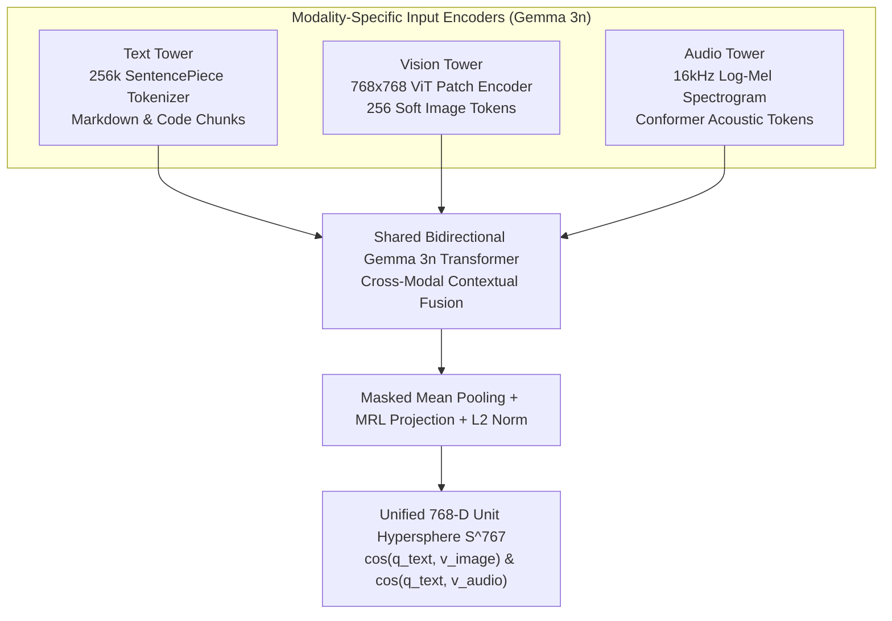

# Cross-Modal Audio & Image RAG

> One vector space for text, architecture diagrams, and 16 kHz speech—no brittle OCR or ASR glue pipelines required.

**Type:** Build | Learn
**Languages:** Python
**Prerequisites:** [Phase 02 — Hybrid Search & RRF Fusion](../../../02-retrieval-engineering/03-hybrid-search-and-rrf-fusion/docs/en.md)
**Time:** ~55 minutes

---

## Learning Objectives

By the end of this lesson, you will be able to:

- Explain how `google/embeddinggemma-2` projects **Text**, **Vision (PNG Diagrams)**, and **Audio (16 kHz WAV Speech)** into a single shared 768-D unit hypersphere ($\mathbb{S}^{767}$)
- Contrast **Native Cross-Modal Embedding Retrieval** against legacy multi-stage OCR/ASR transcription cascades
- Execute cross-modal queries that simultaneously retrieve Markdown documentation, architecture diagrams, and spoken Tamil/Hindi/English audio samples via CLI and Web UI

---

## The Problem

Sarvam AI is a **voice-first and multimodal AI platform**: its developer ecosystem includes Markdown API docs, latency/architecture diagrams (`PNG`), and 16 kHz speech audio samples (`WAV`) for Bulbul v3 Text-to-Speech, Saaras v3 Speech-to-Text, and Samvaad Voice Agents.

In traditional RAG architectures, indexing non-text assets requires brittle preprocessing cascades:
- **Images/Diagrams** must be passed through an external OCR or Vision-to-Text captioning pipeline, losing visual layout and box-and-arrow topology.
- **Audio Samples** must be transcribed to text first, erasing prosody, speaker timbre, acoustic noise characteristics, and code-mixed speech cadence.

Because `google/embeddinggemma-2` is built on the native multimodal **Gemma 3n** backbone, it encodes text tokens, image patches, and 16 kHz audio spectrograms directly into the **same 768-dimensional unit hypersphere**. A single cosine similarity calculation $\hat{\mathbf{q}}_{\text{text}} \cdot \hat{\mathbf{v}}_{\text{audio}}$ or $\hat{\mathbf{q}}_{\text{text}} \cdot \hat{\mathbf{v}}_{\text{image}}$ retrieves across modalities in one step!

---

## The Concept

### Three Modality Encoders, One Shared Unit Hypersphere $\mathbb{S}^{767}$



### Cross-Modal Contrastive Alignment Objective

Let $\phi_{\text{text}}(x_{\text{text}})$, $\phi_{\text{image}}(x_{\text{img}})$, and $\phi_{\text{audio}}(x_{\text{aud}})$ denote the $\ell_2$-normalized 768-D output vectors produced by `google/embeddinggemma-2` for each modality. Because all three towers map onto $\mathbb{S}^{767}$:

$$
\phi_{\text{text}}(x_{\text{text}}),\; \phi_{\text{image}}(x_{\text{img}}),\; \phi_{\text{audio}}(x_{\text{aud}}) \in \mathbb{S}^{767} \subset \mathbb{R}^{768}
$$

For a text query $q$ and a heterogeneous corpus $\mathcal{C} = \mathcal{C}_{\text{text}} \cup \mathcal{C}_{\text{image}} \cup \mathcal{C}_{\text{audio}}$, unified cross-modal similarity for any item $c \in \mathcal{C}$ with modality $m(c) \in \lbrace \text{text}, \text{image}, \text{audio} \rbrace$ is simply:

$$
\text{score}(q, c) = \langle \phi_{\text{text}}(q),\, \phi_{m(c)}(c) \rangle = \sum_{i=1}^{768} \phi_{\text{text}}(q)_i \, \phi_{m(c)}(c)_i
$$

| Modality | Input Representation | Sarvam AI Artifact Examples in `data/multimodal_samples/` | Shared Output Shape |
| :--- | :--- | :--- | :--- |
| **Text (`text`)** | UTF-8 Markdown (`title: ... \| text: ...`) | API Reference specs, Python SDK snippets, pricing tables | `(768,)` unit `float32` |
| **Vision (`image`)** | RGB Raster Image (`PNG`, $768\times 768$) | `sarvam_voice_agent_arch.png`, `sarvam_tts_latency_chart.png`, `sarvam_docai_pipeline.png` | `(768,)` unit `float32` |
| **Audio (`audio`)** | 16 kHz Mono PCM Waveform (`WAV`) | `bulbul_v3_tamil_greeting.wav`, `saaras_v3_codemix_sample.wav`, `samvaad_agent_turn.wav` | `(768,)` unit `float32` |

---

## Build It

### Step 1: Verify 16 kHz Speech Envelope Synthesis and Cross-Modal Hypersphere Alignment

In `code/main.py`, we synthesize a 16 kHz syllable-modulated audio signal, load our 10-item multimodal index (`data/index/multimodal_embeddings_768.npy` containing `text`, `image`, and `audio` vectors), verify unit-sphere normalization across all three modalities, and execute a cross-modal retrieval query:

```bash
python3 phases/03-multimodal-rag/01-cross-modal-audio-and-image-rag/code/main.py
```

Expected output:

```text
========================================================================
PHASE 03 · LESSON 01: CROSS-MODAL AUDIO, VISION & TEXT RAG FROM SCRATCH
========================================================================

1. 16kHz Audio Signal Tower Precheck:
   - Waveform Shape : (4000,) samples @ 16,000 Hz (0.25s frame)
   - Peak / RMS     : peak=0.8065, rms=0.2906

2. Unified Multimodal Index Verification (10 items x 768-D):
   - Modalities Present in Single Vector Space : ['audio', 'image', 'text']
   - Max Deviation from Unit Sphere ||v||_2=1  : 1.19e-07
...
Verification passed: Text, Image, and 16kHz Audio co-exist on S^767 and support cross-modal retrieval.
```

---

## Use It

### 1. CLI Workflow: Run Cross-Modal Search Across Text, PNG Diagrams & WAV Audio

```bash
python -m cli.rag_cli multimodal "Sarvam voice agent streaming architecture and Bulbul v3 speech synthesis"
```

### 2. Web UI Studio Workflow (Tab 3: Multimodal Lab)

Open `http://localhost:8090` and switch to **Tab 3: Multimodal (Text + Audio + Image) Lab**:
1. Enter a cross-modal query such as `"Show me the voice agent architecture diagram and Tamil TTS audio sample"` and click **Search Multimodal Index**.
2. Inspect the unified results gallery:
   - **Image Hits (`IMAGE`)** render the actual PNG architecture diagrams inline (`sarvam_voice_agent_arch.png`, `sarvam_tts_latency_chart.png`).
   - **Audio Hits (`AUDIO`)** render interactive HTML5 `<audio controls>` players so you can listen to the 16 kHz `.wav` samples directly in the browser!
   - **Text Hits (`TEXT`)** display the aligned documentation chunks alongside their cross-modal cosine similarity scores.

---

## Ship It

- **Prompt (`outputs/prompt-multimodal-rag-designer.md`)**: System prompt for architecting unified multimodal RAG pipelines across text, diagrams, and audio streams.
- **Skill (`outputs/skill-cross-modal-index-engineer.md`)**: Agent skill that validates audio sample rates (16 kHz mono PCM), image dimensions, and unit-norm alignment across multimodal embedding indices.

---

## Exercises

1. **[Easy]** Inspect `data/index/multimodal_items.json` and list the file paths and modalities of all 10 indexed multimodal items.
2. **[Medium]** In `code/main.py`, use an **Audio item** (`modality == "audio"`) as the query vector `q_vec` instead of a text item, and find the top-matching **Text** and **Image** items (Audio-to-Text and Audio-to-Image retrieval!).
3. **[Hard]** Compute the $10 \times 10$ cross-modal cosine similarity matrix across all items in `multimodal_embeddings_768.npy` and verify that semantically paired `(text, image, audio)` triples have higher mutual cosine similarity than unrelated pairs.

---

## Key Terms

| Term | What people say | What it actually means |
|------|----------------|----------------------|
| **Cross-Modal Retrieval** | "Text-to-Audio / Text-to-Image search" | Querying in one modality (e.g., text) and retrieving items in another modality (e.g., PNG diagrams or WAV audio) via shared vector space alignment |
| **Log-Mel Spectrogram** | "Audio encoder input" | A time-frequency representation of a 16 kHz audio waveform mapped onto the human perceptual Mel frequency scale |
| **Soft Image/Audio Tokens** | "Multimodal patch embeddings" | Continuous vectors emitted by the Vision ViT or Audio Conformer tower that feed directly into the shared Gemma 3n Transformer |

---

## Further Reading

- [Production Multimodal Indexer & Generator (`src/multimodal_rag.py`)](../../../../src/multimodal_rag.py)
- [`google/embeddinggemma-2` Multimodal Capabilities](https://huggingface.co/google/embeddinggemma-2)
