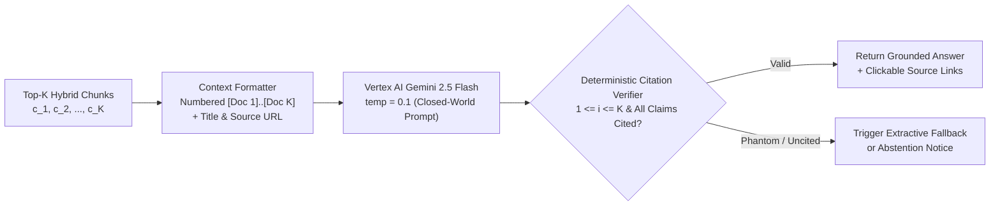

# Vertex AI Grounded Generation & Citation Guardrails

> Retrieval without citation verification is just hallucination with extra steps.

**Type:** Build | Learn
**Languages:** Python
**Prerequisites:** [Phase 03 — Cross-Modal Audio & Image RAG](../../../03-multimodal-rag/01-cross-modal-audio-and-image-rag/docs/en.md)
**Time:** ~45 minutes

---

## Learning Objectives

By the end of this lesson, you will be able to:

- Formulate RAG generation as **Closed-World Epistemic Conditioning** using Google Cloud Vertex AI (`gemini-2.5-flash`)
- Build a structured `[Doc i]` context prompt builder that binds chunk IDs, titles, and documentation URLs to every retrieved passage
- Implement a **Deterministic Citation Guardrail** that detects out-of-bounds phantom citations (`[Doc 9]` when $K=5$) and uncited assertions before returning an answer to the user

---

## The Problem

Even when your Hybrid RRF retriever places the exact right Sarvam AI documentation chunks in the top 5, an LLM can still fail in two dangerous ways:

1. **Prior-Knowledge Leakage (Open-World Drift)**: The LLM blends retrieved facts with outdated pre-training guesses (e.g., inventing a non-existent HTTP header `X-Sarvam-Token` instead of `api-subscription-key`).
2. **Phantom Citations**: The LLM outputs `[Doc 7]` when you only supplied 5 retrieved chunks (`[Doc 1]` through `[Doc 5]`), or states an unverified pricing number with no `[Doc i]` marker at all.

To make RAG trustworthy in production, we combine **Closed-World System Prompting** on Vertex AI (`gemini-2.5-flash` at low temperature $\tau = 0.1$) with a **Deterministic Post-Generation Citation Verifier**.

---

## The Concept

### End-to-End Grounded Generation & Verification Pipeline



### Formal Grounding Constraints

Let $\mathcal{C}_K = \{c_1, c_2, \dots, c_K\}$ be the top-$K$ retrieved chunks formatted as `[Doc 1]` through `[Doc K]`. A generated response $Y = (s_1, s_2, \dots, s_M)$ consisting of $M$ factual sentences satisfies **Strict Citation Validity** if and only if:

$$
\forall s_m \in Y,\; \exists\, i \in \text{citations}(s_m) \quad \text{such that} \quad 1 \le i \le K
$$

and the set of **Phantom Citations** is strictly empty:

$$
\mathcal{P}(Y, K) = \bigl\{\, i \in \text{citations}(Y) \;\big|\; i < 1 \;\vee\; i > K \,\bigr\} = \emptyset
$$

| Generation Parameter | Production Value | Why It Matters for Technical RAG |
| :--- | :--- | :--- |
| **Model (`VERTEX_MODEL_ID`)** | `gemini-2.5-flash` | Sub-second TTFT on Vertex AI with high instruction-following fidelity |
| **Temperature ($\tau$)** | `0.1` | Sharpens token probability distribution around grounded context tokens |
| **Citation Format** | `[Doc 1]`, `[Doc 2]` | Unambiguous regex-parseable markers mapped 1-to-1 to retrieved chunk metadata |
| **Abstention Rule** | Explicit refusal clause | Prevents guessing when a user asks about an undocumented feature |

---

## Build It

### Step 1: Implement `build_grounded_prompt` and `verify_citations` From Scratch

In `code/main.py`, we format retrieved chunks into `[Doc i]` blocks and audit candidate answers using regular expressions:

```python
def verify_citations(answer: str, max_doc_num: int) -> CitationAudit:
    raw_nums = [int(m) for m in re.findall(r"\[Doc\s+(\d+)\]", answer)]
    cited_unique = sorted(set(raw_nums))
    phantom = [n for n in cited_unique if n < 1 or n > max_doc_num]
```

### Step 2: Run the Citation Guardrail Verification

```bash
python3 phases/04-production-and-cloud/01-vertex-ai-grounded-generation-and-citations/code/main.py
```

Expected output:

```text
========================================================================
PHASE 04 · LESSON 01: GROUNDED GENERATION & CITATION GUARDRAILS
========================================================================
...
2. Deterministic Citation Guardrail Audit:
   - [REJECTED] Hallucinated Output -> valid=False | phantom_docs=[9] | uncited_sentences=1
   - [ACCEPTED] Grounded Output     -> valid=True | cited_docs=[1, 2] | phantom_docs=[]

Verification passed: Citation verifier caught phantom [Doc 9] and uncited claims.
```

---

## Use It

### 1. CLI Workflow: Ask Grounded Questions via Vertex AI Gemini

```bash
python -m cli.rag_cli ask "How do I authenticate to Sarvam AI APIs and which Speech-to-Text models are supported?" --mode hybrid --dim 768 --top-k 5
```

### 2. Web UI Studio Workflow

Open `http://localhost:8090` (**Tab 1: RAG Studio**):
1. Enter a question and click **Run RAG Pipeline**.
2. Inspect the **Grounded Answer Panel** on the left: every paragraph cites `[Doc 1]`, `[Doc 2]`, etc., and displays the active generation backend (`Vertex AI gemini-2.5-flash` or deterministic extractive fallback when offline) plus end-to-end latency.

---

## Ship It

- **Prompt (`outputs/prompt-grounded-rag-system.md`)**: Production closed-world system prompt for Vertex AI Gemini RAG synthesis with mandatory `[Doc i]` citations and abstention rules.
- **Skill (`outputs/skill-citation-guardrail-auditor.md`)**: Agent skill that validates LLM RAG responses for phantom citations, uncited sentences, and numerical fidelity against retrieved chunks.

---

## Exercises

1. **[Easy]** Test `verify_citations` in `code/main.py` on the abstention string `"I cannot verify this from the provided Sarvam documentation."` and modify `is_valid` so explicit abstentions are accepted when a question is out-of-scope.
2. **[Medium]** Add a **Numerical Grounding Check** to `verify_citations`: extract all numbers/model versions (e.g., `16kHz`, `22`, `v3`) from the generated answer and verify that every number appears in at least one retrieved `ContextChunk.content`.
3. **[Hard]** Compare Vertex AI `gemini-2.5-flash` responses at `temperature=0.0` vs. `temperature=0.9` across 5 Sarvam API questions and measure citation density.

---

## Key Terms

| Term | What people say | What it actually means |
|------|----------------|----------------------|
| **Closed-World Assumption** | "Strict RAG grounding" | Treating the retrieved `[Doc 1]..[Doc K]` blocks as the *only* facts that exist, forbidding external pre-training assumptions |
| **Phantom Citation** | "Hallucinated reference" | Citing `[Doc 8]` when only $K=5$ documents were provided in the prompt |
| **Extractive Fallback** | "Offline deterministic synthesis" | Assembling a cited answer directly from the highest-scoring sentences of `[Doc 1]..[Doc K]` if the cloud LLM endpoint is unreachable |

---

## Further Reading

- [Production Vertex AI Generator (`src/generator.py`)](../../../../src/generator.py)
- [Google Cloud Vertex AI Generative AI Documentation](https://cloud.google.com/vertex-ai/generative-ai/docs)
