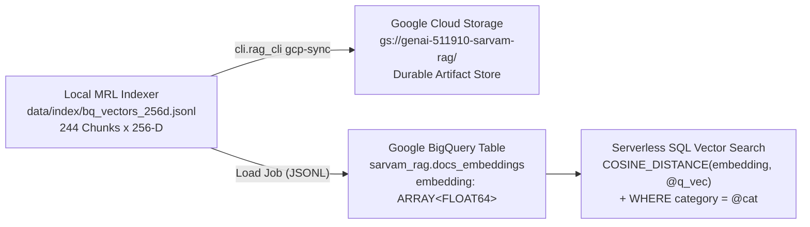

# GCP Storage & BigQuery Vector Search

> You don't need an always-on $200/month vector cluster when serverless BigQuery scans 256-D MRL vectors on demand.

**Type:** Build | Learn
**Languages:** Python
**Prerequisites:** [01 — Vertex AI Grounded Generation & Citations](../../01-vertex-ai-grounded-generation-and-citations/docs/en.md)
**Time:** ~50 minutes

---

## Learning Objectives

By the end of this lesson, you will be able to:

- Design a serverless cloud vector architecture using **Google Cloud Storage (GCS)** for artifact durability and **Google BigQuery** (`ARRAY<FLOAT64>`) for SQL-native vector search
- Write parameterized Google Standard SQL queries using `COSINE_DISTANCE(embedding, @query_vector)` combined with relational `WHERE` metadata filters
- Prove mathematically why `ORDER BY COSINE_DISTANCE(...) ASC` in BigQuery returns the exact same top-$K$ ranking as `cosine_similarity DESC` locally

---

## The Problem

Many RAG tutorials tell beginners to spin up a dedicated, always-on managed vector database cluster that charges `$70–$250+/month` even when sitting completely idle at 3 AM. Worse, keeping document metadata in a relational database while storing vectors in a separate proprietary vector store creates dual-write synchronization bugs whenever documents are updated or filtered by category.

On Google Cloud, we can build a **100% serverless, scale-to-zero cloud vector architecture**:
1. **Google Cloud Storage (`gs://genai-511910-sarvam-rag`)** stores versioned `.npy` MRL matrices and `chunks.jsonl` snapshots for pennies per gigabyte.
2. **Google BigQuery (`genai-511910.sarvam_rag.docs_embeddings`)** stores both structured metadata (`chunk_id`, `category`, `title`, `url`, `content`) and our compact `256-D` Matryoshka vector (`ARRAY<FLOAT64>`) in a single serverless table that supports native `COSINE_DISTANCE` search and SQL `WHERE` filtering!

---

## The Concept

### Dual-Tier Google Cloud RAG Architecture



### Cosine Distance vs. Cosine Similarity Equivalence

In BigQuery Google Standard SQL, `COSINE_DISTANCE(u, v)` is defined as:

$$
\text{COSINE\_DISTANCE}(\mathbf{u}, \mathbf{v}) = 1 - \text{cosine\_similarity}(\mathbf{u}, \mathbf{v}) = 1 - \frac{\mathbf{u} \cdot \mathbf{v}}{\lVert \mathbf{u} \rVert_2 \lVert \mathbf{v} \rVert_2}
$$

Because $\cos\theta \in [-1, +1]$, `COSINE_DISTANCE` lies in $[0, 2]$:
- Identical direction ($\cos\theta = 1.0$) $\implies \text{COSINE\_DISTANCE} = 0.0$
- Orthogonal ($\cos\theta = 0.0$) $\implies \text{COSINE\_DISTANCE} = 1.0$
- Opposite ($\cos\theta = -1.0$) $\implies \text{COSINE\_DISTANCE} = 2.0$

Since $f(x) = 1 - x$ is strictly monotonically decreasing, **minimizing `COSINE_DISTANCE` (`ORDER BY cosine_distance ASC`) is 100% mathematically equivalent to maximizing cosine similarity (`DESC`)**:

$$
\operatorname*{arg\,min}_{d \in \mathcal{C}} \bigl(1 - \cos(\mathbf{q}, \mathbf{d})\bigr) \equiv \operatorname*{arg\,max}_{d \in \mathcal{C}} \cos(\mathbf{q}, \mathbf{d})
$$

| Feature | Local In-Memory Index (`src/retriever.py`) | Cloud Serverless Index (`src/gcp_integration.py`) |
| :--- | :--- | :--- |
| **Storage Format** | `.npy` (`float32`) + `chunks.jsonl` | GCS Bucket + BigQuery `ARRAY<FLOAT64>` (`REPEATED FLOAT64`) |
| **MRL Dimension Used** | `768-D` / `512-D` / `256-D` / `128-D` | `256-D` (3x lower BigQuery scan bytes with 100% Hit@5 parity) |
| **Metadata Filtering** | Python list comprehension | Native SQL `WHERE category = 'speech-to-text' AND has_code = TRUE` |
| **Idle Compute Cost** | `$0.00` (local RAM) | `$0.00` (serverless on-demand SQL; `$0.00` after `destroy`) |

---

## Build It

### Step 1: Validate the BigQuery `REPEATED FLOAT64` Schema and Parameterized SQL

In `code/main.py`, we inspect `data/index/bq_schema.json` (where `ARRAY<FLOAT64>` is represented as `{"name": "embedding", "type": "FLOAT64", "mode": "REPEATED"}`), generate the parameterized SQL query, and verify 100% rank parity on `data/index/bq_vectors_256d.jsonl`:

```bash
python3 phases/04-production-and-cloud/02-gcp-storage-and-bigquery-vector-search/code/main.py
```

Expected output:

```text
========================================================================
PHASE 04 · LESSON 02: GCP STORAGE & BIGQUERY VECTOR SEARCH FROM SCRATCH
========================================================================

1. BigQuery Vector Table Schema Validation (`data/index/bq_schema.json`):
   - Total Columns    : 10
   - Vector Column    : name='embedding', type='FLOAT64', mode='REPEATED'
   - JSONL Export Rows: 120 rows x 256-D MRL vectors
...
Verification passed: BigQuery REPEATED FLOAT64 schema and COSINE_DISTANCE parity verified.
```

---

## Use It

### 1. CLI Workflow: Sync to GCS + BigQuery and Execute Live Cloud Vector Search

```bash
# 1. Provision GCS bucket + BigQuery dataset/table and upload 256-D MRL vectors
python -m cli.rag_cli gcp-sync

# 2. Run a live serverless BigQuery COSINE_DISTANCE vector search
python -m cli.rag_cli gcp-search "How do I use Bulbul v3 for Tamil text-to-speech?" --top-k 5
```

### 2. Web UI Studio Workflow (Tab 4: GCP Cloud & BigQuery)

Open `http://localhost:8090` and switch to **Tab 4: GCP Cloud & BigQuery**:
1. Click **Sync Local Index to GCS & BigQuery** to provision cloud resources on demand.
2. Enter a query in the **BigQuery Vector Search** box and click **Run BigQuery Search** to view live `COSINE_DISTANCE` results and SQL query telemetry.

> [!IMPORTANT]
> **Cloud FinOps Reminder:** When you finish testing live BigQuery vector search, run `python -m cli.rag_cli destroy --yes` (covered in Lesson 04) to delete the BigQuery dataset and GCS bucket so your ongoing cloud bill returns to `$0.00`.

---

## Ship It

- **Prompt (`outputs/prompt-bigquery-vector-architect.md`)**: System prompt for designing BigQuery vector tables, `VECTOR_INDEX` DDL statements, and pre-filtered SQL queries.
- **Skill (`outputs/skill-gcp-vector-ops.md`)**: Agent skill that validates BigQuery JSONL vector exports, checks `REPEATED FLOAT64` array lengths, and verifies `COSINE_DISTANCE` query parameterization.

---

## Exercises

1. **[Easy]** In `code/main.py`, check what happens if you accidentally sort `COSINE_DISTANCE` with `ORDER BY cosine_distance DESC` instead of `ASC`. Which documents are returned first?
2. **[Medium]** Modify `build_bigquery_vector_sql` in `code/main.py` to add a second SQL filter parameter `@require_code BOOL` that filters on `WHERE (@require_code = FALSE OR has_code = TRUE)`.
3. **[Hard]** Calculate the exact BigQuery on-demand bytes scanned when querying 1,000,000 rows of `256-D` `FLOAT64` embeddings versus `768-D` `FLOAT64` embeddings.

---

## Key Terms

| Term | What people say | What it actually means |
|------|----------------|----------------------|
| **`REPEATED FLOAT64` (`ARRAY<FLOAT64>`)** | "BigQuery vector column" | A native BigQuery column type that stores fixed-length embedding vectors as contiguous float arrays |
| **`COSINE_DISTANCE(u, v)`** | "BigQuery vector distance" | $1 - \cos(\mathbf{u}, \mathbf{v}) \in [0, 2]$; smaller values mean higher semantic similarity (sort `ASC`) |
| **Parameterized Query (`@query_vector`)** | "Bound SQL vector parameter" | Passing the query embedding via `ArrayQueryParameter("query_vector", "FLOAT64", vec)` to prevent SQL injection and enable query plan caching |

---

## Further Reading

- [Google Cloud BigQuery Vector Search Overview](https://cloud.google.com/bigquery/docs/vector-search-intro)
- [Production GCP Storage & BigQuery Integration (`src/gcp_integration.py`)](../../../../src/gcp_integration.py)
