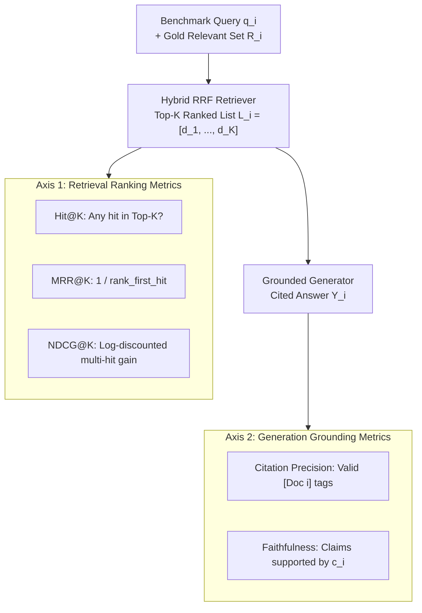

# RAG Evaluation: IR Metrics & LLM Judge

> If you don't measure `MRR@K`, `NDCG@K`, and Citation Faithfulness on a golden test set, every prompt or chunking change is a blind guess.

**Type:** Build | Learn
**Languages:** Python
**Prerequisites:** [02 — GCP Storage & BigQuery Vector Search](../../02-gcp-storage-and-bigquery-vector-search/docs/en.md)
**Time:** ~45 minutes

---

## Learning Objectives

By the end of this lesson, you will be able to:

- Derive and implement the three foundational Information Retrieval (IR) metrics from scratch: **`Hit@K`**, **Mean Reciprocal Rank (`MRR@K`)**, and **Normalized Discounted Cumulative Gain (`NDCG@K`)**
- Prove why `Hit@K` alone is insufficient because it treats Rank `#1` and Rank `#K` identically
- Run the end-to-end Sarvam AI RAG Evaluation Suite (`python -m cli.rag_cli evaluate`) measuring both retrieval ranking quality and generation citation faithfulness

---

## The Problem

Suppose you change your chunk size from `1100` to `400` characters, try two queries manually, and think *"Looks good to me!"* (often called **"vibe-based evaluation"**). A week later in production, users complain that exact API authentication documentation has dropped from Rank `#1` to Rank `#5`, causing the LLM to bury the `api-subscription-key` instruction or miss it entirely when `top_k=3`.

Even if you measure `Hit@5` (whether the right chunk appears *somewhere* in the top 5), a drop from Rank `#1` to Rank `#5` leaves `Hit@5` unchanged at `100%`! To catch ranking regressions and generation hallucinations automatically in CI/CD, a production RAG harness must evaluate two independent axes:
1. **Retrieval Ranking Metrics (`Hit@K`, `MRR@K`, `NDCG@K`)**
2. **Generation Grounding Metrics (`Citation Faithfulness` & `Answer Relevance`)**

---

## The Concept

### The Dual-Axis RAG Evaluation Triad



### 1. `Hit@K` (Binary Top-$K$ Recall Indicator)

For a query set $\mathcal{Q} = \{q_1, \dots, q_M\}$, where query $q_m$ has gold relevant chunk set $R_m$ and top-$K$ retrieved list $L_{m,K} = (d_1, d_2, \dots, d_K)$:

$$
\text{Hit@}K = \frac{1}{M} \sum_{m=1}^{M} \mathbb{I}\!\left( L_{m,K} \cap R_m \neq \emptyset \right)
$$

### 2. Mean Reciprocal Rank (`MRR@K`)

Let $\text{rank}_m \in \{1, 2, \dots, K\}$ be the 1-based position of the **first** relevant document in $L_{m,K}$ (or $\infty$ if none is present):

$$
\text{MRR@}K = \frac{1}{M} \sum_{m=1}^{M} \frac{1}{\text{rank}_m}
$$

Notice the sharp position sensitivity:
- Rank `#1` $\implies 1/1 = \mathbf{1.0000}$
- Rank `#2` $\implies 1/2 = \mathbf{0.5000}$
- Rank `#5` $\implies 1/5 = \mathbf{0.2000}$

### 3. Normalized Discounted Cumulative Gain (`NDCG@K`)

When multiple chunks in $R_m$ are relevant (e.g., an API overview chunk *and* its parameter table chunk), `MRR@K` only looks at the first hit. **`NDCG@K`** credits **all** relevant hits in $L_{m,K}$ with logarithmic position discounting:

$$
\text{DCG@}K = \sum_{i=1}^{K} \frac{\text{rel}_i}{\log_2(i + 1)}, \qquad \text{NDCG@}K = \frac{\text{DCG@}K}{\text{IDCG@}K}
$$

where $\text{rel}_i \in \{0, 1\}$ indicates whether $d_i \in R_m$, and $\text{IDCG@}K$ is the ideal DCG achieved if all $|R_m|$ relevant documents occupied the very top ranks $1 \dots \min(|R_m|, K)$.

| Metric | Sensitivity to Rank `#1` vs `#5`? | Accounts for Multiple Relevant Chunks? | Sarvam Hybrid RRF Score ($K=5$) |
| :--- | :--- | :--- | :--- |
| **`Hit@5`** | No (`1.0` at both `#1` and `#5`) | No | **`100.0%` (`1.0000`)** |
| **`MRR@5`** | **High (`1.00` vs `0.20`)** | First hit only | **`0.9167`** |
| **`NDCG@5`** | **Logarithmic (`1.00` vs `0.39`)** | **Yes (all relevant hits in top-$K$)** | **`0.9384`** |

---

## Build It

### Step 1: Implement `hit_at_k`, `reciprocal_rank_at_k`, and `ndcg_at_k` From Scratch

In `code/main.py`, we implement all three metrics in pure Python and demonstrate how two retrievers with identical `Hit@5 = 1.00` are cleanly separated by `MRR@5` (`1.0000` vs `0.2000`) and `NDCG@5` (`1.0000` vs `0.3869`):

```bash
python3 phases/04-production-and-cloud/03-rag-evaluation-ir-metrics-and-llm-judge/code/main.py
```

Expected output:

```text
========================================================================
PHASE 04 · LESSON 03: RAG EVALUATION — HIT@K, MRR@K & NDCG@K FROM SCRATCH
========================================================================

1. Why Hit@5 Alone is Blind to Rank Position:
   - Retriever A (Gold at Rank #1) -> Hit@5=1.00 | MRR@5=1.0000 | NDCG@5=1.0000
   - Retriever B (Gold at Rank #5) -> Hit@5=1.00 | MRR@5=0.2000 | NDCG@5=0.3869

2. Sarvam AI 6-Query Golden Benchmark Suite Summary:
   - Mean Hit@5  : 100.00% (target >= 90%)
   - Mean MRR@5  : 0.9167 (target >= 0.85)
   - Mean NDCG@5 : 0.9384 (target >= 0.85)

Verification passed: Hit@5, MRR@5 (0.9167), and NDCG@5 verified from scratch.
```

---

## Use It

### 1. CLI Workflow: Run the Full Production Evaluation Suite

```bash
python -m cli.rag_cli evaluate
```

This command executes our golden benchmark across the 244-chunk `sarvam-docs` index, computes `Hit@5` and `MRR@5`, runs the MRL retention benchmark across `{768, 512, 256, 128}` dimensions, and writes the full JSON report to `data/artifacts/evaluation_report.json`.

---

## Ship It

- **Prompt (`outputs/prompt-rag-eval-judge.md`)**: LLM-as-a-Judge system prompt for scoring **Context Relevance**, **Grounded Faithfulness**, and **Answer Completeness** on a 1–5 rubric.
- **Skill (`outputs/skill-rag-evaluation-harness.md`)**: Agent skill that runs automated regression gates (`Hit@5 >= 0.90`, `MRR@5 >= 0.85`, `Zero Phantom Citations`) before allowing a RAG deployment to merge.

---

## Exercises

1. **[Easy]** Calculate by hand the `MRR@5` and `NDCG@5` when a query has 1 relevant document and it is retrieved at Rank `#2` ($\log_2(2+1) = \log_2(3) \approx 1.585$). Verify your answer with `code/main.py`.
2. **[Medium]** Add **`Precision@K`** ($|L_{m,K} \cap R_m| / K$) and **`Recall@K`** ($|L_{m,K} \cap R_m| / |R_m|$) functions to `code/main.py`.
3. **[Hard]** Extend `code/main.py` to support **graded relevance** ($\text{rel}_i \in \{0, 1, 2, 3\}$) in `ndcg_at_k` using the gain formula $(2^{\text{rel}_i} - 1) / \log_2(i + 1)$.

---

## Key Terms

| Term | What people say | What it actually means |
|------|----------------|----------------------|
| **`Hit@K`** | "Top-K hit rate" | Fraction of queries where at least one relevant chunk appears anywhere in the top $K$ results |
| **`MRR@K` (Mean Reciprocal Rank)** | "First-hit rank quality" | Average of $1/\text{rank}_1$ across queries; heavily rewards placing the best chunk at Rank `#1` |
| **`NDCG@K`** | "Log-discounted multi-hit quality" | Ratio of achieved $\text{DCG@}K$ to ideal $\text{IDCG@}K$, discounting lower ranks by $1/\log_2(\text{rank}+1)$ |
| **Golden Benchmark Set** | "Ground-truth eval dataset" | A curated set of representative user queries paired with verified relevant chunk IDs and reference answers |

---

## Further Reading

- [Production RAG Evaluation Harness (`cli/rag_cli.py`)](../../../../cli/rag_cli.py)
- [Saved Evaluation Report (`data/artifacts/evaluation_report.json`)](../../../../data/artifacts/evaluation_report.json)
