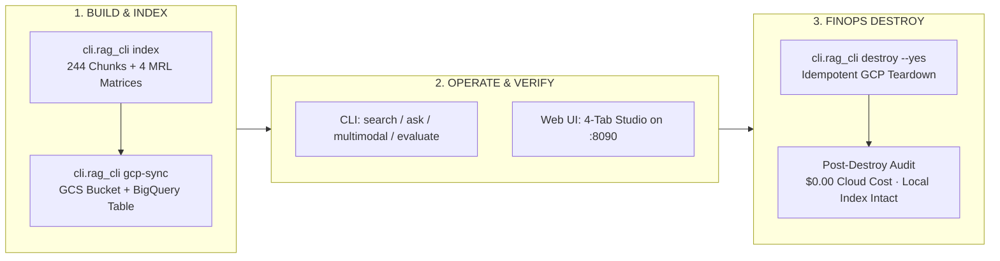

# CLI/UI Operations & Cloud FinOps Resource Destroy

> A production tutorial isn't finished when the cloud resources are created—it is finished when you know how to verify, operate, and cleanly destroy them down to `$0.00`.

**Type:** Build | Learn
**Languages:** Python
**Prerequisites:** [03 — RAG Evaluation: IR Metrics & LLM Judge](../../03-rag-evaluation-ir-metrics-and-llm-judge/docs/en.md)
**Time:** ~45 minutes

---

## Learning Objectives

By the end of this lesson, you will be able to:

- Operate every feature of the Sarvam AI + `google/embeddinggemma-2` RAG platform across both the **9-Command Rich CLI (`cli/rag_cli.py`)** and the **4-Tab FastAPI Web Studio (`ui/app.py`)**
- Understand and implement **Idempotent Cloud Resource Teardown** ($T(T(S)) = T(S) = S_\emptyset$) so repeated teardown runs never crash on `404 NotFound` errors
- Execute and verify complete Google Cloud cleanup (`python -m cli.rag_cli destroy --yes`) leaving `$0.00` in ongoing BigQuery or GCS storage charges while keeping your local `.npy` index 100% intact

---

## The Problem

Almost every cloud AI tutorial teaches you how to create buckets, datasets, and endpoints—and then stops abruptly on the last page, leaving orphaned resources silently billing your credit card month after month. Conversely, when engineers try to write a cleanup script hastily at the end of a project, a naive script that calls `delete_bucket()` without `force=True` fails with `409 BucketNotEmpty`, or crashes halfway through if one resource was already deleted manually.

In professional AI engineering, **Teardown (`destroy`) is a first-class architectural operation** alongside `index`, `search`, and `evaluate`. Furthermore, every capability exposed in a visual Web UI should have a 1-to-1 scriptable CLI counterpart for automation and CI/CD.

---

## The Concept

### Complete Build $\rightarrow$ Verify $\rightarrow$ Destroy Lifecycle



### Mathematical Definition of Idempotent Teardown

Let $\mathcal{S}$ be the state space of your cloud environment, and let $S_\emptyset \in \mathcal{S}$ be the **zero-cost state** where neither the BigQuery dataset (`genai-511910:sarvam_rag`) nor the GCS bucket (`gs://genai-511910-sarvam-rag`) exists. A teardown operator $T: \mathcal{S} \to \mathcal{S}$ is **idempotent** if and only if for all $S \in \mathcal{S}$:

$$
T(S) = S_\emptyset \qquad \text{and} \qquad T(T(S)) = T(S_\emptyset) = S_\emptyset
$$

In plain English: running `python -m cli.rag_cli destroy --yes` once deletes all tables, blobs, datasets, and buckets; running it a second or third time cleanly reports `already_absent` and exits with code `0` without throwing an unhandled `NotFound` exception.

### 1-to-1 CLI vs. Web UI Studio Command Matrix

| Operation | Rich Terminal CLI Command (`cli/rag_cli.py`) | FastAPI Web Studio (`http://localhost:8090`) |
| :--- | :--- | :--- |
| **System Health** | `python -m cli.rag_cli status` | Top Telemetry Status Bar |
| **Build MRL Index** | `python -m cli.rag_cli index` | `POST /api/reindex` |
| **Hybrid / Dense / BM25 Search** | `python -m cli.rag_cli search "<query>" --mode hybrid --dim 768` | **Tab 1: RAG Studio** (Right Context Panel) |
| **Grounded Vertex AI Q&A** | `python -m cli.rag_cli ask "<question>" --mode hybrid` | **Tab 1: RAG Studio** (Left Grounded Answer Panel) |
| **Matryoshka Benchmark** | `python -m cli.rag_cli mrl-benchmark "<query>"` | **Tab 2: Matryoshka (MRL) Explorer** |
| **Multimodal Audio/Image RAG** | `python -m cli.rag_cli multimodal "<query>"` | **Tab 3: Multimodal (Text + Audio + Image) Lab** |
| **Cloud Provision & Sync** | `python -m cli.rag_cli gcp-sync` | **Tab 4: GCP Cloud & BigQuery** (`Sync to GCS & BigQuery`) |
| **BigQuery Vector Search** | `python -m cli.rag_cli gcp-search "<query>"` | **Tab 4: GCP Cloud & BigQuery** (`Run BigQuery Search`) |
| **IR + MRL Evaluation** | `python -m cli.rag_cli evaluate` | Saved to `data/artifacts/eval_report.json` |
| **FinOps Cloud Teardown** | `python -m cli.rag_cli destroy --yes` | Safe CLI-gated teardown (`--include-local` optional) |

---

## Build It

### Step 1: Model Idempotent GCP Teardown From Scratch

In `code/main.py`, we simulate provisioning the GCS bucket (`4` index blobs) and BigQuery dataset (`docs_embeddings` table), then run `idempotent_destroy_gcp_resources` twice in a row to verify that Pass 1 deletes everything and Pass 2 reports `already_absent`:

```bash
python3 phases/04-production-and-cloud/04-cli-ui-operations-and-resource-destroy/code/main.py
```

Expected output:

```text
========================================================================
PHASE 04 · LESSON 04: CLI/UI OPERATIONS & IDEMPOTENT RESOURCE DESTROY
========================================================================
...
2. [DESTROY — PASS 1] Executing `python -m cli.rag_cli destroy --yes`:
   - bigquery_dataset        : deleted (genai-511910:sarvam_rag: removed 1 table(s))
   - gcs_bucket              : deleted (gs://genai-511910-sarvam-rag: removed 4 object(s))
   - ongoing_cloud_cost_usd  : $0.00/month

3. [DESTROY — PASS 2] Re-running `destroy --yes` to Verify Idempotency:
   - bigquery_dataset        : already_absent (genai-511910:sarvam_rag)
   - gcs_bucket              : already_absent (gs://genai-511910-sarvam-rag)
   - ongoing_cloud_cost_usd  : $0.00/month

Verification passed: Build -> Verify -> Destroy lifecycle is 100% idempotent ($0.00 ongoing cost).
```

---

## Use It

### 1. Execute Production Cloud Teardown via CLI

```bash
# Tear down GCP BigQuery dataset + GCS bucket while keeping local .npy index intact
python -m cli.rag_cli destroy --yes
```

### 2. Independent `gcloud` & `bq` Post-Teardown Verification

Always verify teardown with independent Google Cloud CLI commands:

```bash
# Confirm GCS bucket is gone (should return BucketNotFoundException: 404)
gcloud storage ls gs://genai-511910-sarvam-rag

# Confirm BigQuery dataset is gone (should return Not found)
bq show genai-511910:sarvam_rag
```

### 3. Confirm Local Offline RAG Still Works at `$0.00` Cloud Cost

```bash
# Because we did NOT pass --include-local, all local MRL .npy matrices remain ready!
python -m cli.rag_cli search "How does Saaras v3 handle Tamil audio?" --mode hybrid --dim 768
```

---

## Ship It

- **Prompt (`outputs/prompt-finops-teardown-auditor.md`)**: System prompt for auditing cloud AI projects for orphaned storage buckets, vector datasets, and unattached endpoints.
- **Skill (`outputs/skill-cloud-rag-destroyer.md`)**: Agent skill that executes and verifies idempotent GCP teardown while preserving local reproducible artifacts.

---

## Exercises

1. **[Easy]** Run `python -m cli.rag_cli destroy --help` and inspect the difference between `destroy --yes` (cloud-only teardown) and `destroy --yes --include-local` (cloud + local `data/index/` teardown).
2. **[Medium]** Extend `code/main.py` to compute an estimated monthly cost report before and after teardown given a corpus of $N$ vectors stored in GCS Standard Storage (`$0.020/GB-month`) and BigQuery Active Storage (`$0.020/GB-month`).
3. **[Hard]** Inspect the root `Dockerfile` and write a `gcloud run deploy` command that deploys the FastAPI Web Studio (`ui/app.py`) to Google Cloud Run with `--min-instances=0` (scale-to-zero).

---

## Key Terms

| Term | What people say | What it actually means |
|------|----------------|----------------------|
| **Idempotent Operation** | "Safe to re-run" | An operation where executing it $N \ge 1$ times produces the exact same system state as executing it once ($T(T(S)) = T(S)$) |
| **Cascade Deletion** | "`delete_contents=True` / `force=True`" | Recursively removing all child tables inside a BigQuery dataset and all objects inside a GCS bucket before deleting the parent container |
| **Cloud FinOps** | "Cloud cost engineering" | Designing cloud architectures with explicit scale-to-zero defaults and automated teardown commands to eliminate idle spend |

---

## Further Reading

- [Production Teardown Implementation (`src/gcp_integration.py` — `destroy_gcp_resources`)](../../../../src/gcp_integration.py)
- [Production CLI (`cli/rag_cli.py` — `destroy` command)](../../../../cli/rag_cli.py)
